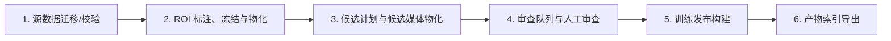

<!-- DOCUMENT-CONTRACT
Purpose: 为项目当前受支持的数据处理链路提供可持续维护、可执行且可验证的端到端运行指南。
Audience: 需要首次跑通、复现或维护项目数据处理链路的开发者和操作人员。
Scope: 覆盖源数据快照、ROI、候选媒体、人工审查、训练数据发布、产物索引及其跨机器执行边界。
Must Preserve:
- 手册的标题和长期定位不绑定某一链路版本；当前支持版本与主要适用契约集中声明，版本特有差异在相关步骤中明确标注。
- 每个流程环节都给出可追溯的入口、主要输入与产物、执行机器、验收检查和进入下一步的条件。
- 冻结产物与 release 不可覆盖；上游产物选择和身份必须可追溯，并明确保留各产物集合的解析与路径边界。
- 区分本机轻量操作与训练机重计算或 GPU 操作，不暗示本机能够复现训练机任务。
Non-goals:
- 记录某次运行状态、历史发布基线或实验结果。
- 说明模型训练、评测和部署流程。
-->

# 数据处理运行手册

> 新的正式数据处理从[第10节：现行显式七阶段](#10-现行数据入口versioning显式七阶段)开始。第1–9节保留历史业务、参数和产物解释；其中release_build.py、release_build_phase2.py、rebuild_data.py已停止CLI执行，不能照抄历史命令发布或promote。review_candidates_app的旧--queue模式也已停用；ROI现行显式路径参数见第10.1节。ROI冻结/物化、候选规划/物化、队列构建/Phase2构建及历史分流的7个辅助CLI也已停用，精确名单见pipeline/scripts/SCRIPTS.md。状态与迁移证据见项目TODO及docs/results/。

## 1. 历史链路的适用范围、版本与假设

- 目标读者：首次跑通、复现或维护当前受支持数据处理链路的人。
- 当前数据处理链路版本：**4.1**。本文中的命令、默认值、目录和产物说明均以 4.1 为当前执行基线；版本升级时继续维护本手册，并同步更新本条、适用契约、版本特有路径、命令和验收条件，而不是因版本号另建一份平行主手册。
- 代码根目录：`<repo>`（本仓库根目录）。所有命令均从 `<repo>` 执行。
- 数据根目录：多数脚本 `--data-root` 默认使用 `<repo>/workspace/data`，正文中显式写出 `--data-root workspace/data` 仅为可读性，可省略。
- 机器分工：
  - **Mac（uv 环境）**：ROI 标注、人工审查、轻量校验与队列构建。
  - **训练机（Conda  环境）**：ROI 视频物化、候选媒体物化、重计算、训练发布构建。
- 当前审查与发布契约：`pipeline/contracts/tensile_vlm_v4_1.json`。候选计划阶段仍使用 v3 契约，具体边界见 Step 3.1。
- Prompt 管理：`pipeline/prompt_control/active_prompt.yaml`。

## 2. 前置准备

### 2.1 运行环境

- **Mac**：仓库已配置 `uv`。运行前先确保依赖可用：
  ```bash
  uv sync
  ```
  关键依赖：`streamlit`、`streamlit-cropper==0.3.1`。
- **训练机**：激活 Conda `agent` 环境；确保 `ffmpeg` / `ffprobe` 在 `PATH` 中；模型目录 `models/minicpmv4_5` 已就位。

### 2.2 数据放置约定

数据统一放在项目内 `workspace/data/`（Git 忽略）。首次运行前，确保：

```text
workspace/data/
├── source/
│   ├── videos/        # 原始 MP4
│   └── annotations/   # 原始标注
└── derived/metadata/
    └── video_meta.json  # 遗留路径，当前链路不生成；权威视频元数据为 source snapshot 内 video_meta.json
```

> 注意：`source/videos`、`source/annotations` 是生成快照的前提；`source/splits` 是旧系统遗留路径，source 快照生成不再读取 source/splits，划分由 `build_source_snapshot` 在生成快照时按确定性策略内部产出。生成 source snapshot 后，下游脚本以 `derived/metadata/source_snapshots/<id>/video_meta.json` 为权威视频元数据输入。

## 3. 流程总览



六步一句话：先校验、放置源数据并生成 source/split 快照，再固定 ROI 并裁剪源视频，随后生成候选片段与实际帧，再经人工审查后构建不可覆盖的训练发布，最后导出产物索引。

## 4. 产物 ID 与回溯

本流程中大部分下游脚本都支持通过产物 ID 指定上游输入，而不必总是使用最近一次产物。解析规则如下：

- **不传 ID**：脚本自动使用目标集合的 `LATEST` 指针，即当前 index 中最新物化或最新被触碰的世代。
- **短哈希前缀**：传入 ID 的前缀，脚本在目标集合的 `index.json` 中查找唯一匹配项。例如 `<roi-manifest-旧哈希前缀>` 可命中以该前缀开头的 ROI manifest，但若前缀同时匹配多个候选则会报错。
- **完整 ID**：传入完整产物 ID，脚本做精确匹配。

查询可用 ID 的入口：

- 已接入全局索引的集合（`source_snapshots`、`split_snapshots`、`roi_manifests`、`roi_videos`）：查看 `workspace/data/INDEX.md` 或对应集合的 `index.json`。
- 尚未接入全局索引的集合（候选媒体、审查队列、决定、release 等）：查看各自集合目录下的 `index.json`。

回溯示例（以下 ID 均为占位格式，请替换为实际查询到的 ID）：

```bash
# 显式指定 ROI manifest 与 source snapshot，而非使用 LATEST
uv run python pipeline/scripts/roi_materialize_videos.py \
  --data-root workspace/data \
  --roi-manifest <roi-manifest-旧哈希前缀> \
  --video-meta <source-snapshot-旧哈希前缀> \
  --workers 2

# 显式指定候选计划与 ROI 媒体，重新物化候选媒体
python pipeline/scripts/subvideo_materialize_media.py \
  --data-root workspace/data \
  --candidate-plan <candidate-plan-旧哈希前缀> \
  --roi-media <roi-media-旧哈希前缀>
```

注意事项：

- 中段词不会命中。例如只写 `media` 或 `roi` 会被当成完整 ID 或前缀处理，通常无法匹配任何候选并报错；请使用足够长度的前缀或完整 ID。
- `LATEST` 指针可能失效：如果对应集合的 `index.json` 被重建、清空或对应世代被移除，再次使用 `LATEST` 会报 `LATEST 指针 '...' 已失效，不在当前 index 候选集中`。
- 前缀若匹配多个候选，会报 `产物选择器 '...' 存在多义匹配，候选: ...`，此时应改用更长的前缀或完整 ID。

## 5. 逐步操作

以下命令中的 `<...>` 为每次运行实际生成的 ID 或路径。按性质分为三类：

1. **脚本输出，可从 `INDEX.md` / `index.json` / 脚本输出中查询**：`<source-snapshot-id>`、`<split-snapshot-id>`、`<roi-manifest-id>`、`<roi-media-id>`、`<candidate-media-id>`、`<candidate-plan-id>`、`<queue-id>`、`<route-id>`、`<release-id>` 等。
2. **用户自定**：`<run-id>` 是你自己起的 staging 目录名（如 `2024-08-26-test`），用来隔离一次 `rebuild_data.py` 的 staging 产物；`<reviewer-id>` 是审查人工号/名称，仅写入审计元数据。
3. **审查 UI 生成**：`<batch-id>` 在 `review_candidates_app.py` 中随着保存/冻结审查结果自动生成，**不能**从 `INDEX.md` 提前查询。

`source/split/ROI manifest/ROI media` 等 ID 均为脚本按内容哈希自动计算，不是你输入的参数。

### Step 1：源数据就位并生成快照

本步骤假设源数据已按 `docs/project-guide.md` 中「初始数据」列的约定放置到
`workspace/data/source/{videos,annotations}`（110 个 MP4、CSV 列）。 split 由脚本内部按确定性策略生成：当前数据下近似 89/21 的 train/test 比例，以及 3 折 stratified split，均为脚本输出，不是输入约束。直接生成 source/split 快照。

#### 1.1 快照生成

- **目的**：物化不可变的 source snapshot 与 split snapshot（含视频元数据与训练/测试划分）。
- **机器**：训练机（Conda  环境）。
- **命令**：
  > `<run-id>` 是你自己起的 staging 目录名（如 `run-2024-08-26`），用来把一次 `rebuild_data.py` 的产物隔离在 `workspace/data-staging/<run-id>`；只有执行 `promote` 后，source/split 快照才会正式落入 `workspace/data`。

  ```bash
  # 仅校验源数据身份与拆分计划
  python pipeline/scripts/rebuild_data.py run \
    --source-data-root workspace/data \
    --run-root workspace/data-staging/<run-id> \
    --source-only \
    --check-only

  # 真正物化快照到 staging run-root
  python pipeline/scripts/rebuild_data.py run \
    --source-data-root workspace/data \
    --run-root workspace/data-staging/<run-id> \
    --source-only

  # 把 staging 产物晋级到 workspace/data
  python pipeline/scripts/rebuild_data.py promote \
    --run-root workspace/data-staging/<run-id>
  ```
- **参数**：

  | 参数 | 性质 | 默认值 | 说明 |
  | --- | --- | --- | --- |
  | `--run-root` | **必填** | - | staging 目录，用户自定；建议每次新起一个名字 |
  | `--source-data-root` | 可选 | `workspace/data` | 必须等于当前数据根 |
  | `--source-only` | 开关 | 关闭 | 只跑 source/split 快照，不进入 ROI/审查/发布 |
  | `--check-only` | 开关 | 关闭 | 只校验，不写快照 |
  | `--roi-mode` | 可选 | `--source-only` 时自动补 `review` | 完整流水线必填 |
  | `--review-mode` | 可选 | `--source-only` 时自动补 `review` | 完整流水线必填 |
  | `--review-reference-id` | 可选 | `review-ref-7cd2e73a1cd1` | - |
  | `--model` | 可选 | `models/minicpmv4_5` | - |
  | `--workers` | 可选 | `2` | - |
  | `--expected-count` | 可选 | `110` | 源视频期望数量 |

  `promote` 子命令：`--run-root` 必填，`--expected-count` 默认 `110`。
- **产物位置**：
  - `workspace/data/derived/metadata/source_snapshots/<source-snapshot-id>/`
    - 含 `video_meta.json`、`source_manifest.json` 等
  - `workspace/data/derived/metadata/split_snapshots/<split-snapshot-id>/`
    - 含 `split_manifest.json`、`split_decision.json`、`test.json`、`fold_0_train.json`、`fold_0_val.json`、`fold_1_train.json`、`fold_1_val.json`、`fold_2_train.json`、`fold_2_val.json`
- **验收/检查**：`run --source-only` 输出 `source_snapshotted` 状态、`source_snapshot_id`、`split_snapshot_id`；快照目录已生成且 `source_snapshots/<id>/` 含 `video_meta.json`，`split_snapshots/<id>/` 含 splits。
- **进入下一步条件**：已知 `<source-snapshot-id>` 与 `<split-snapshot-id>`，且快照已晋级到 `workspace/data`。

### Step 2：ROI 标注、冻结与物化

> 注意：本步骤使用的 `video_meta.json` 来自 Step 1 生成的 source snapshot（`workspace/data/derived/metadata/source_snapshots/<source-snapshot-id>/video_meta.json`），不再使用旧路径 `derived/metadata/video_meta.json`。
>
> 阶段 2 已接入 LATEST 指针：`roi_freeze_decisions.py` 与 `roi_materialize_videos.py` 的 source/split/ROI 产物参数不传 ID 时，默认自动解析对应集合的 LATEST 指针；也可显式传入完整 ID 或短前缀（详见「产物 ID 与回溯」）。

#### 2.1 标注 ROI

- **目的**：在源视频上标定固定 ROI（上/下夹具、完整试样）。
- **机器**：Mac（uv 环境，streamlit-cropper 仅 Mac 依赖中已配置）。
- **命令**：
  ```bash
  uv run streamlit run pipeline/scripts/roi_annotation_app.py -- \
    --data-root workspace/data \
    --metadata workspace/data/derived/metadata/source_snapshots/<source-snapshot-id>/video_meta.json \
    --output workspace/data/derived/metadata/roi_decisions.json
  ```
- **参数**：

  | 参数 | 性质 | 默认值 | 说明 |
  | --- | --- | --- | --- |
  | `--data-root` | 可选 | `workspace/data` | - |
  | `--metadata` | 可选，缺省自动取 LATEST | `source_snapshots` 的 LATEST 指向的 `video_meta.json` | 可传完整 ID / 短前缀 / 路径（不再指向遗留路径） |
  | `--output` | 可选 | `derived/metadata/roi_decisions.json` | ROI 决定保存路径 |
  | `--project-root` | 可选 | 当前数据根 | 通常不需要传 |

  > 说明：`--metadata` 现在为可选，缺省时自动解析 `source_snapshots` 集合的 `LATEST` 指针，指向该快照内的 `video_meta.json`；显式传入时支持路径（原样透传）或快照 ID / 前缀（自动解析）。若 `source_snapshots` 无 `LATEST` 或前缀存在多义匹配，脚本会抛错终止（fail-closed），不会静默回退遗留路径 `derived/metadata/video_meta.json`；此时请先运行 Step 1 生成 source snapshot，或显式传入 Step 1 产出的快照路径/ID。

- **产物位置**：`workspace/data/derived/metadata/roi_decisions.json`。
- **验收/检查**：UI 中每个视频的关键时刻必须包含上/下夹具、完整试样和位置判断。
- **进入下一步条件**：所有源视频完成标注并保存。

#### 2.2 冻结 ROI 决定

- **目的**：把 ROI 决定打包成不可变的 ROI manifest。
- **机器**：Mac（轻量校验）。
- **命令**：
  ```bash
  uv run python pipeline/scripts/roi_freeze_decisions.py --check-only
  uv run python pipeline/scripts/roi_freeze_decisions.py
  ```
  若使用非默认数据根，加 `--data-root <path>`。
- **参数**：

  | 参数 | 性质 | 默认值 | 说明 |
  | --- | --- | --- | --- |
  | `--data-root` | 可选 | `workspace/data` | - |
  | `--decisions` | 可选 | `derived/metadata/roi_decisions.json` | ROI 决定输入 |
  | `--video-metadata` | 可选，缺省自动取 LATEST | `source_snapshots` 的 LATEST 指向的 `video_meta.json` | 可传完整 ID / 短前缀 / 路径 |
  | `--test-manifest` | 可选，缺省自动取 LATEST | `split_snapshots` 的 LATEST 指向的 `test.json` | 可传完整 ID / 短前缀 / 路径 |
  | `--output-root` | 可选 | `derived/metadata/roi_manifests` | - |
  | `--check-only` | 开关 | 关闭 | 只校验摘要，不写冻结目录 |

- **产物位置**：`workspace/data/derived/metadata/roi_manifests/<roi-manifest-id>/`。
- **验收/检查**：`--check-only` 输出校验报告；正式运行后目录中出现 `manifest.json` 且 `roi_manifest_id` 已打印。
- **进入下一步条件**：无校验错误，且已知 `<roi-manifest-id>`。

#### 2.3 物化 ROI 视频

- **目的**：按 ROI manifest 裁剪出保持原时间轴的 3:4 源视频。
- **机器**：训练机（ffmpeg 重计算）。
- **命令**：
  ```bash
  # 先只校验生成计划
  python pipeline/scripts/roi_materialize_videos.py \
    --data-root workspace/data \
    --check-only

  # 小样本试跑（必须指定隔离目录）
  python pipeline/scripts/roi_materialize_videos.py \
    --data-root workspace/data \
    --video-ids video_0001 video_0008 \
    --output-root workspace/data/derived/roi_videos/sample_roi_videos \
    --workers 1

  # 全量生成
  python pipeline/scripts/roi_materialize_videos.py \
    --data-root workspace/data \
    --workers 2
  ```
- **参数**：

  | 参数 | 性质 | 默认值 | 说明 |
  | --- | --- | --- | --- |
  | `--data-root` | 可选 | `workspace/data` | - |
  | `--roi-manifest` | 可选，缺省自动取 LATEST | `roi_manifests` 的 LATEST 指向的 `manifest.json` | 可传完整 ID / 短前缀 / 路径 |
  | `--video-meta` | 可选，缺省自动取 LATEST | `source_snapshots` 的 LATEST 指向的 `video_meta.json` | 可传完整 ID / 短前缀 / 路径 |
  | `--output-root` | 可选 | `derived/roi_videos` | 小样本试跑时必须改隔离目录 |
  | `--video-ids` | 可选 | 全部视频 | 仅小样本试跑用 |
  | `--workers` | 可选 | `2` | - |
  | `--check-only` | 开关 | 关闭 | 只校验计划，不调用 ffmpeg |

- **产物位置**：`workspace/data/derived/roi_videos/<roi-media-id>/`。
- **验收/检查**：目录中出现 `manifest.json`；单条媒体通过分辨率、帧数、帧率、时长检查。
- **进入下一步条件**：`manifest.json` 存在，且已知 `<roi-media-id>`。

### Step 3：候选计划与候选媒体物化

> 阶段 2 已接入 LATEST 指针：`subvideo_build_plan.py` 的 `--roi-media-dir`、`subvideo_materialize_media.py` 的 `--candidate-plan` / `--roi-media` 不传时默认解析对应集合的 LATEST 指针；也可显式传入完整 ID 或短前缀（详见「产物 ID 与回溯」）。

#### 3.1 生成候选计划

- **目的**：基于 ROI 视频和 review reference 生成内容寻址的候选计划。
- **机器**：Mac 或训练机（轻量计算）。
- **命令**：
  ```bash
  # 先只打印计划身份与统计
  uv run python pipeline/scripts/subvideo_build_plan.py \
    --data-root workspace/data \
    --review-reference-dir workspace/data/derived/metadata/review_reference/<review-ref-id> \
    --dry-run

  # 正式生成
  uv run python pipeline/scripts/subvideo_build_plan.py \
    --data-root workspace/data \
    --review-reference-dir workspace/data/derived/metadata/review_reference/<review-ref-id> \
    --output-root workspace/data/derived/metadata/candidate_plans
  ```

  > 注意：候选计划步骤固定使用 v3 契约（脚本默认值），v4.1 契约从审查/发布环节开始使用；因此 `subvideo_build_plan.py` 不需要也不应显式传入 `--contract pipeline/contracts/tensile_vlm_v4_1.json`。
- **参数**：

  | 参数 | 性质 | 默认值 | 说明 |
  | --- | --- | --- | --- |
  | `--data-root` | 可选 | `workspace/data` | - |
  | `--roi-media-dir` | 可选，缺省自动取 LATEST | `roi_videos` 的 LATEST | 可传完整 ID / 短前缀 / 路径 |
  | `--review-reference-dir` | 可选 | `derived/metadata/review_reference/review-ref-7cd2e73a1cd1` | v3 review reference |
  | `--contract` | 可选 | `pipeline/contracts/tensile_vlm_v3.json` | 不要改成 v4.1 |
  | `--output-root` | 可选 | `derived/metadata/candidate_plans` | - |
  | `--dry-run` | 开关 | 关闭 | 只计算统计，不写目录 |

- **产物位置**：`workspace/data/derived/metadata/candidate_plans/<plan-id>/`。
- **验收/检查**：`--dry-run` 输出 `plan_id`、development 候选数、需审查数；正式运行后目录中出现 `manifest.json`。
- **进入下一步条件**：计划已生成，且已知 `<plan-id>`。

#### 3.2 物化候选媒体

- **目的**：生成候选 MP4、实际 MiniCPM 抽帧和门禁结果。
- **机器**：训练机（Conda环境，GPU/模型推理）。
- **命令**：
  ```bash
  # 先只校验输入与身份
  python pipeline/scripts/subvideo_materialize_media.py \
    --data-root workspace/data \
    --check-only

  # 小样本试跑（必须同时指定隔离目录）
  python pipeline/scripts/subvideo_materialize_media.py \
    --data-root workspace/data \
    --limit 3 \
    --video-output-root workspace/data/derived/subvideos/sample_candidate_media \
    --frame-output-root workspace/data/derived/frames/sample_candidate_media \
    --result-root workspace/data/derived/metadata/candidate_media_results/sample_candidate_media

  # 全量生成
  python pipeline/scripts/subvideo_materialize_media.py \
    --data-root workspace/data
  ```
- **参数**：

  | 参数 | 性质 | 默认值 | 说明 |
  | --- | --- | --- | --- |
  | `--data-root` | 可选 | `workspace/data` | - |
  | `--candidate-plan` | 可选，缺省自动取 LATEST | `candidate_plans` 的 LATEST | 可传完整 ID / 短前缀 / 路径 |
  | `--roi-media` | 可选，缺省自动取 LATEST | `roi_videos` 的 LATEST | 可传完整 ID / 短前缀 / 路径 |
  | `--model` | 可选 | `models/minicpmv4_5` | - |
  | `--scope` | 可选 | `all` | `development` / `test_audit` / `all` |
  | `--candidate-ids` | 可选 | - | 指定只物化部分 candidate |
  | `--limit` | 可选 | - | 小样本试跑限制数量 |
  | `--video-output-root` | 可选 | `derived/subvideos` | 子集试跑时必须改隔离目录 |
  | `--frame-output-root` | 可选 | `derived/frames` | 子集试跑时必须改隔离目录 |
  | `--result-root` | 可选 | `derived/metadata/candidate_media_results` | 子集试跑时必须改隔离目录 |
  | `--check-only` | 开关 | 关闭 | 只校验，不生成媒体 |

- **产物位置**：
  - `workspace/data/derived/subvideos/<candidate-media-id>/`
  - `workspace/data/derived/frames/<candidate-media-id>/`
  - `workspace/data/derived/metadata/candidate_media_results/<candidate-media-id>/`
- **验收/检查**：`manifest.json` 与 `development_materialized.json` 均已生成；MP4、解码、抽帧、时间映射、状态门禁全部通过。
- **进入下一步条件**：`<candidate-media-id>` 已知，且 `development_materialized.json` 存在。

### Step 4：审查队列与人工审查

#### 4.1 构建审查队列

- **目的**：把 materialized 候选组织成当前 4.1 链路的审查队列（`observed` / `incipient`）。
- **机器**：Mac（轻量）。
- **命令**：
  ```bash
  uv run python pipeline/scripts/review_build_queue.py \
    --data-root workspace/data \
    --contract pipeline/contracts/tensile_vlm_v4_1.json \
    --output-root workspace/data/derived/metadata/review_queues
  ```
- **参数**：

  | 参数 | 性质 | 默认值 | 说明 |
  | --- | --- | --- | --- |
  | `--data-root` | 可选 | `workspace/data` | - |
  | `--materialized` | 可选，缺省自动取 LATEST | `candidate_media_results` 的 LATEST 指向的 `development_materialized.json` | 可传完整 ID / 短前缀 / 路径 |
  | `--manifest` | 可选，缺省自动取 LATEST | `candidate_media_results` 的 LATEST 指向的 `manifest.json` | 可传完整 ID / 短前缀 / 路径 |
  | `--project-root` | 可选 | 项目根目录 | - |
  | `--contract` | 可选 | `pipeline/contracts/tensile_vlm_v4_1.json` | - |
  | `--output-root` | 可选 | `derived/metadata/review_queues` | - |

- **产物位置**：`workspace/data/derived/metadata/review_queues/<queue-id>/review_queue.json`。
- **验收/检查**：输出 `queue_id`、`candidate_count`、`observed_count`、`incipient_count`。
- **进入下一步条件**：队列文件已生成，且已知 `<queue-id>`。

#### 4.2 人工审查

- **目的**：逐候选确认标签（优先看帧画面而非源视频）。
- **机器**：Mac（uv 环境 + streamlit）。
- **命令**：
  > `--reviewer-id` 仅在需要覆盖默认角色时提供；`<batch-id>` 由审查 UI 在保存/冻结时自动生成，不能从 `INDEX.md` 提前查询。
  > 本项目由唯一维护者审查，界面默认将“项目维护者”写入每条新人工决定，无需手填姓名。可用 `--reviewer-id` 指定其他非空标识。历史缺失字段保留原貌，不因缺姓名要求重审；复用历史审批需绑定相同媒体、帧、时间戳和标签，并单独记录维护者确认依据。人工队列仍须全部完成才能发布。

  ```bash
  uv run streamlit run pipeline/scripts/review_candidates_app.py -- \
    --data-root workspace/data \
    --queue workspace/data/derived/metadata/review_queues/<queue-id>/review_queue.json
  ```
  若使用历史分流，加 `--routing-manifest`：
  ```bash
  uv run streamlit run pipeline/scripts/review_candidates_app.py -- \
    --data-root workspace/data \
    --queue workspace/data/derived/metadata/review_queues/<queue-id>/review_queue.json \
    --routing-manifest workspace/data/derived/metadata/review_routes/<route-id>/routing_manifest.json
  ```
- **参数**：

  | 参数 | 性质 | 默认值 | 说明 |
  | --- | --- | --- | --- |
  | `--data-root` | 可选 | `workspace/data` | - |
  | `--queue` | **必填** | - | 审查队列 JSON 路径 |
  | `--reviewer-id` | 可选 | 项目维护者 | 写入新人工决定的审查人标识 |
  | `--project-root` | 可选 | 项目根目录 | - |
  | `--review-reference` | 可选 | - | - |
  | `--candidate-id` | 可选 | - | 可重复，指定只审部分 candidate |
  | `--routing-manifest` | 可选 | - | 历史分流 manifest 路径 |
  | `--limit` | 可选 | - | 只审前 N 条 |
  | `--draft` | 可选 | - | 断点续审草稿 |
  | `--output-root` | 可选 | `derived/metadata/review_decisions` | - |

- **产物位置**：默认保存到 `workspace/data/derived/metadata/review_decisions/<queue-id>/review-batch-<batch-id>/decisions.json`（`<batch-id>` 由 UI 生成）。
- **验收/检查**：UI 状态全部为 `approved`、`corrected`、`dropped` 或 `needs_regenerate`；没有 `remaining`。
- **进入下一步条件**：全部候选形成合法终态，且已知 `<batch-id>`。

#### 4.3 （可选）阶段 2 隔离队列与历史分流

- **目的**：当存在阶段 1 审计和上一轮冻结决策时，生成开发/密封测试隔离队列，并按历史决定分流以减少重复人工审查。
- **机器**：Mac（轻量）。
- **命令**：
  ```bash
  # 从阶段 1 审计生成两个隔离队列
  uv run python pipeline/scripts/review_build_phase2_queues.py \
    --audit-manifest workspace/data/derived/metadata/v4_1/effective_view_audits/<audit-id>/audit_manifest.json \
    --contract pipeline/contracts/tensile_vlm_v4_1.json \
    --output-root workspace/data/derived/metadata/review_queues

  # 基于上一轮冻结决策分流
  uv run python pipeline/scripts/review_route_from_history.py \
    --queue workspace/data/derived/metadata/review_queues/<queue-id>/review_queue.json \
    --previous-decisions workspace/data/derived/metadata/review_decisions/<prev-queue-id>/<prev-batch-id>/decisions.json \
    --output-root workspace/data/derived/metadata/review_routes
  ```
- **参数**（`review_build_phase2_queues.py`）：

  | 参数 | 性质 | 默认值 | 说明 |
  | --- | --- | --- | --- |
  | `--audit-manifest` | **必填** | - | 阶段 1 审计 manifest 路径 |
  | `--project-root` | 可选 | 项目根目录 | - |
  | `--contract` | 可选 | `pipeline/contracts/tensile_vlm_v4_1.json` | - |
  | `--output-root` | 可选 | `derived/metadata/review_queues` | - |

- **参数**（`review_route_from_history.py`）：

  | 参数 | 性质 | 默认值 | 说明 |
  | --- | --- | --- | --- |
  | `--queue` | **必填** | - | 当前队列 JSON 路径 |
  | `--previous-decisions` | **必填** | - | 上一轮 decisions.json 路径 |
  | `--current-draft` | 可选 | - | 当前审查草稿 |
  | `--project-root` | 可选 | 项目根目录 | - |
  | `--output-root` | 可选 | `derived/metadata/review_routes` | - |
  | `--review-decisions-root` | 可选 | `derived/metadata/review_decisions` | - |

- **产物位置**：新队列目录 + `workspace/data/derived/metadata/review_routes/<route-id>/routing_manifest.json`。
- **验收/检查**：队列身份、候选集合、契约 hash 与审计一致；分流后进入 UI 的候选为 `manual_review` 子集。
- **进入下一步条件**：分流产物已知，且后续发布使用分流后的人工决定。

### Step 5：构建训练发布

- **目的**：把审查决定物化为不可覆盖的训练 release。
- **机器**：训练机（Conda  环境）。
- **命令**：
  ```bash
  python pipeline/scripts/release_build.py \
    --data-root workspace/data \
    --materialized workspace/data/derived/metadata/candidate_media_results/<candidate-media-id>/development_materialized.json \
    --media-manifest workspace/data/derived/metadata/candidate_media_results/<candidate-media-id>/manifest.json \
    --queue workspace/data/derived/metadata/review_queues/<queue-id>/review_queue.json \
    --decisions workspace/data/derived/metadata/review_decisions/<queue-id>/review-batch-<batch-id>/decisions.json \
    --contract pipeline/contracts/tensile_vlm_v4_1.json
  ```
- **参数**（`release_build.py`）：

  | 参数 | 性质 | 默认值 | 说明 |
  | --- | --- | --- | --- |
  | `--data-root` | 可选 | `workspace/data` | - |
  | `--project-root` | 可选 | 当前数据根 | 通常传 `.` |
  | `--materialized` | **必填** | - | `candidate_media_results` 的 `development_materialized.json` |
  | `--media-manifest` | **必填** | - | `candidate_media_results` 的 `manifest.json` |
  | `--queue` | **必填** | - | 审查队列 JSON |
  | `--decisions` | **必填** | - | 审查决定 JSON |
  | `--contract` | 可选 | `pipeline/contracts/tensile_vlm_v4_1.json` | - |
  | `--source-snapshot` | 可选，缺省自动取 LATEST | `source_snapshots` 的 LATEST | 可传完整 ID / 短前缀 / 路径 |
  | `--split-snapshot` | 可选，缺省自动取 LATEST | `split_snapshots` 的 LATEST | 可传完整 ID / 短前缀 / 路径 |
  | `--source-tree-sha256` | 可选 | 从解析后的 source snapshot 自动计算 | 通常不传 |
  | `--split-tree-sha256` | 可选 | 从解析后的 split snapshot 自动计算 | 通常不传 |
  | `--releases-dir` | 可选 | `training_releases` | - |

  阶段 2 发布先验证再发布：
  ```bash
  python pipeline/scripts/release_build_phase2.py --validate-only \
    --project-root . \
    --base-release-dir workspace/data/releases/<base-release-id> \
    --materialized workspace/data/derived/metadata/candidate_media_results/<candidate-media-id>/development_materialized.json \
    --media-manifest workspace/data/derived/metadata/candidate_media_results/<candidate-media-id>/manifest.json \
    --queue workspace/data/derived/metadata/review_queues/<queue-id>/review_queue.json \
    --routing-manifest workspace/data/derived/metadata/review_routes/<route-id>/routing_manifest.json \
    --manual-decisions workspace/data/derived/metadata/review_decisions/<queue-id>/review-batch-<batch-id>/decisions.json \
    --audit workspace/data/derived/metadata/v4_1/effective_view_audits/<audit-id>/audit_manifest.json \
    --splits-dir workspace/data/derived/metadata/split_snapshots/<split-snapshot-id> \
    --contract pipeline/contracts/tensile_vlm_v4_1.json

  python pipeline/scripts/release_build_phase2.py \
    --project-root . \
    --base-release-dir workspace/data/releases/<base-release-id> \
    --materialized workspace/data/derived/metadata/candidate_media_results/<candidate-media-id>/development_materialized.json \
    --media-manifest workspace/data/derived/metadata/candidate_media_results/<candidate-media-id>/manifest.json \
    --queue workspace/data/derived/metadata/review_queues/<queue-id>/review_queue.json \
    --routing-manifest workspace/data/derived/metadata/review_routes/<route-id>/routing_manifest.json \
    --manual-decisions workspace/data/derived/metadata/review_decisions/<queue-id>/review-batch-<batch-id>/decisions.json \
    --audit workspace/data/derived/metadata/v4_1/effective_view_audits/<audit-id>/audit_manifest.json \
    --splits-dir workspace/data/derived/metadata/split_snapshots/<split-snapshot-id> \
    --contract pipeline/contracts/tensile_vlm_v4_1.json
  ```
- **参数**（`release_build_phase2.py`）：

  | 参数 | 性质 | 默认值 | 说明 |
  | --- | --- | --- | --- |
  | `--validate-only` | 开关 | 关闭 | 只验证，不发布 |
  | `--project-root` | 可选 | 当前数据根 | 通常传 `.` |
  | `--base-release-dir` | 可选 | 脚本硬编码默认值 | **建议显式传入** |
  | `--materialized` | 可选 | 脚本硬编码默认值 | **建议显式传入** |
  | `--media-manifest` | 可选 | 脚本硬编码默认值 | **建议显式传入** |
  | `--queue` | 可选 | 脚本硬编码默认值 | **建议显式传入** |
  | `--routing-manifest` | 可选 | 脚本硬编码默认值 | **建议显式传入** |
  | `--manual-decisions` | 可选 | 脚本硬编码默认值 | **建议显式传入** |
  | `--audit` | 可选 | 脚本硬编码默认值 | **建议显式传入** |
  | `--contract` | 可选 | `pipeline/contracts/tensile_vlm_v4_1.json` | - |
  | `--splits-dir` | 可选 | `source/splits`（遗留） | 缺省指向遗留路径，新链路必须显式传入 split snapshot 目录 |
  | `--releases-dir` | 可选 | `training_releases` | - |

- **产物位置**：`workspace/data/releases/<release-id>/`。
- **验收/检查**：脚本输出 `release_id`、`status`、`counts`；目标目录必须不存在，否则拒绝覆盖。
- **进入下一步条件**：`manifest/release_manifest.json` 已生成，且已知 `<release-id>`。

### Step 6：生成产物索引

- **目的**：汇总各产物集合的 `index.json`，生成全局可读的 `INDEX.md`。
- **机器**：Mac 或训练机。
- **命令**：
  ```bash
  python pipeline/scripts/build_artifact_index.py
  # 或在非默认数据根上运行
  python pipeline/scripts/build_artifact_index.py --data-root /path/to/data
  ```
- **参数**：

  | 参数 | 性质 | 默认值 | 说明 |
  | --- | --- | --- | --- |
  | `--data-root` | 可选 | 当前项目 current data root | - |

- **产物位置**：`workspace/data/INDEX.md`。
- **验收/检查**：`INDEX.md` 当前列出 `source_snapshots`、`split_snapshots`、`roi_manifests`、`roi_videos` 四类集合；候选媒体、队列、决定、release 等集合后续接入。
- **进入下一步条件**：索引生成成功，可供下游查找 artifact ID。

## 6. 产物索引说明

- 当前 `build_artifact_index.py` 维护并读取以下 4 个产物集合的 `index.json`：`source_snapshots`、`split_snapshots`、`roi_manifests`、`roi_videos`。
- `pipeline/scripts/build_artifact_index.py` 读取这些 `index.json`，生成 `workspace/data/INDEX.md` 全局总览。
- 候选媒体、审查队列、决定、release 等其他集合尚未接入全局索引，将在后续版本中支持。
- 下游命令中 `<...-id>` 可从已接入集合的 `index.json` 或 `INDEX.md` 查到。

## 7. 故障处理

| 现象                                             | 含义                                        | 处理                                                                                                   |
| ---------------------------------------------- | ----------------------------------------- | ---------------------------------------------------------------------------------------------------- |
| `DataRootError: ... 必须位于 ...`                  | 输出路径不在受管集合目录内                             | 检查 `--output-root` 是否在 `workspace/data/derived/metadata/<collection>` 或 `workspace/data/releases` 下。 |
| `目标目录已存在` / 拒绝覆盖                               | releases 与冻结产物不可覆盖                        | 若确实要重新生成，使用新的 `<run-id>` / `<release-id>`，不要删除旧目录。                                                   |
| `identity_sha256` / `tree_sha256` 不匹配          | 上游身份漂移                                    | 重新确认输入 artifact ID 与 hash；不要手动改冻结文件。                                                                 |
| `staging state 的 schema/layout/root/Git 身份不匹配` | `rebuild_data.py` 恢复时 Git commit 或目录结构不一致 | 在同一 Git 版本下用同一 `run-root` 恢复，否则新建 run-root。                                                          |
| `视频 metadata 不存在`                              | source snapshot 中 `video_meta.json` 缺失    | 回到 Step 1 检查源数据并重新生成 source snapshot。                                                                |
| `ffmpeg/ffprobe 未找到`                           | 训练机缺少媒体工具                                 | 安装 ffmpeg 并确保在 PATH 中。                                                                               |
| 审查 UI 中候选 `remaining > 0`                      | 还有未审核候选                                   | 继续审查，直到全部形成终态。                                                                                       |
| `LATEST 指针 '...' 已失效，不在当前 index 候选集中`      | 目标集合的 `index.json` 中不存在 `LATEST` 标记，或对应世代已被移除/重建 | 用 `build_artifact_index.py` 重建索引；若仍需旧世代，查询 `INDEX.md` 或对应 `index.json` 后显式传入完整 ID 或唯一前缀（见 §4）。 |
| `产物选择器 '...' 存在多义匹配，候选: ...`              | 传入的短前缀同时命中多个候选                           | 改用更长的前缀或完整 ID，直到唯一匹配。                                                                           |
| 想使用旧世代，但脚本默认走了 LATEST                     | 未显式指定 ID，目标集合默认使用 LATEST 指针         | 查询目标集合的 `index.json` / `INDEX.md`，在命令中显式传入旧世代完整 ID 或唯一前缀。                                  |

## 8. 不该做的事（速查）

- 不要把旧 `data/07_metadata`、`data/08_training_ready`、`review_subvideos_app.py` 当成当前数据处理链路的主入口。
- 不要删除或覆盖已冻结的 ROI manifest、review batch、candidate media、training release。
- 不要把 `needs_regenerate`、缺媒体、哈希漂移或非法标签带入发布。
- 不要让源视频初始标签静默覆盖帧窗口人工复标结果。
- 不要把训练完成本身等同于任务效果验收通过。

## 9. 编排器模式（可选）

如果你希望用一个命令跑隔离重建，可以使用 orchestrator。`<run-id>` 与 Step 1.1 相同，是你自定的 staging 目录名。

```bash
# 首次或完整重建
python pipeline/scripts/rebuild_data.py run \
  --source-data-root workspace/data \
  --run-root workspace/data-staging/<run-id> \
  --roi-mode review \
  --review-mode review

# 仅校验源数据身份
python pipeline/scripts/rebuild_data.py run \
  --source-data-root workspace/data \
  --run-root workspace/data-staging/<run-id> \
  --source-only \
  --check-only

# 物化 source/split 快照到 staging（不进入后续 ROI/审查/发布）
python pipeline/scripts/rebuild_data.py run \
  --source-data-root workspace/data \
  --run-root workspace/data-staging/<run-id> \
  --source-only

# 把 staging 产物晋级到 workspace/data
python pipeline/scripts/rebuild_data.py promote \
  --run-root workspace/data-staging/<run-id>
```

> 注意：
>
> - `run --source-only` 会真实生成 source/split 快照，但产物留在 `run-root` 的 staging data 中，需要执行 `promote` 才能落入 `workspace/data`。
> - `run --source-only --check-only` 仅做校验，不写入快照。
> - 同一 `run-root` 续跑完整流水线时，必须使用与首次相同的 `--roi-mode` / `--review-mode`，否则需换 `run-root`。

## 10. 现行数据入口：versioning显式七阶段

正式数据构建统一使用python -m versioning data，完整身份为data-v4.1-rN。旧发布和重建CLI只保留停用提示；不提供legacy开关或路径回退。已有发布对象、业务算法和历史审计记录保留，旧集合index/LATEST不用于新版本选择。

### 10.1 准备显式输入

先在训练机核对原视频、tags/mapping注释、既定split、已完成的人工ROI决定、业务契约、历史参考及实际processor文件。操作者按[显式输入契约](../versioning/SCRIPTS.md#显式数据七阶段)准备tensile-data/inputs/v1 YAML，逐文件固定规范路径、大小和SHA256；该节逐项定义split、ROI和media/processor配置。ROI界面保留为输入准备工具，必须显式给出metadata文件、输出和媒体项目根。metadata来自已核对的历史source snapshot中的video_meta.json（明确到文件），或操作者提供的同结构视频清单；清单应与本批输入视频一致。工具不构造新source版本，不解析snapshot ID/前缀/LATEST，也不接受--data-root默认选择。

```sh
python -m streamlit run pipeline/scripts/roi_annotation_app.py -- \
  --metadata /absolute/source-snapshot/video_meta.json \
  --output /absolute/roi-draft/roi_decisions.json \
  --project-root /absolute/media-root
```

project-root用于解析metadata中的video_path；应指向实际媒体根，不能指向迁移来源镜像。输出是可编辑ROI输入准备文件，不得指向已有封存对象或metadata自身。人工完成后，按输入契约将该文件路径/大小/SHA绑定到inputs的ROI引用，再运行七阶段；ROI阶段会按真实媒体尺寸及已有几何规则复验决定。本批只改参数选择，未改变人工几何与准入规则。

INPUTS包含已经完成的ROI决定；source阶段不会替操作者生成或猜测决定。各阶段只消费明确输入，不按文件名生成ROI，不重新划分三折，不固定每视频候选数量。真实媒体处理在训练机执行；Mac用于完整审查包、草稿和轻量验证。test_audit材料留在子视频阶段，不能混入开发审查/训练。当前该真实链发布development，holdout构建须按单独契约处理。

以下变量由操作者明确设置：PYTHON为项目解释器绝对路径，STORE为独立store根，INPUTS为已核对YAML，BATCH与YAML一致，VERSION为已确认且未占用的完整data身份。现有历史release复制迁移使用migration data-precheck/data-migrate与已确认mapping，不通过重跑本链替代迁移。

### 10.2 处理与审查导出

| 阶段与入口 | 明确输入 | STORE内主要输出 | 进入下一步的条件 |
| --- | --- | --- | --- |
| data source | 原视频、注释与给定split | data/working/BATCH/source及stage_manifest.json | pins、成员和完整文件匹配 |
| data roi | source、人工ROI决定 | data/working/BATCH/roi裁剪媒体/冻结决定 | 源身份、分辨率、裁剪与决定一致 |
| data subvideo | ROI、候选契约、两域参考、processor配置 | data/working/BATCH/subvideo候选媒体、采样帧、映射与排除原因 | 真实物化和采样证据完整 |
| data review_export | 候选媒体与开发域参考 | data/working/BATCH/review_export完整可搬移包 | 导出包文件与manifest一致 |
| data review_import | 同一INPUTS及完整人工RETURN | data/working/BATCH/review_import回收证据 | 决定覆盖完整、审查者/时间/标签与证据绑定合法 |
| data release | 已回收审查、完整VERSION | data/working/BATCH/release构建证据；data/releases/VERSION/payload | 审查及构建校验通过，版本不冲突 |
| data release_validate | 同一INPUTS/BATCH/VERSION | JSON校验报告 | payload封存、文件/上游绑定及训练准入通过 |

从代码仓库执行：

```sh
"$PYTHON" -m versioning data source --root "$STORE" --inputs "$INPUTS" --batch "$BATCH"
"$PYTHON" -m versioning data roi --root "$STORE" --inputs "$INPUTS" --batch "$BATCH"
"$PYTHON" -m versioning data subvideo --root "$STORE" --inputs "$INPUTS" --batch "$BATCH"
"$PYTHON" -m versioning data review_export --root "$STORE" --inputs "$INPUTS" --batch "$BATCH"
```

阶段目录已有时仅在全部输入、上游和文件匹配时复用，漂移即停止；不自动删除或覆盖后重跑。

### 10.3 人工回收与发布

把整个STORE/data/working/BATCH/review_export复制到Mac的PACKAGE普通目录，不能只带队列JSON。Mac明确设置自身PYTHON、包外DRAFT与REVIEW_OUTPUT：

```sh
"$PYTHON" -m streamlit run pipeline/scripts/review_candidates_app.py -- --versioning-package "$PACKAGE" --draft "$DRAFT" --output-root "$REVIEW_OUTPUT"
```

在界面检查真实视频和采样证据，完成所有候选后冻结REVIEW_OUTPUT/review_return.json。默认审查者为“项目维护者”，可显式使用其他非空标识；历史审批复用须保留核对依据，不把测试决定当成人工审批。保存与冻结会复验整包，不能只筛选部分候选完成回收。

把回收文件复制到训练机明确的RETURN路径，再执行：

```sh
"$PYTHON" -m versioning data review_import --root "$STORE" --inputs "$INPUTS" --batch "$BATCH" --results "$RETURN"
"$PYTHON" -m versioning data release --root "$STORE" --inputs "$INPUTS" --batch "$BATCH" --version "$VERSION"
"$PYTHON" -m versioning data release_validate --root "$STORE" --inputs "$INPUTS" --batch "$BATCH" --version "$VERSION"
```

正式payload包括媒体、冻结契约/审查、六份fold数据集、dataset_info和质量计数；同级release.yaml/README为元数据。完整版本已存在则拒绝，staging遗留需核对并显式处理。release_validate只读核验，不启动训练，也不生成release_pointer.json。

### 10.4 DVC、封存与恢复

在STORE按实际情况显式初始化DVC后，执行data dvc-config生成该store的dvc.yaml/params.yaml。完整命令及依赖清单见[DVC配置与手动执行](../versioning/SCRIPTS.md#dvc-配置与手动执行)。输入/代码依赖全部固定，跨机配置须重新生成，不能沿用原机器绝对路径。

先dvc repro review_export，人工回收完成后再dvc repro release_validate；缺少回收时停止。阶段输出使用persist，输入过期只报告，不自动删旧输出悄悄重建。正式payload单独经payload.dvc跟踪，已封存目录不是普通可重写out；恢复后核验封存权限与输入绑定。不要对全部封存payload执行强制commit。

### 10.9 holdout claim 与训练边界

- `python -m versioning data claim` 只接受已经封存且 `purpose: holdout` 的完整 data 版本，并要求显式给出 `--pre-registration`、`--eval-version`、`--model-version`、`--split` 与 `--executor`；命令先核对预注册与四元组、校验 holdout 隔离布局，再把预注册原子冻结为只读的 `evaluations/staging/<eval>/authorization/pre_registration.yaml`，最后把该冻结文件的完整 SHA-256 与身份一起原子写入 release 的 `authorization/claim.yaml`。规则或阈值发生任何内容变化都会被拒绝。
- `python -m versioning train create` 在创建 MLflow Run 前在线执行数据训练引用门；`purpose: holdout`、`training_allowed: false` 或 `status: invalid` 均直接拒绝。
- holdout 的 `eval create` 还必须显式提供匹配的 `--pre-registration` 与 `--executor`，并把稳定审计路径和内容摘要记录到 eval Run；`eval complete` 必须再次显式提供预注册与 executor，按摘要核对冻结内容和 claim，在完成门通过后先原子落 `consumed.yaml`，再以可恢复顺序提交 MLflow 的 `workflow_state` 与原生 RunStatus。同一内容在另一台机器上的绝对路径可以不同；消费写入或状态提交中断时，同一完整身份和 executor 可以安全重试，任何内容或身份漂移均拒绝且不创建第二份 claim。
- 完整参数以各子命令 `--help` 为准；所有正式版本均使用完整 `<kind>-v<协议>-r<N>` 身份，不接受隐式 latest 或短前缀。

<!-- DECISION-LOG
D001 — 将本文维护为不绑定版本号的数据处理主手册，并在正文集中声明当前支持的链路版本。
Why: 数据处理链路后续可能升级；把版本号写入标题会让长期入口与 4.1 偶然耦合，容易产生平行手册或遗留过期入口。
Trade-off: 版本升级时必须同时核对当前版本声明、版本特有路径、命令、默认值和验收条件，不能只修改版本号。
D002 — 现行显式七阶段与历史操作参考分区，保留旧业务解释但停用旧CLI不再作为操作入口。
Why: 迁移已确认逐入口停止旧写入；保留参数历史有助追溯，但不能让旧说明重新授予发布权限。
-->
