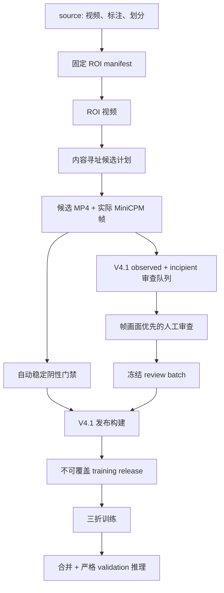

# V4.1 数据处理与训练发布运行手册

本文是 `main` 上当前 V4.1 数据链路的操作入口。V2/V3 的旧编号目录、旧审核 UI 和
`publish_training_release.py --activate` 流程只用于历史复现，不是当前 V4.1 的正式路径。

所有命令从 mVllm_2 仓库根目录执行。媒体物化、训练和 GPU 推理在训练电脑进行；本机
可以检查配置、运行轻量校验、进行人工审查并复核已同步结果。

## 当前基线

| 项目 | 当前值 |
| --- | --- |
| 契约 | `tensile-vlm/v4.1` |
| 当前运行时契约 hash | `3798f00cbec7a3cad3e50de66dd2b5bdeecca1a95ae74297cbd0d71e7ec438ab` |
| 数据根 | `<repo>/workspace/data` |
| 当前 development 发布 | `v4.1.0-ecb5aeb9657c` |
| 基础不可变发布 | `v4.1.0-760050fad303` |
| 阶段 2 新物化候选 | 410 |
| 阶段 2 当前人工决定 | 177 |
| 阶段 2 历史一致沿用 | 233 |
| 阶段 2 排除 | 7 |
| 当前正式训练样本 | 1678 |

当前 development 发布已完成并通过训练 runtime 的完整媒体校验，供 source-aware 3k
实验使用。基础发布已用于上一轮三折训练，两者都保持不可变；不得覆盖或删除后重建。

## 数据链



## 目录与消费边界

```text
workspace/data/
├── source/
│   ├── videos/
│   ├── annotations/
│   └── splits/
├── derived/
│   ├── roi_videos/
│   ├── subvideos/
│   ├── frames/
│   └── metadata/
└── releases/
```

| 区域 | 用途 | 可否直接训练 |
| --- | --- | --- |
| `source/` | 原视频、标注和源视频级划分 | 否 |
| `derived/roi_videos/` | 固定 ROI 后的源视频 | 否 |
| `derived/subvideos/` | 内容寻址候选 MP4 | 否 |
| `derived/frames/` | 模型实际查看的帧画面 | 否 |
| `derived/metadata/` | manifest、队列、审查和质量证据 | 否 |
| `releases/<release_id>/` | 冻结且通过门禁的训练输入 | 是，只读 |

活跃代码通过 `pipeline.current_data` 解析项目内物理目录；冻结产物中的旧 `data/...`
相对媒体路径由纯路径映射兼容，不依赖软链接。

## 第一步：迁移或验证项目内数据

```bash
python pipeline/scripts/migrate_project_local_workspace.py --copy
python pipeline/scripts/migrate_project_local_workspace.py
```

必须满足：

- 新目录是物理副本且不含软链接；
- `source/`、`derived/` 和由旧 `training_releases/` 映射出的 `releases/` 齐全；
- 文件数、总字节数和全部受管文件 SHA-256 一致；
- 旧外部根保持不变，至少保留到一次真实训练和严格评测完成。

`manage_versioned_data_roots.py`、marker、profile 和 `TENSILE_DATA_HOME` 只用于历史流程，
不能作为 main 的活跃 V4.1 入口。

## 第二步：ROI 与候选媒体

当前冻结批次已经完成这一步。新一轮数据变更时才重新执行，并且必须产生新的内容身份。

### ROI 决定与冻结

```bash
streamlit run pipeline/scripts/roi_annotation_app.py -- \
  --metadata workspace/data/derived/metadata/video_meta.json \
  --output workspace/data/derived/metadata/roi_decisions.json

uv run python pipeline/scripts/freeze_roi_decisions.py --check-only
uv run python pipeline/scripts/freeze_roi_decisions.py
```

人工必须确认关键时刻的上/下夹具、完整试样和位置判断信息均被保留。`fixed_roi` 使用
3:4 裁剪框；`no_crop` 后续补边到 3:4。

### 物化 ROI 视频

```bash
uv run python pipeline/scripts/materialize_roi_videos.py --check-only

# 首次先输出到隔离的小样本目录
uv run python pipeline/scripts/materialize_roi_videos.py \
  --video-ids video_0001 video_0008 video_0100 \
  --output-root data/current/sample_roi_videos \
  --workers 1

# 小样本通过后再完整生成
uv run python pipeline/scripts/materialize_roi_videos.py --workers 2
```

只有最终 `manifest.json` 出现，才表示该批次完整完成。单条媒体通过分辨率、帧数、帧率
和时长检查后才会原子发布。

### 候选计划与媒体

当前 V4.1 发布沿用了已经冻结的 ROI 候选媒体批次
`candidate-media-8de972530561`。候选计划和媒体物化脚本内部仍有 `v3` 历史命名，
这是 provenance 路径，不代表当前契约退回 V3。

```bash
uv run python pipeline/scripts/build_v3_candidate_plan.py --dry-run
uv run python pipeline/scripts/build_v3_candidate_plan.py

uv run python pipeline/scripts/materialize_v3_candidate_media.py --check-only

# 首次用隔离目录检查真实 MP4、帧映射和门禁
uv run python pipeline/scripts/materialize_v3_candidate_media.py \
  --limit 3 \
  --video-output-root data/current/sample_candidate_media/videos \
  --frame-output-root data/current/sample_candidate_media/frames \
  --result-root data/current/sample_candidate_media/results

# 小样本通过后再完整生成
uv run python pipeline/scripts/materialize_v3_candidate_media.py
```

候选只有在 MP4、解码、真实 MiniCPM 抽帧、时间映射和状态门禁全部通过后才可进入下游。
禁止只同步 metadata 而遗漏视频或帧图。

## 第三步：构建 V4.1 审查队列

V4.1 队列同时包含：

- `observed`：当前帧窗口已看到发生或已经发生断裂；
- `incipient`：尚未断裂，但当前窗口有明确的临界韧性断裂视觉征兆。

普通稳定未断裂候选经过自动门禁后不进入人工队列。

```bash
python pipeline/scripts/build_v4_1_review_queue.py \
  --materialized \
    workspace/data/derived/metadata/v3/candidate_media_results/\
candidate-media-8de972530561/development_materialized.json \
  --manifest \
    workspace/data/derived/metadata/v3/candidate_media_results/\
candidate-media-8de972530561/manifest.json
```

当前冻结队列：

`workspace/data/derived/metadata/v4_1/review_queues/v4-1-review-4a449c8d1193/review_queue.json`

队列身份、候选集合、媒体 manifest 和契约任一漂移，都必须创建新队列，不能复用旧草稿。

## 第四步：以帧画面为主进行人工审查

```bash
streamlit run pipeline/scripts/review_v4_candidates_app.py -- \
  --queue \
    workspace/data/derived/metadata/v4_1/review_queues/\
v4-1-review-4a449c8d1193/review_queue.json \
  --reviewer-id <reviewer-id>
```

审查原则：

- 默认折叠视频，优先审查模型实际加载的帧画面；
- 当前帧窗口是标签权威来源，不用源视频旧标签覆盖人工帧级判断；
- 同一源视频的重叠候选可以因可见信息不同而拥有不同标签；
- 普通 `未断裂` 的其他字段必须为 `null`；
- `临界未断裂` 可以携带 prospective 的机制和位置，但不能当作已断裂；
- `grip_root` 是严重的夹具根部齐根断裂；
- `outside_gauge_non_root` 是标距外、但并非齐根的非理想断裂位置；
- 缺媒体、帧图漂移、无法可靠判断或需要重生成的候选不得静默批准。

全部候选形成合法终态后，UI 才能冻结内容寻址的 review batch。当前冻结决策：

`workspace/data/derived/metadata/v4_1/review_decisions/v4-1-review-4a449c8d1193/review-batch-9043bbe4c286/decisions.json`

### 阶段 2 新增候选的隔离审查

2026-07-25 阶段 1 有效视图审计已经完成。410 条开发候选和 332 条密封测试候选必须
从同一冻结审计分别生成两个内容绑定的队列：

```bash
python pipeline/scripts/build_v4_1_phase2_review_queues.py \
  --audit-manifest \
    workspace/data/derived/metadata/v4_1/effective_view_audits/\
phase1_verified/audit_manifest.json
```

命令会打印两个不同的 `queue_id` 和路径，但不会创建训练发布。若已有同契约、已冻结且
校验通过的上一轮审查，必须先以上一轮为基准生成内容寻址的分流制品：

```bash
python pipeline/scripts/route_v4_1_review_from_history.py \
  --queue <development_review_queue.json> \
  --previous-decisions <previous_frozen_decisions.json> \
  --current-draft <current_full_queue_draft.json>

streamlit run pipeline/scripts/review_v4_candidates_app.py -- \
  --queue <development_review_queue.json> \
  --routing-manifest <routing_manifest.json> \
  --reviewer-id <reviewer-id>
```

固定分流优先保留当前轮已有人工决定。上一轮整源均为 `approved`、同一
`source_video + semantic_window_role` 只有一个标签共识且与当前提示一致时，记录为
`historical_consensus`；只要上一轮同源出现 `corrected`、`dropped` 或
`needs_regenerate`，或身份、角色、共识、提示不匹配，就进入 `manual_review`。
历史沿用记录单独保存，不伪装成本轮人工批准。没有合格同源历史的队列仍全量人工审查。

阶段 2 队列额外执行以下门禁：

- 队列绑定阶段 1 审计、V4.1 契约、materialized 输入及其 SHA-256；
- 开发与密封测试使用不同队列身份和草稿/决定目录；
- 历史 V3 或自动标签只显示为提示，界面不预选 `clip_state`；
- 审核者必须确认已经依据实际采样帧独立核对四个字段；
- 普通 `未断裂` 测试候选不会被旧 observed/incipient 过滤逻辑排除；
- 任一审计、媒体、帧图、候选集合或 scope 漂移都会拒绝加载。

2026-07-25 已正式生成并完整加载验证：

- development：`v4-1-phase2-development-dc453f01fb23`，410 项、44 个源；
- sealed test 初始队列：`v4-1-phase2-sealed_test-a16926aca6d2`，332 项、20 个源。

两队列的视频、采样帧和身份哈希均通过，源视频交集为空。2026-07-26 已按上一轮冻结
batch 生成分流：development 为 `33 existing_human + 233 historical_consensus +
144 manual_review`；sealed test 因无同源历史为 `332 manual_review`。development
人工子队列已冻结为 `review-batch-7a7222b947da`，其中 118 corrected、19 approved、
7 dropped；三类来源已合成为
`combined-review-decisions-b4ade2d3e526`。截至 2026-07-26，当时 sealed test 尚无
冻结人工 batch。
轻量身份和当前分流见
[`docs/results/v4_1_phase2_review_queues/`](results/v4_1_phase2_review_queues/)；
development 发布证据见
[`docs/results/v4_1_phase2_development_release/`](results/v4_1_phase2_development_release/)。
密封测试决定冻结后必须继续隔离，不能用于训练、采样、学习曲线或模型选择。

2026-07-27，canonical V4.1 analysis prompt 更新后，sealed test 在相同 audit、媒体、
候选顺序和 candidate ID 上重新进行内容寻址，当前队列为
`v4-1-phase2-sealed_test-4f66487a6315`。它与初始队列的唯一身份输入差异是 contract
hash；旧队列和旧 routing 保留为历史对象，不再作为当前 Stage D 输入。

当前 332 条已冻结为 `review-batch-6a8d94bd7675`：209 approved、90 corrected、
33 dropped。专用发布器已生成受限、不可变的
`v4.1-sealed-test-5546b8bf1ec3`，其中 299 条可验收候选仍覆盖全部 20 个独立源。
完整性和哈希见
[`docs/results/v4_1_stage_d_sealed_test_release/`](results/v4_1_stage_d_sealed_test_release/)。
该发布的 one-time evaluation authorization 仍为 false；不得据此直接启动或重复运行
sealed 推理。

## 第五步：构建不可覆盖的 V4.1 训练发布

基础发布复现入口仍为：

```bash
python pipeline/scripts/build_v4_1_training_release.py
```

阶段 2 development 发布必须先执行完整 preflight，再创建不可覆盖目录：

```bash
python pipeline/scripts/build_v4_1_phase2_training_release.py --validate-only
python pipeline/scripts/build_v4_1_phase2_training_release.py
python finetune/validate_v4_1_release.py \
  --release-id v4.1.0-ecb5aeb9657c \
  --verify-media
```

发布器会验证：

- 当前数据根与 V4.1 marker；
- contract version/hash；
- materialized、media manifest、queue 和 decisions 的内容身份；
- reviewed、automatic negative、excluded 三类候选互斥且合计正确；
- 标签联动约束；
- 媒体路径和哈希；
- 源视频级三折隔离；
- release ID 与内容一致；
- 目标目录不存在，拒绝覆盖。

当前阶段 2 输出：

`workspace/data/releases/v4.1.0-ecb5aeb9657c`

发布清单：

`workspace/data/releases/v4.1.0-ecb5aeb9657c/manifest/release_manifest.json`

当前 fold 数量：

| 数据集 | 数量 |
| --- | ---: |
| Fold 0 train | 1253 |
| Fold 0 validation | 425 |
| Fold 1 train | 1014 |
| Fold 1 validation | 664 |
| Fold 2 train | 1186 |
| Fold 2 validation | 492 |

如果脚本提示发布已经存在，应先比较 manifest 和上游哈希。不要删除旧发布后重建；
数据确有变化时应得到新的内容寻址 release ID。

## 第六步：三折训练与任务效果验收

```bash
python finetune/archive/run_v4_1_three_fold_training.py --validate-only
python finetune/archive/run_v4_1_three_fold_training.py

python finetune/archive/run_v4_1_post_training.py --validate-only
python finetune/archive/run_v4_1_post_training.py
```

详细说明和产物路径见 [V4.1 微调、合并与评测](../finetune/README.md)。

2026-07-24 正式视觉 LoRA 三折、merged BF16 和两种 4-bit 验证已经完成，三个 fold
共 1216 条且运行失败为 0。任务效果尚未通过生产验收：BF16 断裂相关三状态宏平均
召回率为 24.54%，`已断裂`召回率为 9.00%，并有 35 条输出漏掉必填
`special_case` 字段。当前结果和制品身份见
[正式视觉运行证据冻结](results/v4_1_0_760050fad303_20260724_visual/README.md)。

2026-07-29 又完成了 `v4.1-prompt-concise-cv-v1-seed3411` 三折训练、最佳 checkpoint
回载、合并和 1581 条严格评测。早停行为符合预期，但加权合法率只有 79.63%，并出现
“未断裂”类别坍缩；该实验没有晋级为发布模型。其全部 15 个 checkpoint 保留，用于
分析合法率、类别分布和中间学习能力随 step 的变化。

三折训练完成仍不等于模型效果验收完成。当前已经使用
`v4.1-agent-pipeline-fold0-r1` 跑通 V4.1 服务和 TensileAgent 工程链路，但该发布仅用于
稳定演示和后续联调，不改变模型质量门失败的事实。

### 语义 Prompt 对照

固定全字段 Prompt 对照不得修改 development release、seed3411 视频多重集、顺序、标签
或 LoRA 超参数。先运行 Prompt 发布，再在训练机生成派生 bundle 和冻结 run manifest：

```bash
python -m pipeline.prompt_control validate \
  --source pipeline/prompt_control/active_prompt.yaml
python -m pipeline.prompt_control publish \
  --source pipeline/prompt_control/active_prompt.yaml
python finetune/build_v4_1_fixed_prompt_dataset.py
python finetune/prepare_v4_1_fixed_prompt_run.py
```

实验 ID 固定为 `v4.1-prompt-minimal-v1-seed3411`。训练、合并、评测命令以
`finetune/experiments/<experiment-id>/manifest.json` 为准。严格评测必须传入 input 内的
`experiment_contract.json`；Prompt、release、sampling 或 schema 任一 hash 不一致时
停止运行，不能回退到 `prompt_library.yaml`、仓库当前 contract Prompt 或临时 overlay。

## 失败恢复

- 数据迁移校验失败：保留旧根，清理经核实的不完整暂存副本后重新复制；禁止用软链接。
- 媒体物化中断：使用同一内容身份重跑；脚本会校验并复用已完成产物。
- 审查中断：从同一 queue-bound 草稿继续；不要复制别的队列草稿。
- 冻结后发现标签错误：创建新队列、新 review batch 和新训练发布，不能改冻结文件。
- 训练中断：依据训练状态和 LLaMA-Factory 产物恢复；不要覆盖身份不明的目录。
- 训练完成但任务尚未分析：保留全部 checkpoint；不能只因已有 merged 就自动删除。
- 评测中断：`evaluation_records.jsonl` 可续跑；run identity 不一致时使用新输出目录。

## 不可绕过的规则

- 不要向 `tensile-data/archive` 写入任何 V4.1 数据。
- 不要把旧 `data/07_metadata` 或 `data/08_training_ready` 当成 V4.1 主入口。
- 不要使用旧 `review_subvideos_app.py` 审查 V4.1 queue。
- 不要让源视频初始标签静默覆盖帧窗口人工复标结果。
- 不要把 `needs_regenerate`、缺媒体、哈希漂移或非法标签带入发布。
- 不要覆盖冻结 review batch 或 training release。
- 不要仅依据 train/eval loss 宣称任务效果达标。
- 不要把当前 V4.1 中间服务描述为 production，也不要用 Agent 链路通过替代模型质量验收。

## 历史流程

V2 的完整编号目录、增量复审、`publish_training_release.py --activate`、全量训练和
V2 测试集评测都属于封存流程。需要复现时切换到 `tensile-vlm-v2-final` /
`archive/v2` 并使用 `tensile-data/archive`，不要从 `main` 的当前说明拼接新旧命令。

V3/V4 文档和 artifact 是 V4.1 形成过程中的设计与迁移证据，不是可部署运行时。

## 关联文档

- [仓库总览](../README.md)
- [V4.1 微调、合并与评测](../finetune/README.md)
- [数据隔离设计](plans/2026-07-23-v2-v4-1-data-isolation-design.md)
- [迁移报告](reports/2026-07-23-v2-v4-1-data-migration.md)
- [V4.1 临界未断裂契约设计](plans/2026-07-23-tensile-vlm-v4-1-incipient-fracture-design.md)
