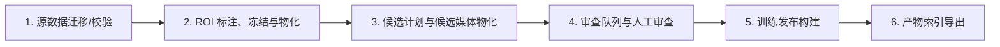

# V4.1 数据处理运行手册

> 本文只描述如何运行当前项目的数据处理链路，不记录任何一次具体运行的状态、基线或历史发布。状态性内容见 `docs/results/` 与 `docs/project-guide.md`。

## 1. 适用范围与假设

- 目标读者：首次跑通 V4.1 数据处理链路的人。
- 代码根目录：`<repo>`（本仓库根目录）。所有命令均从 `<repo>` 执行。
- 机器分工：
  - **Mac（uv 环境）**：ROI 标注、人工审查、轻量校验与队列构建。
  - **训练机（Conda  环境）**：ROI 视频物化、候选媒体物化、重计算、训练发布构建。
- 当前契约：`pipeline/contracts/tensile_vlm_v4_1.json`。
- Prompt 管理：`pipeline/prompt_control/active_prompt.yaml`。

## 2. 前置准备

### 2.1 运行环境

- **Mac**：仓库已配置 `uv`。运行前先确保依赖可用：
  ```bash
  uv sync
  ```
  关键依赖：`streamlit`、`streamlit-cropper==0.3.1`。
- **训练机**：激活 Conda `agent` 环境；确保 `ffmpeg` / `ffprobe` 在 `PATH` 中；模型目录 `models/minicpmv4_5` 已就位。

### 2.2 数据放置约定

数据统一放在项目内 `workspace/data/`（Git 忽略）。首次运行前，确保：

```text
workspace/data/
├── source/
│   ├── videos/        # 原始 MP4
│   ├── annotations/     # 原始标注
│   └── splits/          # train/test 划分 JSON
└── derived/metadata/
    └── video_meta.json  # 源视频元数据（由源数据提供或从旧系统迁移）
```

> 注意：`source/videos`、`source/annotations`、`source/splits` 是生成快照的前提；生成 source snapshot 后，下游脚本以 `derived/metadata/source_snapshots/<id>/video_meta.json` 为权威视频元数据输入。

## 3. 流程总览



六步一句话：先校验、放置源数据并生成 source/split 快照，再固定 ROI 并裁剪源视频，随后生成候选片段与实际帧，再经人工审查后构建不可覆盖的训练发布，最后导出产物索引。

## 4. 逐步操作

以下命令中的 `<...>` 为每次运行实际生成的 ID 或路径，由上游脚本输出或 `workspace/data/INDEX.md` / 各集合 `index.json` 查询得到。

### Step 1：迁移源数据并生成快照

本步骤分为两段：① 把源数据放置到 `workspace/data` 并做迁移校验；② 生成 source/split 快照。只有完成 ① 后才能进入 ②。

#### 1.1 数据放置与迁移校验（前置）

- **目的**：把源数据物理复制到项目内 `workspace/data/`，并校验完整性。
- **机器**：数据所在机器（通常是训练机，Conda  环境）。
- **命令**：
  ```bash
  # 复制并校验
  python pipeline/scripts/source_migrate_workspace.py --copy
  # 仅校验已复制的目录
  python pipeline/scripts/source_migrate_workspace.py
  ```
  可选显式指定源根：
  ```bash
  python pipeline/scripts/source_migrate_workspace.py \
    --source-root /path/to/tensile-data/current \
    --destination-root workspace/data \
    --copy
  ```
- **产物位置**：`workspace/data/source/{videos,annotations,splits}`。
- **验收/检查**：校验通过会输出 JSON，包含文件数、总字节数、SHA-256 一致性。失败时保留旧根，清理不完整副本后重试，禁止用软链接。
- **进入下一步条件**：两次校验均成功，源数据已就位。

#### 1.2 快照生成

- **目的**：物化不可变的 source snapshot 与 split snapshot（含视频元数据与训练/测试划分）。
- **机器**：训练机（Conda  环境）。
- **命令**：
  ```bash
  # 仅校验源数据身份与拆分计划
  python pipeline/scripts/rebuild_data.py run \
    --source-data-root workspace/data \
    --run-root workspace/data-staging/<run-id> \
    --source-only \
    --check-only

  # 真正物化快照到 staging run-root
  python pipeline/scripts/rebuild_data.py run \
    --source-data-root workspace/data \
    --run-root workspace/data-staging/<run-id> \
    --source-only

  # 把 staging 产物晋级到 workspace/data
  python pipeline/scripts/rebuild_data.py promote \
    --run-root workspace/data-staging/<run-id>
  ```
- **产物位置**：
  - `workspace/data/derived/metadata/source_snapshots/<source-snapshot-id>/`
    - 含 `video_meta.json`、`source_manifest.json` 等
  - `workspace/data/derived/metadata/split_snapshots/<split-snapshot-id>/`
    - 含 `fold_0/1/2` 的 `train.json` / `val.json` 以及 `test.json`
- **验收/检查**：`run --source-only` 输出 `source_snapshotted` 状态、`source_snapshot_id`、`split_snapshot_id`；快照目录已生成且 `source_snapshots/<id>/` 含 `video_meta.json`，`split_snapshots/<id>/` 含 splits。
- **进入下一步条件**：已知 `<source-snapshot-id>` 与 `<split-snapshot-id>`，且快照已晋级到 `workspace/data`。

### Step 2：ROI 标注、冻结与物化

> 注意：本步骤使用的 `video_meta.json` 来自 Step 1 生成的 source snapshot（`workspace/data/derived/metadata/source_snapshots/<source-snapshot-id>/video_meta.json`），不再使用旧路径 `derived/metadata/video_meta.json`。

#### 2.1 标注 ROI

- **目的**：在源视频上标定固定 ROI（上/下夹具、完整试样）。
- **机器**：Mac（uv 环境，streamlit-cropper 仅 Mac 依赖中已配置）。
- **命令**：
  ```bash
  uv run streamlit run pipeline/scripts/roi_annotation_app.py -- \
    --data-root workspace/data \
    --metadata workspace/data/derived/metadata/source_snapshots/<source-snapshot-id>/video_meta.json \
    --output workspace/data/derived/metadata/roi_decisions.json
  ```
- **产物位置**：`workspace/data/derived/metadata/roi_decisions.json`。
- **验收/检查**：UI 中每个视频的关键时刻必须包含上/下夹具、完整试样和位置判断。
- **进入下一步条件**：所有源视频完成标注并保存。

#### 2.2 冻结 ROI 决定

- **目的**：把 ROI 决定打包成不可变的 ROI manifest。
- **机器**：Mac（轻量校验）。
- **命令**：
  ```bash
  uv run python pipeline/scripts/roi_freeze_decisions.py --check-only
  uv run python pipeline/scripts/roi_freeze_decisions.py
  ```
  若使用非默认数据根，加 `--data-root <path>`。
- **产物位置**：`workspace/data/derived/metadata/roi_manifests/<roi-manifest-id>/`。
- **验收/检查**：`--check-only` 输出校验报告；正式运行后目录中出现 `manifest.json` 且 `roi_manifest_id` 已打印。
- **进入下一步条件**：无校验错误，且已知 `<roi-manifest-id>`。

#### 2.3 物化 ROI 视频

- **目的**：按 ROI manifest 裁剪出保持原时间轴的 3:4 源视频。
- **机器**：训练机（ffmpeg 重计算）。
- **命令**：
  ```bash
  # 先只校验生成计划
  python pipeline/scripts/roi_materialize_videos.py \
    --data-root workspace/data \
    --roi-manifest workspace/data/derived/metadata/roi_manifests/<roi-manifest-id> \
    --video-meta workspace/data/derived/metadata/source_snapshots/<source-snapshot-id>/video_meta.json \
    --check-only

  # 小样本试跑（必须指定隔离目录）
  python pipeline/scripts/roi_materialize_videos.py \
    --data-root workspace/data \
    --roi-manifest workspace/data/derived/metadata/roi_manifests/<roi-manifest-id> \
    --video-meta workspace/data/derived/metadata/source_snapshots/<source-snapshot-id>/video_meta.json \
    --video-ids video_0001 video_0008 \
    --output-root workspace/data/derived/roi_videos/sample_roi_videos \
    --workers 1

  # 全量生成
  python pipeline/scripts/roi_materialize_videos.py \
    --data-root workspace/data \
    --roi-manifest workspace/data/derived/metadata/roi_manifests/<roi-manifest-id> \
    --video-meta workspace/data/derived/metadata/source_snapshots/<source-snapshot-id>/video_meta.json \
    --workers 2
  ```
- **产物位置**：`workspace/data/derived/roi_videos/<roi-media-id>/`。
- **验收/检查**：目录中出现 `manifest.json`；单条媒体通过分辨率、帧数、帧率、时长检查。
- **进入下一步条件**：`manifest.json` 存在，且已知 `<roi-media-id>`。

### Step 3：候选计划与候选媒体物化

#### 3.1 生成候选计划

- **目的**：基于 ROI 视频和 review reference 生成内容寻址的候选计划。
- **机器**：Mac 或训练机（轻量计算）。
- **命令**：
  ```bash
  # 先只打印计划身份与统计
  uv run python pipeline/scripts/subvideo_build_plan.py \
    --data-root workspace/data \
    --roi-media-dir workspace/data/derived/roi_videos/<roi-media-id> \
    --review-reference-dir workspace/data/derived/metadata/review_reference/<review-ref-id> \
    --dry-run

  # 正式生成
  uv run python pipeline/scripts/subvideo_build_plan.py \
    --data-root workspace/data \
    --roi-media-dir workspace/data/derived/roi_videos/<roi-media-id> \
    --review-reference-dir workspace/data/derived/metadata/review_reference/<review-ref-id> \
    --output-root workspace/data/derived/metadata/candidate_plans
  ```

> 注意：候选计划步骤固定使用 v3 契约（脚本默认值），v4.1 契约从审查/发布环节开始使用；因此 `subvideo_build_plan.py` 不需要也不应显式传入 `--contract pipeline/contracts/tensile_vlm_v4_1.json`。

- **产物位置**：`workspace/data/derived/metadata/candidate_plans/<plan-id>/`。
- **验收/检查**：`--dry-run` 输出 `plan_id`、development 候选数、需审查数；正式运行后目录中出现 `manifest.json`。
- **进入下一步条件**：计划已生成，且已知 `<plan-id>`。

#### 3.2 物化候选媒体

- **目的**：生成候选 MP4、实际 MiniCPM 抽帧和门禁结果。
- **机器**：训练机（Conda环境，GPU/模型推理）。
- **命令**：
  ```bash
  # 先只校验输入与身份
  python pipeline/scripts/subvideo_materialize_media.py \
    --data-root workspace/data \
    --candidate-plan workspace/data/derived/metadata/candidate_plans/<plan-id> \
    --roi-media workspace/data/derived/roi_videos/<roi-media-id> \
    --check-only

  # 小样本试跑（必须同时指定隔离目录）
  python pipeline/scripts/subvideo_materialize_media.py \
    --data-root workspace/data \
    --candidate-plan workspace/data/derived/metadata/candidate_plans/<plan-id> \
    --roi-media workspace/data/derived/roi_videos/<roi-media-id> \
    --limit 3 \
    --video-output-root workspace/data/derived/subvideos/sample_candidate_media \
    --frame-output-root workspace/data/derived/frames/sample_candidate_media \
    --result-root workspace/data/derived/metadata/candidate_media_results/sample_candidate_media

  # 全量生成
  python pipeline/scripts/subvideo_materialize_media.py \
    --data-root workspace/data \
    --candidate-plan workspace/data/derived/metadata/candidate_plans/<plan-id> \
    --roi-media workspace/data/derived/roi_videos/<roi-media-id>
  ```
- **产物位置**：
  - `workspace/data/derived/subvideos/<candidate-media-id>/`
  - `workspace/data/derived/frames/<candidate-media-id>/`
  - `workspace/data/derived/metadata/candidate_media_results/<candidate-media-id>/`
- **验收/检查**：`manifest.json` 与 `development_materialized.json` 均已生成；MP4、解码、抽帧、时间映射、状态门禁全部通过。
- **进入下一步条件**：`<candidate-media-id>` 已知，且 `development_materialized.json` 存在。

### Step 4：审查队列与人工审查

#### 4.1 构建审查队列

- **目的**：把 materialized 候选组织成 V4.1 审查队列（`observed` / `incipient`）。
- **机器**：Mac（轻量）。
- **命令**：
  ```bash
  uv run python pipeline/scripts/review_build_queue.py \
    --data-root workspace/data \
    --materialized workspace/data/derived/metadata/candidate_media_results/<candidate-media-id>/development_materialized.json \
    --manifest workspace/data/derived/metadata/candidate_media_results/<candidate-media-id>/manifest.json \
    --contract pipeline/contracts/tensile_vlm_v4_1.json \
    --output-root workspace/data/derived/metadata/review_queues
  ```
- **产物位置**：`workspace/data/derived/metadata/review_queues/<queue-id>/review_queue.json`。
- **验收/检查**：输出 `queue_id`、`candidate_count`、`observed_count`、`incipient_count`。
- **进入下一步条件**：队列文件已生成，且已知 `<queue-id>`。

#### 4.2 人工审查

- **目的**：逐候选确认标签（优先看帧画面而非源视频）。
- **机器**：Mac（uv 环境 + streamlit）。
- **命令**：
  ```bash
  uv run streamlit run pipeline/scripts/review_candidates_app.py -- \
    --data-root workspace/data \
    --queue workspace/data/derived/metadata/review_queues/<queue-id>/review_queue.json \
    --reviewer-id <reviewer-id>
  ```
  若使用历史分流，加 `--routing-manifest`：
  ```bash
  uv run streamlit run pipeline/scripts/review_candidates_app.py -- \
    --data-root workspace/data \
    --queue workspace/data/derived/metadata/review_queues/<queue-id>/review_queue.json \
    --routing-manifest workspace/data/derived/metadata/review_routes/<route-id>/routing_manifest.json \
    --reviewer-id <reviewer-id>
  ```
- **产物位置**：默认保存到 `workspace/data/derived/metadata/review_decisions/<queue-id>/review-batch-<batch-id>/decisions.json`。
- **验收/检查**：UI 状态全部为 `approved`、`corrected`、`dropped` 或 `needs_regenerate`；没有 `remaining`。
- **进入下一步条件**：全部候选形成合法终态，且已知 `<batch-id>`。

#### 4.3 （可选）阶段 2 隔离队列与历史分流

- **目的**：当存在阶段 1 审计和上一轮冻结决策时，生成开发/密封测试隔离队列，并按历史决定分流以减少重复人工审查。
- **机器**：Mac（轻量）。
- **命令**：
  ```bash
  # 从阶段 1 审计生成两个隔离队列
  uv run python pipeline/scripts/review_build_phase2_queues.py \
    --audit-manifest workspace/data/derived/metadata/v4_1/effective_view_audits/<audit-id>/audit_manifest.json \
    --contract pipeline/contracts/tensile_vlm_v4_1.json \
    --output-root workspace/data/derived/metadata/review_queues

  # 基于上一轮冻结决策分流
  uv run python pipeline/scripts/review_route_from_history.py \
    --queue workspace/data/derived/metadata/review_queues/<queue-id>/review_queue.json \
    --previous-decisions workspace/data/derived/metadata/review_decisions/<prev-queue-id>/<prev-batch-id>/decisions.json \
    --output-root workspace/data/derived/metadata/review_routes
  ```
- **产物位置**：新队列目录 + `workspace/data/derived/metadata/review_routes/<route-id>/routing_manifest.json`。
- **验收/检查**：队列身份、候选集合、契约 hash 与审计一致；分流后进入 UI 的候选为 `manual_review` 子集。
- **进入下一步条件**：分流产物已知，且后续发布使用分流后的人工决定。

### Step 5：构建训练发布

- **目的**：把审查决定物化为不可覆盖的训练 release。
- **机器**：训练机（Conda  环境）。
- **命令**：
  > 参数来源说明：
  >
  > - `--source-snapshot` / `--split-snapshot` 分别指向 Step 1 生成的 source/split 快照目录。
  > - `--source-tree-sha256` / `--split-tree-sha256` 为对应快照目录的内容树哈希；`release_build.py` 内部会通过 `tree_inventory` 重新计算并校验。手动获取时可查看 orchestrator staging 目录 `control/rebuild.json` 中的 `source_snapshot_tree_sha256` / `split_snapshot_tree_sha256`，或使用 `pipeline.data_rebuild.tree_inventory` 计算。
  ```bash
  python pipeline/scripts/release_build.py \
    --data-root workspace/data \
    --source-snapshot workspace/data/derived/metadata/source_snapshots/<source-snapshot-id> \
    --split-snapshot workspace/data/derived/metadata/split_snapshots/<split-snapshot-id> \
    --source-tree-sha256 <source-tree-sha256> \
    --split-tree-sha256 <split-tree-sha256> \
    --materialized workspace/data/derived/metadata/candidate_media_results/<candidate-media-id>/development_materialized.json \
    --media-manifest workspace/data/derived/metadata/candidate_media_results/<candidate-media-id>/manifest.json \
    --queue workspace/data/derived/metadata/review_queues/<queue-id>/review_queue.json \
    --decisions workspace/data/derived/metadata/review_decisions/<queue-id>/review-batch-<batch-id>/decisions.json \
    --contract pipeline/contracts/tensile_vlm_v4_1.json
  ```
  阶段 2 发布先验证再发布：
  ```bash
  python pipeline/scripts/release_build_phase2.py --validate-only \
    --project-root . \
    --base-release-dir workspace/data/releases/<base-release-id> \
    --materialized workspace/data/derived/metadata/candidate_media_results/<candidate-media-id>/development_materialized.json \
    --media-manifest workspace/data/derived/metadata/candidate_media_results/<candidate-media-id>/manifest.json \
    --queue workspace/data/derived/metadata/review_queues/<queue-id>/review_queue.json \
    --routing-manifest workspace/data/derived/metadata/review_routes/<route-id>/routing_manifest.json \
    --manual-decisions workspace/data/derived/metadata/review_decisions/<queue-id>/review-batch-<batch-id>/decisions.json \
    --audit workspace/data/derived/metadata/v4_1/effective_view_audits/<audit-id>/audit_manifest.json \
    --contract pipeline/contracts/tensile_vlm_v4_1.json

  python pipeline/scripts/release_build_phase2.py \
    --project-root . \
    --base-release-dir workspace/data/releases/<base-release-id> \
    --materialized workspace/data/derived/metadata/candidate_media_results/<candidate-media-id>/development_materialized.json \
    --media-manifest workspace/data/derived/metadata/candidate_media_results/<candidate-media-id>/manifest.json \
    --queue workspace/data/derived/metadata/review_queues/<queue-id>/review_queue.json \
    --routing-manifest workspace/data/derived/metadata/review_routes/<route-id>/routing_manifest.json \
    --manual-decisions workspace/data/derived/metadata/review_decisions/<queue-id>/review-batch-<batch-id>/decisions.json \
    --audit workspace/data/derived/metadata/v4_1/effective_view_audits/<audit-id>/audit_manifest.json \
    --contract pipeline/contracts/tensile_vlm_v4_1.json
  ```
- **产物位置**：`workspace/data/releases/<release-id>/`。
- **验收/检查**：脚本输出 `release_id`、`status`、`counts`；目标目录必须不存在，否则拒绝覆盖。
- **进入下一步条件**：`manifest/release_manifest.json` 已生成，且已知 `<release-id>`。

### Step 6：生成产物索引

- **目的**：汇总各产物集合的 `index.json`，生成全局可读的 `INDEX.md`。
- **机器**：Mac 或训练机。
- **命令**：
  ```bash
  python pipeline/scripts/build_artifact_index.py
  # 或在非默认数据根上运行
  python pipeline/scripts/build_artifact_index.py --data-root /path/to/data
  ```
- **产物位置**：`workspace/data/INDEX.md`。
- **验收/检查**：`INDEX.md` 当前列出 `source_snapshots`、`split_snapshots`、`roi_manifests`、`roi_videos` 四类集合；候选媒体、队列、决定、release 等集合后续接入。
- **进入下一步条件**：索引生成成功，可供下游查找 artifact ID。

## 5. 产物索引说明

- 当前 `build_artifact_index.py` 维护并读取以下 4 个产物集合的 `index.json`：`source_snapshots`、`split_snapshots`、`roi_manifests`、`roi_videos`。
- `pipeline/scripts/build_artifact_index.py` 读取这些 `index.json`，生成 `workspace/data/INDEX.md` 全局总览。
- 候选媒体、审查队列、决定、release 等其他集合尚未接入全局索引，将在后续版本中支持。
- 下游命令中 `<...-id>` 可从已接入集合的 `index.json` 或 `INDEX.md` 查到。

## 6. 故障处理

| 现象                                             | 含义                                        | 处理                                                                                                   |
| ---------------------------------------------- | ----------------------------------------- | ---------------------------------------------------------------------------------------------------- |
| `DataRootError: ... 必须位于 ...`                  | 输出路径不在受管集合目录内                             | 检查 `--output-root` 是否在 `workspace/data/derived/metadata/<collection>` 或 `workspace/data/releases` 下。 |
| `目标目录已存在` / 拒绝覆盖                               | releases 与冻结产物不可覆盖                        | 若确实要重新生成，使用新的 `<run-id>` / `<release-id>`，不要删除旧目录。                                                   |
| `identity_sha256` / `tree_sha256` 不匹配          | 上游身份漂移                                    | 重新确认输入 artifact ID 与 hash；不要手动改冻结文件。                                                                 |
| `staging state 的 schema/layout/root/Git 身份不匹配` | `rebuild_data.py` 恢复时 Git commit 或目录结构不一致 | 在同一 Git 版本下用同一 `run-root` 恢复，否则新建 run-root。                                                          |
| `视频 metadata 不存在`                              | source snapshot 中 `video_meta.json` 缺失    | 回到 Step 1 检查源数据并重新生成 source snapshot。                                                                |
| `ffmpeg/ffprobe 未找到`                           | 训练机缺少媒体工具                                 | 安装 ffmpeg 并确保在 PATH 中。                                                                               |
| 审查 UI 中候选 `remaining > 0`                      | 还有未审核候选                                   | 继续审查，直到全部形成终态。                                                                                       |

## 7. 不该做的事（速查）

- 不要把旧 `data/07_metadata`、`data/08_training_ready`、`review_subvideos_app.py` 当成 V4.1 主入口。
- 不要删除或覆盖已冻结的 ROI manifest、review batch、candidate media、training release。
- 不要把 `needs_regenerate`、缺媒体、哈希漂移或非法标签带入发布。
- 不要让源视频初始标签静默覆盖帧窗口人工复标结果。
- 不要把训练完成本身等同于任务效果验收通过。

## 8. 编排器模式（可选）

如果你希望用一个命令跑隔离重建，可以使用 orchestrator：

```bash
# 首次或完整重建
python pipeline/scripts/rebuild_data.py run \
  --source-data-root workspace/data \
  --run-root workspace/data-staging/<run-id> \
  --roi-mode review \
  --review-mode review

# 仅校验源数据身份
python pipeline/scripts/rebuild_data.py run \
  --source-data-root workspace/data \
  --run-root workspace/data-staging/<run-id> \
  --source-only \
  --check-only

# 物化 source/split 快照到 staging（不进入后续 ROI/审查/发布）
python pipeline/scripts/rebuild_data.py run \
  --source-data-root workspace/data \
  --run-root workspace/data-staging/<run-id> \
  --source-only

# 把 staging 产物晋级到 workspace/data
python pipeline/scripts/rebuild_data.py promote \
  --run-root workspace/data-staging/<run-id>
```

> 注意：
>
> - `run --source-only` 会真实生成 source/split 快照，但产物留在 `run-root` 的 staging data 中，需要执行 `promote` 才能落入 `workspace/data`。
> - `run --source-only --check-only` 仅做校验，不写入快照。
> - 同一 `run-root` 续跑完整流水线时，必须使用与首次相同的 `--roi-mode` / `--review-mode`，否则需换 `run-root`。

