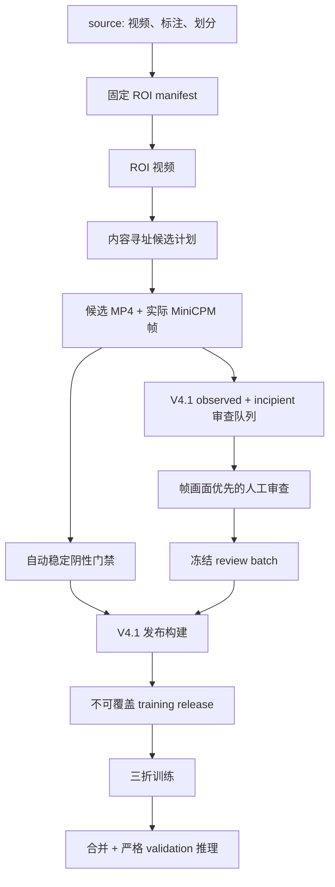

# V4.1 数据处理与训练发布运行手册

本文是 `main` 上当前 V4.1 数据链路的操作入口。V2/V3 的旧编号目录、旧审核 UI 和
`publish_training_release.py --activate` 流程只用于历史复现，不是当前 V4.1 的正式路径。

所有命令从 mVllm_2 仓库根目录执行。媒体物化、训练和 GPU 推理在训练电脑进行；本机
可以检查配置、运行轻量校验、进行人工审查并复核已同步结果。

## 当前基线

| 项目 | 当前值 |
| --- | --- |
| 契约 | `tensile-vlm/v4.1` |
| 契约 hash | `47e393007ff1677c8b60a47d6d86f8181d7b1388a238d79469a3046bc045b937` |
| 数据根 | `tensile-data/current` |
| 冻结发布 | `v4.1.0-760050fad303` |
| 物化候选 | 1285 |
| 人工审查 | 774 |
| 自动稳定阴性 | 511 |
| 排除 | 10 |
| 正式训练样本 | 1275 |

当前发布已完成并用于三折训练。除非数据内容确有更改，否则不要重复发布或覆盖它。

## 数据链



## 目录与消费边界

```text
tensile-data/current/
├── source/
│   ├── videos/
│   ├── annotations/
│   └── splits/
├── derived/
│   ├── roi_videos/
│   ├── subvideos/
│   ├── frames/
│   └── metadata/
├── training_releases/
└── .compat/workspace/
```

| 区域 | 用途 | 可否直接训练 |
| --- | --- | --- |
| `source/` | 原视频、标注和源视频级划分 | 否 |
| `derived/roi_videos/` | 固定 ROI 后的源视频 | 否 |
| `derived/subvideos/` | 内容寻址候选 MP4 | 否 |
| `derived/frames/` | 模型实际查看的帧画面 | 否 |
| `derived/metadata/` | manifest、队列、审查和质量证据 | 否 |
| `training_releases/<release_id>/` | 冻结且通过门禁的训练输入 | 是，只读 |

`.compat/workspace` 只为已冻结的 `data/...` 相对路径提供同版本兼容视图。新代码应优先
通过 `pipeline.current_data` / `pipeline.data_roots` 解析路径，不要手工拼接旧编号目录。

## 第一步：验证数据根

```bash
python pipeline/scripts/manage_versioned_data_roots.py check --contract all
python pipeline/scripts/manage_versioned_data_roots.py workspace \
  --contract tensile-vlm/v4.1
```

必须满足：

- `current` marker 声明 `tensile-vlm/v4.1` 且 lifecycle 为 `active`；
- `archive` marker 声明 `tensile-vlm/v2` 且 lifecycle 为 `frozen`；
- 两个根目录不是同一位置；
- V4.1 操作不会解析到 archive；
- frozen V2 根不会接收写操作。

新环境需要初始化时：

```bash
python pipeline/scripts/manage_versioned_data_roots.py init --contract all
```

默认根目录是仓库同级 `tensile-data`；使用其他位置时显式设置
`TENSILE_DATA_HOME` 或传入 `--data-home`。

## 第二步：ROI 与候选媒体

当前冻结批次已经完成这一步。新一轮数据变更时才重新执行，并且必须产生新的内容身份。

### ROI 决定与冻结

```bash
streamlit run pipeline/scripts/roi_annotation_app.py -- \
  --metadata data/current/derived/metadata/video_meta.json \
  --output data/current/derived/metadata/roi_decisions.json

uv run python pipeline/scripts/freeze_roi_decisions.py --check-only
uv run python pipeline/scripts/freeze_roi_decisions.py
```

人工必须确认关键时刻的上/下夹具、完整试样和位置判断信息均被保留。`fixed_roi` 使用
3:4 裁剪框；`no_crop` 后续补边到 3:4。

### 物化 ROI 视频

```bash
uv run python pipeline/scripts/materialize_roi_videos.py --check-only

# 首次先输出到隔离的小样本目录
uv run python pipeline/scripts/materialize_roi_videos.py \
  --video-ids video_0001 video_0008 video_0100 \
  --output-root data/current/sample_roi_videos \
  --workers 1

# 小样本通过后再完整生成
uv run python pipeline/scripts/materialize_roi_videos.py --workers 2
```

只有最终 `manifest.json` 出现，才表示该批次完整完成。单条媒体通过分辨率、帧数、帧率
和时长检查后才会原子发布。

### 候选计划与媒体

当前 V4.1 发布沿用了已经冻结的 ROI 候选媒体批次
`candidate-media-8de972530561`。候选计划和媒体物化脚本内部仍有 `v3` 历史命名，
这是 provenance 路径，不代表当前契约退回 V3。

```bash
uv run python pipeline/scripts/build_v3_candidate_plan.py --dry-run
uv run python pipeline/scripts/build_v3_candidate_plan.py

uv run python pipeline/scripts/materialize_v3_candidate_media.py --check-only

# 首次用隔离目录检查真实 MP4、帧映射和门禁
uv run python pipeline/scripts/materialize_v3_candidate_media.py \
  --limit 3 \
  --video-output-root data/current/sample_candidate_media/videos \
  --frame-output-root data/current/sample_candidate_media/frames \
  --result-root data/current/sample_candidate_media/results

# 小样本通过后再完整生成
uv run python pipeline/scripts/materialize_v3_candidate_media.py
```

候选只有在 MP4、解码、真实 MiniCPM 抽帧、时间映射和状态门禁全部通过后才可进入下游。
禁止只同步 metadata 而遗漏视频或帧图。

## 第三步：构建 V4.1 审查队列

V4.1 队列同时包含：

- `observed`：当前帧窗口已看到发生或已经发生断裂；
- `incipient`：尚未断裂，但当前窗口有明确的临界韧性断裂视觉征兆。

普通稳定未断裂候选经过自动门禁后不进入人工队列。

```bash
python pipeline/scripts/build_v4_1_review_queue.py \
  --materialized \
    data/current/derived/metadata/v3/candidate_media_results/\
candidate-media-8de972530561/development_materialized.json \
  --manifest \
    data/current/derived/metadata/v3/candidate_media_results/\
candidate-media-8de972530561/manifest.json
```

当前冻结队列：

`data/current/derived/metadata/v4_1/review_queues/v4-1-review-4a449c8d1193/review_queue.json`

队列身份、候选集合、媒体 manifest 和契约任一漂移，都必须创建新队列，不能复用旧草稿。

## 第四步：以帧画面为主进行人工审查

```bash
streamlit run pipeline/scripts/review_v4_candidates_app.py -- \
  --queue \
    data/current/derived/metadata/v4_1/review_queues/\
v4-1-review-4a449c8d1193/review_queue.json \
  --manifest \
    data/current/derived/metadata/v3/candidate_media_results/\
candidate-media-8de972530561/manifest.json \
  --reviewer-id <reviewer-id>
```

审查原则：

- 默认折叠视频，优先审查模型实际加载的帧画面；
- 当前帧窗口是标签权威来源，不用源视频旧标签覆盖人工帧级判断；
- 同一源视频的重叠候选可以因可见信息不同而拥有不同标签；
- 普通 `未断裂` 的其他字段必须为 `null`；
- `临界未断裂` 可以携带 prospective 的机制和位置，但不能当作已断裂；
- `grip_root` 是严重的夹具根部齐根断裂；
- `outside_gauge_non_root` 是标距外、但并非齐根的非理想断裂位置；
- 缺媒体、帧图漂移、无法可靠判断或需要重生成的候选不得静默批准。

全部候选形成合法终态后，UI 才能冻结内容寻址的 review batch。当前冻结决策：

`data/current/derived/metadata/v4_1/review_decisions/v4-1-review-4a449c8d1193/review-batch-9043bbe4c286/decisions.json`

## 第五步：构建不可覆盖的 V4.1 训练发布

先确认默认输入仍指向要发布的批次：

```bash
python pipeline/scripts/build_v4_1_training_release.py
```

发布器会验证：

- 当前数据根与 V4.1 marker；
- contract version/hash；
- materialized、media manifest、queue 和 decisions 的内容身份；
- reviewed、automatic negative、excluded 三类候选互斥且合计正确；
- 标签联动约束；
- 媒体路径和哈希；
- 源视频级三折隔离；
- release ID 与内容一致；
- 目标目录不存在，拒绝覆盖。

当前输出：

`data/current/training_releases/v4.1.0-760050fad303`

发布清单：

`data/current/training_releases/v4.1.0-760050fad303/manifest/release_manifest.json`

当前 fold 数量：

| 数据集 | 数量 |
| --- | ---: |
| Fold 0 train | 850 |
| Fold 0 validation | 425 |
| Fold 1 train | 830 |
| Fold 1 validation | 445 |
| Fold 2 train | 929 |
| Fold 2 validation | 346 |

如果脚本提示发布已经存在，应先比较 manifest 和上游哈希。不要删除旧发布后重建；
数据确有变化时应得到新的内容寻址 release ID。

## 第六步：三折训练与任务效果验收

```bash
python finetune/run_v4_1_three_fold_training.py --validate-only
python finetune/run_v4_1_three_fold_training.py

python finetune/run_v4_1_post_training.py --validate-only
python finetune/run_v4_1_post_training.py
```

详细说明和产物路径见 [V4.1 微调、合并与评测](../finetune/README.md)。

三折训练完成不等于模型效果验收完成。必须等待三个 fold 的
`evaluation_summary.json`、`evaluation_records.jsonl` 和 `runtime_failures.csv` 完整，
再检查严格 schema 合法率、四字段准确率、联合准确率、混淆表和典型失败样例。

## 失败恢复

- 数据根检查失败：修复路径或 marker，不要用软链接把 current 指向 archive。
- 媒体物化中断：使用同一内容身份重跑；脚本会校验并复用已完成产物。
- 审查中断：从同一 queue-bound 草稿继续；不要复制别的队列草稿。
- 冻结后发现标签错误：创建新队列、新 review batch 和新训练发布，不能改冻结文件。
- 训练中断：依据训练状态和 LLaMA-Factory 产物恢复；不要覆盖身份不明的目录。
- 评测中断：`evaluation_records.jsonl` 可续跑；run identity 不一致时使用新输出目录。

## 不可绕过的规则

- 不要向 `tensile-data/archive` 写入任何 V4.1 数据。
- 不要把旧 `data/07_metadata` 或 `data/08_training_ready` 当成 V4.1 主入口。
- 不要使用旧 `review_subvideos_app.py` 审查 V4.1 queue。
- 不要让源视频初始标签静默覆盖帧窗口人工复标结果。
- 不要把 `needs_regenerate`、缺媒体、哈希漂移或非法标签带入发布。
- 不要覆盖冻结 review batch 或 training release。
- 不要仅依据 train/eval loss 宣称任务效果达标。
- 不要在 V4.1 服务和 Agent 整体迁移完成前替换现有 V2 生产服务。

## 历史流程

V2 的完整编号目录、增量复审、`publish_training_release.py --activate`、全量训练和
V2 测试集评测都属于封存流程。需要复现时切换到 `tensile-vlm-v2-final` /
`archive/v2` 并使用 `tensile-data/archive`，不要从 `main` 的当前说明拼接新旧命令。

V3/V4 文档和 artifact 是 V4.1 形成过程中的设计与迁移证据，不是可部署运行时。

## 关联文档

- [仓库总览](../README.md)
- [V4.1 微调、合并与评测](../finetune/README.md)
- [数据隔离设计](plans/2026-07-23-v2-v4-1-data-isolation-design.md)
- [迁移报告](reports/2026-07-23-v2-v4-1-data-migration.md)
- [V4.1 临界未断裂契约设计](plans/2026-07-23-tensile-vlm-v4-1-incipient-fracture-design.md)
