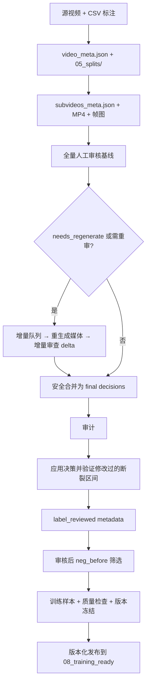

# 数据处理与训练运行手册

说明如何将源拉伸视频和人工标注转换为可安全用于训练的最终数据。所有命令从项目根目录执行。子视频生成、模型选帧、训练和完整评测在训练电脑执行；当前电脑只做检查、审核、整理和导出已同步的结果。

## 数据链



## 目录状态与消费边界

数据流程分为“处理工作区”和“已发布版本”两层。目录编号表示处理阶段，不代表目录中的
每个文件都可以直接训练。

| 目录 | 状态 | 谁写入 | 是否可直接训练/评估 |
| --- | --- | --- | --- |
| `data/03_subvideos/`–`data/05_splits/` | 生成与划分工作区 | 生成、划分脚本 | 否 |
| `data/06_merged/` | 待发布构建工作区 | 训练/测试样本生成脚本 | 否 |
| `data/07_metadata/` | 审核、检查、冻结过程证据 | 审核和质量门脚本 | 否 |
| `data/08_training_ready/<release_id>/` | 不可覆盖的已发布版本 | 仅 `publish_training_release.py` | 是，但必须是当前激活版本 |

必须明确以下行为：

- 步骤 1–7 **不会**生成或更新 `08_training_ready`。
- 只有步骤 8 的 `publish_training_release.py` 会创建新的 `08_training_ready/<release_id>`。
- 在新一轮数据仍处于步骤 1–7 时，训练和本地评估继续指向上一次激活的发布版本，不会
  误读尚未完成的 `06_merged`。
- `--activate` 只在发布成功后切换
  `finetune/dataset_info.json` 和 `finetune/active_data_release.json`。
- `scripts/clear_data_outputs.py` 不清理 `08_training_ready`；旧发布版本作为历史训练证据
  保留。

## 关键产物及其身份

| 文件 | 身份 | 用途 | 限制 |
| --- | --- | --- | --- |
| `data/07_metadata/subvideos_meta.label_reviewed.json` | 工作区权威审核基线 | 保存完整人工审核与标签修正结果 | 不能用原始或 `.reviewed.json` 替代 |
| `data/07_metadata/subvideos_meta.filtered_neg_before.label_reviewed.json` | 工作区发布输入 | 本轮筛选后的训练级 metadata | 不能手工删改；尚不能直接训练 |
| `data/06_merged/` | 工作区发布输入 | 六个 fold、两类测试文件和统计 | 不能作为训练或评估入口 |
| `data/07_metadata/quality_check_report.json` | 发布门证据 | 证明选定工作区通过质量检查 | `error_count` 必须为 0 |
| `data/07_metadata/data_version_lock.json` | 发布门证据 | 冻结输入、划分和样本清单哈希 | 冻结后不得再修改上游文件 |
| `data/08_training_ready/<release_id>/` | 最终交付物 | 分类后的训练、验证、评估、metadata 和 manifest | 不可覆盖；正式消费只读已激活版本 |

## 端到端执行顺序

| 步骤 | 产物 | 作用 | 下游输入 |
| --- | --- | --- | --- |
| 1 | `video_meta.json`、`data/05_splits/` | 规范源标签并冻结视频级划分 | 子视频生成、增量队列、区间验证 |
| 2 | `subvideos_meta.json`、MP4、帧图 | 建立模型输入与源视频帧的真实映射 | 人工审核、区间验证 |
| 3 | 基线审核决策 | 人工确认候选样本的可用性和标签 | 增量队列或最终合并 |
| 4 | 增量队列、重生成媒体、delta | 只处理未完成或冲突样本 | 安全合并 |
| 5 | `subvideo_train_review_decisions_final.json` | 固化最终人工决策 | 审计、应用决策 |
| 6 | `.reviewed.json`、`.label_reviewed.json`、筛选后 `.label_reviewed.json` | 应用标签、剔除不可验证区间并执行审核后样本缩减 | 训练样本导出 |
| 7 | `data/06_merged/`、`data_version_lock.json` | 输出待发布文件并冻结版本 | 训练数据发布 |
| 8 | `data/08_training_ready/<release_id>/` | 分类、校验并原子发布训练版本 | 训练与评测 |

命令中的默认输入/输出路径已写入脚本默认值，正常流程不需要重复传入。只有随复审轮次变化的中间产物需要指定 `--round round_XX`。

### 下一轮数据处理时的正常行为

1. 开始处理前记录 `finetune/active_data_release.json`；它是当前仍可训练的旧版本。
2. 按实际需要执行步骤 1–6。增量复审不应为图省事清空整个工作区。
3. 步骤 7 可以重建或覆盖 `06_merged` 和本轮 `07_metadata` 报告，但不会影响旧的
   `08_training_ready`。
4. 步骤 7 四个命令全部成功后，才能执行步骤 8。
5. 步骤 8 成功后会新增一个发布目录；带 `--activate` 时才把训练和评估切到新版本。
6. 新版本激活后再开始训练。不要在步骤 1–7 期间手工改
   `finetune/dataset_info.json` 指向工作区。

### 步骤 1：规范源标签并冻结划分

**输入**：`data/01_videos/`、`data/02_annotations/all_videos_tag.csv`。

```bash
python pipeline/scripts/dataset_manager.py \
  --csv data/02_annotations/all_videos_tag.csv \
  --video-dir data/01_videos \
  --metadata-dir data/07_metadata \
  --splits-dir data/05_splits \
  --seed 42
```

**输出**：

- `data/07_metadata/video_meta.json`
- `data/05_splits/*.json`
- `data/07_metadata/test_manifest_sha256.json`

**质量门**：一旦开始人工审核，不得重新运行此步骤来重分 split。

### 步骤 2：生成候选子视频、媒体和实际帧映射

小样本验证：

```bash
python pipeline/scripts/subvideo_builder.py \
  --model models/minicpmv4_5 \
  --sample-size 10 \
  --sample-output-dir data/sample_subvideos
```

确认无误后完整生成：

```bash
python pipeline/scripts/subvideo_builder.py --model models/minicpmv4_5
```

**输出**：

- `data/03_subvideos/`：子视频 MP4。
- `data/04_frames/`：实际抽帧图。
- `data/07_metadata/subvideos_meta.json`：候选标签、裁剪参数、split、处理器指纹和实际映射。

**质量门**：不要只同步 metadata 而遗漏 MP4 或帧图。没有实际媒体无法可信审核，也无法确认区间标签。

### 步骤 3：建立全量人工审核基线

```bash
streamlit run pipeline/scripts/review_subvideos_app.py -- \
  --metadata data/07_metadata/subvideos_meta.json \
  --output data/07_metadata/review_decisions/subvideo_train_review_decisions.json
```

审核人员为每个非 `neg_before` 子视频选择：

- `approved`：确认或修正标签和区间。
- `dropped`：该样本不进入训练，但记录保留。
- `needs_regenerate`：媒体或区间无法可靠判断，进入增量流程。

**输出**：`data/07_metadata/review_decisions/subvideo_train_review_decisions.json`。这是历史基线，增量轮次只能读取，不能覆盖。

### 步骤 4：仅对问题样本进行增量重审

以 `round_01` 为例。每轮使用独立的目录、队列、媒体、delta 和报告。

#### 4.1 建立只读增量队列

```bash
python pipeline/scripts/prepare_incremental_review_queue.py \
  --round round_01 \
  --include-approved-interval-conflicts
```

默认队列针对 `needs_regenerate`；`--include-approved-interval-conflicts` 额外纳入需复核的已批准区间。

#### 4.2 只为队列生成新媒体和映射

```bash
python pipeline/scripts/materialize_incremental_review_media.py \
  --round round_01 \
  --reasons baseline_needs_regenerate approved_interval_conflict
```

**输出**：版本化的 MP4/帧图、该轮实际映射 metadata 和生成报告。不得覆盖历史 `data/03_subvideos/` 或 `data/04_frames/`。

如果报告有生成失败项，不要对缺媒体样本启动 UI。要么在训练电脑修复并重生成，要么由数据负责人决定 `dropped`，并在 4.4 中写入 delta。

#### 4.3 审查增量媒体并输出 delta

```bash
streamlit run pipeline/scripts/review_subvideos_app.py -- \
  --metadata data/07_metadata/incremental_review/round_01/incremental_review_round_01_metadata.json \
  --incremental-delta \
  --output data/07_metadata/incremental_review/round_01/incremental_review_delta_decisions.json
```

增量模式只输出队列内样本的 delta，基线决策只读。不要把此输出写回历史完整决策文件。

#### 4.4 记录无法生成但已决定剔除的项目（按需）

```bash
python pipeline/scripts/append_incremental_failure_drops.py --round round_01
```

仅当生成失败且已确认剔除时执行。把失败原因写入 `dropped` delta，不覆盖基线。

#### 4.5 安全合并为最终决策

若执行过 4.4，使用 `*_resolved.json`；否则使用 UI 的 delta：

```bash
python pipeline/scripts/merge_incremental_review_decisions.py \
  --delta data/07_metadata/incremental_review/round_01/incremental_review_delta_decisions_resolved.json \
  --queue data/07_metadata/incremental_review/round_01/incremental_review_queue_metadata.json
```

默认不允许覆盖历史 `approved`。确实需要推翻已批准结论时，delta 必须有人工理由，并显式加入 `--allow-approved-supersede`。

### 步骤 5：审计最终人工决策

```bash
python pipeline/scripts/audit_review_decisions.py
```

**目的**：只读检查最终决策是否有重复 ID、非法状态、未审查项、关键标签异常、断裂区间修改和源时间/帧号不一致。

**输出**：默认写入 `data/07_metadata/final_review_audit/`：

- `review_decision_audit.json`：JSON 总报告。
- `review_decision_audit.md`：Markdown 摘要。
- `review_key_label_change_queue.csv`：关键标签变化。
- `review_fracture_interval_queue.csv`：断裂区间变化。
- `review_fracture_interval_source_queue.csv`：按源视频聚合的区间问题。
- `review_regeneration_queue.csv`：需重生成项。
- `review_source_time_frame_queue.csv`：时间/帧检查。

**处理结果**：

- 非法状态、未审查或 `needs_regenerate`：回到步骤 4。
- 人工改过的区间：步骤 6 会基于实际映射和可靠源事件帧自动决定保留或 `dropped`。
- 该审计不替代源视频像素级复核。若需确认真正首断帧，必须在训练电脑查看源视频并重新走增量流程。

### 步骤 6：生成唯一可训练的最终 metadata

#### 6.1 应用决策并验证人工修改的断裂区间

```bash
python pipeline/scripts/apply_review_decisions.py \
  --strict \
  --interval-verification-video-meta data/07_metadata/video_meta.json \
  --interval-mapping-override \
  data/07_metadata/incremental_review/round_01/incremental_review_round_01_metadata.json
```

做两件事：

1. 对 `approved` 样本应用人工标签和区间；`dropped` 保留为排除状态；`needs_regenerate` 或未审查样本在 `--strict` 下阻止输出。
2. 检查所有发生过变化的 `fracture_between`：最终区间覆盖可靠源事件帧则保持 `approved`；否则自动转为 `dropped`。

每个自动剔除项都带有 `interval_verification`，记录原区间、最终区间、映射来源、源视频帧边界、源事件帧和剔除原因。这是长期证据，不得删除。

**注意**：每一个有重生成媒体的 `round_XX` 都必须传入对应的 `--interval-mapping-override`。可重复传入多个轮次，后传入的同 ID 映射优先。

#### 6.2 输出训练级 metadata 和排除记录

```bash
python pipeline/scripts/apply_label_corrections.py
```

**结果**：

- `subvideos` 只保留 `approved` 样本，供训练导出使用。
- 所有 `dropped` 样本进入 `excluded_subvideos`。
- 因区间验证剔除的样本连同 `interval_verification` 一起进入 `excluded_subvideos`。

正式训练不得使用 `--no-strict`，也不得使用原始候选 metadata 或中间 `.reviewed.json` 替代 `.label_reviewed.json`。

#### 6.3 筛选审核后的 `neg_before` 样本

```bash
python pipeline/scripts/filter_reviewed_neg_before.py \
  --output-report data/07_metadata/filter_neg_before_dropped_report.json
```

正式输出为
`data/07_metadata/subvideos_meta.filtered_neg_before.label_reviewed.json`。report 只记录被删
样本，不能作为训练输入。该步骤必须在标签修正后执行，并保留原始
`subvideos_meta.label_reviewed.json` 作为审核基线。

### 步骤 7：导出训练数据、执行质量门并冻结版本

```bash
python pipeline/scripts/training_sample_builder.py \
  --subvideos-meta data/07_metadata/subvideos_meta.filtered_neg_before.label_reviewed.json
python scripts/validate_no_oob.py \
  --subvideos-meta data/07_metadata/subvideos_meta.filtered_neg_before.label_reviewed.json
python pipeline/scripts/quality_check.py \
  --subvideos-meta data/07_metadata/subvideos_meta.filtered_neg_before.label_reviewed.json
python pipeline/scripts/freeze_data_version.py \
  --subvideos-meta data/07_metadata/subvideos_meta.filtered_neg_before.label_reviewed.json
```

四个门分别检查：

1. `training_sample_builder.py`：从唯一训练级 metadata 生成各 fold 样本。
2. `validate_no_oob.py`：区间索引不越界，映射字段可用。
3. `quality_check.py`：检查媒体路径、审核状态、映射、标签和排除记录。
4. `freeze_data_version.py`：写入数据版本锁，记录输入与产物的一致性。

任一步失败都不能发布。修复后从失败步骤的上游重新执行，避免使用部分覆盖的
`data/06_merged/`。

**此时不会出现新的 `data/08_training_ready/<release_id>/`。** 质量检查通过和版本
冻结只说明工作区具备发布资格，不能省略步骤 8，也不能直接启动训练。

### 步骤 8：发布并激活唯一训练版本

**输入**：

- `data/06_merged/`
- `data/07_metadata/subvideos_meta.filtered_neg_before.label_reviewed.json`
- `data/07_metadata/quality_check_report.json`
- `data/07_metadata/data_version_lock.json`

```bash
python pipeline/scripts/publish_training_release.py --activate
```

**输出**：

- 新目录 `data/08_training_ready/<release_id>/`
- 更新后的 `finetune/dataset_info.json`
- 更新后的 `finetune/active_data_release.json`

默认版本名由 `data_version_lock.json` 的版本号和样本清单 SHA-256 前八位组成，例如
`v2.0.0-1dab1e5e`。发布器会：

1. 确认质量报告 `error_count == 0`。
2. 确认质量报告对应当前选择的 `06_merged` 和正式训练 metadata。
3. 确认 `data/06_merged/` 与版本锁中的样本哈希一致。
4. 要求六个 fold 文件完整，并要求每组评估输入和真值成对存在。
5. 将最终文件分类复制到临时目录、逐文件校验 SHA-256，再原子改名。
6. 拒绝覆盖同名版本；`--activate` 同步更新训练注册表和本地评估版本指针。

发布目录的分类如下：

```text
data/08_training_ready/<release_id>/
├── datasets/train/            正式训练集
├── datasets/validation/       正式验证集
├── datasets/evaluation/       独立评估输入与真值
├── metadata/                  训练使用的唯一正式 metadata
├── reports/                   样本统计与质量报告
└── manifest/                  版本锁与逐文件用途/hash 清单
```

发布时的固定映射如下：

| 工作区来源 | 发布后路径 | 正式用途 |
| --- | --- | --- |
| `06_merged/fold_N_train.json` | `datasets/train/fold_N.json` | fold N 训练 |
| `06_merged/fold_N_val.json` | `datasets/validation/fold_N.json` | fold N 训练期验证和独立复核 |
| `06_merged/test_inputs.json` | `datasets/evaluation/source_videos/inputs.json` | 源视频测试输入 |
| `06_merged/test_ground_truth.json` | `datasets/evaluation/source_videos/ground_truth.json` | 源视频测试真值 |
| `06_merged/test_subvideo_inputs.json` | `datasets/evaluation/subvideos/inputs.json` | 子视频测试输入 |
| `06_merged/test_subvideo_ground_truth.json` | `datasets/evaluation/subvideos/ground_truth.json` | 子视频测试真值 |
| `07_metadata/subvideos_meta.filtered_neg_before.label_reviewed.json` | `metadata/training_subvideos.json` | 发布版本的训练 metadata 与追溯证据 |
| `06_merged/samples_meta.json` | `reports/sample_statistics.json` | 样本数量和分布统计 |
| `07_metadata/quality_check_report.json` | `reports/quality_check.json` | 发布时质量门结果 |
| `07_metadata/data_version_lock.json` | `manifest/data_version_lock.json` | 上游冻结证据 |
| 发布脚本生成 | `manifest/release_manifest.json` | 文件用途、来源、大小与 SHA-256 |

`data/06_merged/` 和 `data/07_metadata/` 保留为处理工作区与过程证据，不移动、不删除。
当前激活版本记录在 `finetune/active_data_release.json`。

#### 发布后的确认

```bash
cat finetune/active_data_release.json
python -m json.tool \
  data/08_training_ready/<release_id>/manifest/release_manifest.json
```

确认以下项目后才能训练：

- `active_data_release.json` 中的 `release_id` 是本轮新版本。
- manifest 的 `status` 为 `training_ready`、`immutable` 为 `true`。
- manifest 的 `quality.error_count` 为 `0`。
- `finetune/dataset_info.json` 六个数据集均指向同一个新版本目录。

#### 重复版本和失败恢复

- 若提示“release already exists”，表示默认 `release_id` 已存在。通常说明训练样本没有
  变化，应停止并检查 `data_version_lock.json`，不要删除旧版本或强制覆盖。
- 如果确有意发布一个样本哈希相同、但评估或正式 metadata 有计划变更的版本，可在确认
  原因后显式使用 `--release-id <有意义的新版本名>`；仍然不能覆盖已有目录。
- 如果目录已经发布成功，但 `--activate` 阶段失败，修复配置问题后单独激活：

```bash
python pipeline/scripts/publish_training_release.py \
  --activate-existing <release_id>
```

- 如需临时回退到历史发布版本，也使用 `--activate-existing <旧 release_id>`，不复制、
  不修改该版本中的文件。

## 训练与验收边界

只有步骤 8 发布并激活成功后，才能在训练电脑运行三个 fold：

```bash
cd finetune
python train_with_contract.py MiniCPM/config/minicpmv4_5_lora_sft_interval_fold0.yaml
python train_with_contract.py MiniCPM/config/minicpmv4_5_lora_sft_interval_fold1.yaml
python train_with_contract.py MiniCPM/config/minicpmv4_5_lora_sft_interval_fold2.yaml
```

训练 loss 下降只说明训练目标收敛，不能单独证明断裂任务效果。实际验收必须使用训练电脑同步的预测、指标和 checkpoint/adapter 链路，至少检查：JSON/schema 合法率、`has_fracture`、type/location、interval/time 命中率、joint success，以及成功和失败预测样例。

## 不可绕过的规则

- 不要在人工审核后重新运行 `dataset_manager.py` 来重新划分当前数据集。
- 不要让增量 UI 覆盖历史完整决策文件；它只能写 delta。
- 不要把 `needs_regenerate`、未审查、缺媒体或 `dropped` 样本带入训练。
- 对重生成媒体不要省略 `--interval-verification-video-meta` 和对应 `--interval-mapping-override`。
- 不要把被 `interval_verification` 转为 `dropped` 的样本重新塞回训练。若要恢复，先在源视频确认事件帧，再重新生成、增量审核和合并。
- 不要用源视频旧标签静默覆盖人工确认过的普通标签。
- 不要让训练或评估直接读取 `data/06_merged/`。
- 不要手工覆盖或修改 `data/08_training_ready/<release_id>/` 中的文件。
- 不要在步骤 7 未全部通过时运行发布脚本，也不要省略 `--activate` 后的版本确认。
