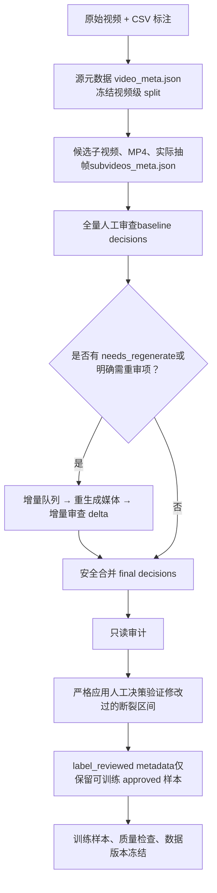

# 数据处理与训练运行手册

本手册说明如何把原始拉伸视频和人工标注，转换为可安全用于模型训练的最终数据。所有命令从项目根目录执行。子视频生成、模型选帧、训练和完整评测必须在训练电脑执行；当前电脑只用于检查、审查、整理和导出已同步的结果。

## 1. 整条数据链

最终训练数据不是直接由原始 CSV 导出。它经过“源标签规范化—视频级划分—子视频和实际帧生成—人工审核—增量重审—最终标签验证—训练样本导出”几层处理。每层都解决一个不同的问题，并留下对应的可追溯文件。



这条链最终要交付的不是某个中间 JSON，而是以下三类结果：

| 最终结果                                                  | 用途                                | 不能用什么替代                                                 |
| ----------------------------------------------------- | --------------------------------- | ------------------------------------------------------- |
| `data/07_metadata/subvideos_meta.label_reviewed.json` | 唯一允许输入训练样本导出的子视频 metadata         | 不能用原始 `subvideos_meta.json` 或仅应用审核的 `.reviewed.json` 替代 |
| `data/06_merged/`                                     | 各 fold 的训练/验证 ShareGPT 样本、测试输入和统计 | 不能手工拼接或混用旧版本样本                                          |
| `data/07_metadata/data_version_lock.json`             | 冻结本次训练数据的文件、划分和版本证据               | 不能在训练后静默修改其上游输入                                         |

### 1.1 每一层解决什么问题

1. **源元数据与划分**：把 CSV 中的断裂时间、帧号、类型和位置规范化，同时按原视频冻结 train/val/test，避免同一原视频的不同子视频泄漏到不同集合。
2. **候选子视频与实际帧**：生成模型真正会看到的 MP4 和抽帧，并以 `actual_frame_mapping` 记录每个采样索引对应的原视频帧。`fracture_between` 只对这份映射有效。
3. **人工基线审查**：人工判断子视频是否可用，并修正普通标签和区间标签。`approved`、`dropped`、`needs_regenerate` 是此时的业务状态。
4. **增量重审**：只重新生成或复核有问题的子视频，历史基线保持不变；新增结论以 delta 的形式保存并安全合并。
5. **最终区间验证**：普通人工标签直接进入后续流程；但人工改过的 `fracture_between` 必须能借助实际帧映射覆盖可靠的源事件帧，否则样本改为 `dropped`。这避免不同子视频映射到互相矛盾的真实断裂时刻。
6. **训练导出与冻结**：只把通过上述门槛的 `approved` 样本导出为训练数据，再进行越界、路径、状态和版本检查。

## 2. 端到端执行顺序

下表是日常执行时应遵循的顺序。首次建库执行第 1–3 步；已有人工基线时从第 4 步开始；只有完成第 7 步后才能训练。

| 步骤 | 产生什么                                         | 为什么需要它             | 下一步读取它          |
| -- | -------------------------------------------- | ------------------ | --------------- |
| 1  | `video_meta.json`、`data/05_splits/`          | 规范源标签并冻结视频级划分      | 子视频生成、增量队列、区间验证 |
| 2  | `subvideos_meta.json`、MP4、帧图                 | 建立模型输入与原视频帧之间的真实映射 | 人工审查、区间验证       |
| 3  | 基线审查决策                                       | 人工决定候选样本的可用性和标签    | 增量队列或最终合并       |
| 4  | 增量队列、重生成媒体、delta                             | 只处理未完成或冲突样本        | 安全合并            |
| 5  | `subvideo_train_review_decisions_final.json` | 固化两轮及后续轮次的最终人工决策   | 审计、严格应用决策       |
| 6  | `.reviewed.json`、`.label_reviewed.json`      | 应用人工标签并剔除不可验证的修改区间 | 训练样本导出          |
| 7  | `data/06_merged/`、`data_version_lock.json`   | 输出训练文件并冻结可复现版本     | 训练与评测           |

### 命令参数约定

固定的 `data/07_metadata` 输入和最终输出已经写入脚本默认值，因此在正常流程中不需要重复传入 `--metadata`、`--decisions`、`--video-meta`、`--output` 等稳定路径。只有会随着复审轮次变化的中间产物需要明确选择：增量准备、重生成媒体和失败追加使用 `--round round_XX`；最终应用决策时，对实际重生成过的轮次传入对应的 `--interval-mapping-override`。如需临时调试或迁移目录，仍可显式覆盖默认参数。

## 3. 按顺序执行的脚本说明

### 步骤 1：规范源标签并冻结划分

**输入**：`data/01_videos/`、`data/02_annotations/all_videos_tag.csv`。

```bash
python pipeline/scripts/dataset_manager.py \
  --csv data/02_annotations/all_videos_tag.csv \
  --video-dir data/01_videos \
  --metadata-dir data/07_metadata \
  --splits-dir data/05_splits \
  --seed 42
```

**核心逻辑**：CSV 中的时间、帧号、类型和位置被规范化为 `video_meta.json`；划分按源视频完成，而不是按子视频完成。

**输出**：

- `data/07_metadata/video_meta.json`
- `data/05_splits/*.json`
- `data/07_metadata/test_manifest_sha256.json`

**质量门**：一旦开始人工审查，不得重新执行此步骤来重分 split。后续源标签问题可以用于重生成媒体或追溯，但不得导致已冻结的视频级划分变化。

### 步骤 2：生成候选子视频、媒体和实际帧映射

先在训练电脑运行小样本烟雾测试：

```bash
python pipeline/scripts/subvideo_builder.py \
  --model models/minicpmv4_5 \
  --sample-size 10 \
  --sample-output-dir data/sample_subvideos
```

确认 MP4、帧图和 sample manifest 正确后，再完整生成：

```bash
python pipeline/scripts/subvideo_builder.py \
  --model models/minicpmv4_5
```

**核心逻辑**：脚本裁剪 full/focus/负样本窗口，并保存模型处理器实际抽出的帧。`actual_frame_mapping` 中的每项记录“采样索引 → 子视频帧 → 原视频帧/时间”；训练、审核和断裂区间验证必须使用同一份映射。

**输出**：

- `data/03_subvideos/`：实际子视频 MP4。
- `data/04_frames/`：实际抽帧图。
- `data/07_metadata/subvideos_meta.json`：候选标签、裁剪参数、split、处理器指纹和实际映射。

**质量门**：不要只同步 metadata 而遗漏 MP4 或帧图；没有实际媒体就无法可信地人工审核，也不能确认区间标签。

### 步骤 3：建立全量人工审查基线

```bash
streamlit run pipeline/scripts/review_subvideos_app.py -- \
  --metadata data/07_metadata/subvideos_meta.json \
  --output data/07_metadata/review_decisions/subvideo_train_review_decisions.json
```

审核人员为每个非 `neg_before` 子视频选择：

- `approved`：确认或修正 `has_fracture`、`type`、`location`、`fracture_between`。
- `dropped`：该样本永不进入训练，但记录保留。
- `needs_regenerate`：当前媒体或区间无法可靠判断，必须进入下一步的增量流程。

**输出**：`data/07_metadata/review_decisions/subvideo_train_review_decisions.json`。这是历史基线，增量轮次只能读取它，不能用新的 UI 输出覆盖它。

### 步骤 4：仅对问题样本进行增量重审

此步骤的目标是避免重做全部 approved 样本。每轮使用新的 `round_XX` 目录、队列、媒体、delta 和报告；以下以 `round_01` 为例。

#### 4.1 建立只读增量队列

```bash
python pipeline/scripts/prepare_incremental_review_queue.py \
  --round round_01 \
  --include-approved-interval-conflicts
```

默认队列针对 `needs_regenerate`；`--include-approved-interval-conflicts` 额外纳入明确需要复核的已批准区间。该脚本不改历史决策、不改 split、不生成媒体。

#### 4.2 只为队列生成新的媒体和映射

```bash
python pipeline/scripts/materialize_incremental_review_media.py \
  --round round_01 \
  --reasons baseline_needs_regenerate approved_interval_conflict
```

**输出**：版本化的 MP4/帧图、该轮实际映射 metadata 和生成报告。不得覆盖历史 `data/03_subvideos/` 或 `data/04_frames/`。

如果报告有生成失败项，不要对缺媒体样本启动 UI。要么在训练电脑修复并重生成，要么由数据负责人明确决定 `dropped`，并在 4.4 中写入 delta。

#### 4.3 审查增量媒体并输出 delta

```bash
streamlit run pipeline/scripts/review_subvideos_app.py -- \
  --metadata data/07_metadata/incremental_review/round_01/incremental_review_round_01_metadata.json \
  --incremental-delta \
  --output data/07_metadata/incremental_review/round_01/incremental_review_delta_decisions.json
```

增量模式只输出队列内样本的 delta，并带有基线决策作为只读上下文。不要把此输出写回历史完整决策文件。

#### 4.4 记录无法生成但已决定剔除的项目（按需）

```bash
python pipeline/scripts/append_incremental_failure_drops.py \
  --round round_01
```

仅当生成失败且已确认剔除时执行。它把失败原因写入 `dropped` delta，而不覆盖基线。

#### 4.5 安全合并为最终决策

若执行过 4.4，使用 `*_resolved.json`；否则使用 UI 的 delta：

```bash
python pipeline/scripts/merge_incremental_review_decisions.py \
  --delta data/07_metadata/incremental_review/round_01/incremental_review_delta_decisions_resolved.json \
  --queue data/07_metadata/incremental_review/round_01/incremental_review_queue_metadata.json
```

默认不允许覆盖历史 `approved`。确实需要推翻已批准结论时，delta 必须有人工理由，并显式加入 `--allow-approved-supersede`。输出的 final decisions 是后续所有质量门唯一读取的人工决策。

### 步骤 5：审计最终人工决策

```bash
python pipeline/scripts/audit_review_decisions.py
```

**目的**：只读检查最终决策是否有重复 ID、非法状态、未审查项、关键标签异常、断裂区间修改和源时间/帧号不一致。

**输出**：JSON 总报告、Markdown 摘要和多张 CSV 队列（关键标签变化、断裂区间变化、按源视频聚合的区间问题、需重生成项、时间/帧检查）。

**如何处理结果**：

- 非法状态、未审查或 `needs_regenerate`：回到步骤 4，完成重生成和复审。
- 人工改过的区间：不需要在此阶段手工猜测是否应保留；步骤 6 会基于实际映射和可靠源事件帧自动决定保留或 `dropped`，并留下证据。
- 该审计不替代原视频像素级复核。若需确认真正首断帧，必须在训练电脑查看原视频，并重新走增量流程。

### 步骤 6：生成唯一可训练的最终 metadata

本步骤有两个串行脚本：先严格应用决策并验证人工修改过的断裂区间，再把 `dropped` 样本移入排除记录并输出训练 metadata。

#### 6.1 应用决策并验证人工修改的断裂区间

```bash
python pipeline/scripts/apply_review_decisions.py \
  --interval-mapping-override \
    data/07_metadata/incremental_review/round_01/incremental_review_round_01_metadata.json
```

**这个命令做两件事**：

1. 对 `approved` 样本应用人工普通标签和人工区间；`dropped` 保留为排除状态；`needs_regenerate` 或未审查样本在 `--strict` 下阻止输出。
2. 检查所有跨基线/增量轮次发生过变化的 `fracture_between`：
   - 最终区间借助当前或重生成后的 `actual_frame_mapping` 覆盖可靠的 `event_frame_effective` → 保持 `approved`；
   - 最终区间为空、映射缺失/越界、源事件不可靠/缺失、或不覆盖源事件帧 → 自动转为 `dropped`。

每个自动剔除项都带有 `interval_verification`，包括原区间、最终区间、映射来源、原视频帧边界、源事件帧和剔除原因。它是审查初始帧标注、子视频裁剪和实际抽帧流程的长期证据，不得删除。

**重生成媒体特别注意**：每一个有重生成媒体的 `round_XX` 都必须传入相应的 `--interval-mapping-override`。可重复传入多个轮次；后传入的同 ID 映射优先。遗漏该参数会使验证误用历史映射。

#### 6.2 输出训练级 metadata 和排除记录

```bash
python pipeline/scripts/apply_label_corrections.py
```

**结果**：

- `subvideos` 只保留 `approved` 样本，供训练导出使用；
- 所有 `dropped` 样本进入 `excluded_subvideos`；
- 因区间验证而剔除的样本会连同 `interval_verification` 一起进入 `excluded_subvideos`，因此样本不进训练，但问题证据完整保留。

正式训练不得使用 `--no-strict`，也不得使用原始候选 metadata 或中间 `.reviewed.json` 替代 `.label_reviewed.json`。

### 步骤 7：导出训练数据、执行质量门并冻结版本

```bash
python scripts/validate_no_oob.py
python pipeline/scripts/training_sample_builder.py
python pipeline/scripts/quality_check.py
python pipeline/scripts/freeze_data_version.py
```

四个门分别检查：

1. `validate_no_oob.py`：区间索引不越界，映射字段可用；
2. `training_sample_builder.py`：从唯一训练级 metadata 生成各 fold 样本；
3. `quality_check.py`：检查媒体路径、审核状态、映射、标签和排除记录；
4. `freeze_data_version.py`：写入本轮训练的数据版本锁，记录输入与产物的一致性。

任一步失败都不能开始训练。修复后从失败步骤的上游重新执行，避免使用部分覆盖的 `data/06_merged/`。

## 4. 训练与验收边界

只有步骤 7 全部成功后，才能在训练电脑运行三个 fold 的训练配置：

```bash
cd finetune
python train_with_contract.py MiniCPM/config/minicpmv4_5_lora_sft_interval_fold0.yaml
python train_with_contract.py MiniCPM/config/minicpmv4_5_lora_sft_interval_fold1.yaml
python train_with_contract.py MiniCPM/config/minicpmv4_5_lora_sft_interval_fold2.yaml
```

训练 loss 下降只能说明训练目标在收敛，不能单独证明断裂任务效果。实际验收必须使用训练电脑同步的预测、指标和 checkpoint/adapter 链路，至少检查：JSON/schema 合法率、`has_fracture`、type/location、interval/time 命中率、joint success，以及成功和失败预测样例。

## 5. 不可绕过的规则

- 不要在人工审查后重新运行 `dataset_manager.py` 来重新划分当前数据集。
- 不要让增量 UI 覆盖历史完整决策文件；它只能写 delta。
- 不要把 `needs_regenerate`、未审查、缺媒体或 `dropped` 样本带入训练。
- 不要省略 `--interval-verification-video-meta`；对重生成媒体不要省略对应 `--interval-mapping-override`。
- 不要把被 `interval_verification` 转为 `dropped` 的样本重新塞回训练。若要恢复，先在原视频确认事件帧，再重新生成、增量审查和合并。
- 不要用源视频旧标签静默覆盖人工确认过的普通标签。
