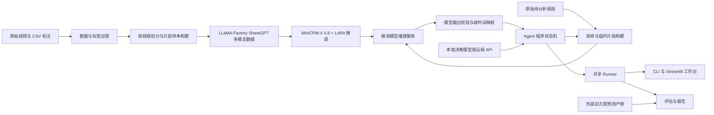

# 材料拉伸断裂识别 Agent 项目计划

> 状态：已批准
> 版本：7

## 项目目标

本项目面向 Agent 竞赛和材料拉伸视频研究，建设一套可重复运行、可展示分析过程的断裂识别系统。系统通过微调 MiniCPM-V 4.6 判断视频片段中是否发生断裂，再由使用通用大模型的 Agent 多轮选择检查范围、核验结果并缩小断裂时间区间，最终给出明确结果或诚实地表示无法辨认。

主要使用者是竞赛评委和项目研究人员。项目优先保证判断过程可追踪、结果可复现、不同方案可公平比较，不要求实时运行、工业部署或多人在线服务。

`docs/PROJECT_PLAN.md` 是项目当前设计的唯一权威来源。项目级方向、边界、契约和验收规则在本文维护；每个核心步骤的具体设计、执行清单和验证方法在独立实施方案中维护。Agent 只有在项目计划和对应实施方案均已批准且版本一致时才能修改代码或数据流程。

## 需求与范围

MVP 包含六项能力：建立可复现的数据基础；完成 MiniCPM-V 4.6 的 interval 微调；提供单次模型判断；实现多轮 Agent；提供单视频和批量运行入口及本地可视化工作台；在统一测试清单上完成单次模型、完整 Agent 和外部旧方案的比较。

微调模型负责判断当前视频片段是否包含断裂，并输出 `has_fracture`、`fracture_between`、`type`、`location` 和 `confidence`。`has_fracture` 可以为 `true`、`false` 或 `null`：`null` 只表示视频异常导致无法确定是否断裂。模型判断为七种正常断裂模式之一且能够定位时，`has_fracture=true`，`fracture_between` 只能是严格相邻且未越界的 `[i, i+1]`；不再接受 `[0,0]`、`[N-1,N-1]` 或其他边界哨兵。确认当前片段未断裂时，`has_fracture=false`、`type=未断裂`，`fracture_between` 和 `location` 为 `null`。模型另保留 `未夹紧` 和 `视频异常` 两类无法可靠分析的结果。

Agent 对外结果使用三个简洁状态：

- `fracture`：已可靠确认发生断裂，输出宽度不超过 1 秒的断裂时间区间、断裂模式、位置和置信度。
- `no_fracture`：经过完整覆盖检查后可靠确认未发生断裂，不输出断裂时间区间或位置。
- `unrecognized`：由于视频异常、未夹紧、结果持续冲突、连续非法输出、置信度不足或达到检查上限而无法形成可靠结论，不得伪装成 `fracture` 或 `no_fracture`。

确认断裂时，位置使用 `inside_gauge`、`outside_gauge` 或 `unknown`；`unknown` 表示已经确认发生断裂，但无法可靠判断断裂位置。对外结果不提供估计时刻和帧区间。采样帧映射、帧区间和根据时间区间派生的中点只作为内部诊断或评估数据保留，不得成为面向用户的权威结论。

每个视频只定位 CSV 标注对应的一个主要断裂事件。MVP 不包含多个断裂事件识别、新视频采集和人工标注、在线标注工具、实时推理、工业部署、多人服务或多种多模态基础模型适配。自适应抽帧可以作为基础方案完成后的效果优化，但不是 MVP 验收前提。

旧直接预测方案由另一个项目维护，不在本项目中保留其训练流程、数据产物或运行依赖。本项目只接收旧项目基于指定测试清单生成的版本化预测产物，并负责与单次模型和完整 Agent 生成统一对比报告。

## 技术方案

### 系统框架与信息流

项目由数据与标签治理、微调数据构建、模型微调、模型推理服务、Agent 工具执行层、Agent 决策循环、统一运行入口、可视化工作台和评估模块组成。各层只承担自己的职责，不能绕过接口直接读取其他层的内部数据。

数据构建阶段可以读取 CSV 真值并生成监督答案；模型推理服务、Agent 和普通分析界面不得读取 CSV 真值。评估模块在所有方案完成预测后单独读取真值。共享 Runner 只编排已经定义的模型服务、工具执行层和 Agent，不复制模型判断或状态机逻辑。

### 文档与设计治理

本文批准后，现有三份架构设计文档转为历史资料并归档，不再作为当前实现依据。归档前先识别其中仍有价值的接口细节、伪代码、配置说明和验证方法，并在后续实施设计中逐项吸收。任何改变项目目标、范围、公共契约、核心流程或验收标准的修改都必须先提升项目计划版本并重新批准；实现层发现计划不可行时必须停止施工并返回项目设计阶段。

### 数据与标签治理

数据以现有 110 个视频及 CSV 标注为依据，包括 88 个确认断裂、7 个确认未断裂、1 个未夹紧和 14 个视频异常。14 个视频异常又分为两组：7 个无法确定是否断裂，7 个确认发生断裂但断裂时间不可靠。CSV 原字段保持只读，训练时实际采用的标签通过 `has_fracture_canonical`、`location_canonical`、`is_label_conflict`、`label_governance_reason` 等派生字段表达；这里的 `canonical` 仅表示“处理冲突后供训练使用的值”。CSV 中 `is_abnormal=TRUE` 是旧的粗粒度标记，不能覆盖更具体的 `未断裂`、`未夹紧` 或 `视频异常` 类型。领域参考资料用于解释视觉现象，不能覆盖 CSV 或代码闭集。

划分以原视频为最小单位并使用固定随机种子。原视频数量不超过两条的断裂类别只进入训练，不进入验证和最终测试；其余视频先划出约 20% 的独立测试集，剩余视频进行三折训练和验证。一个原视频生成的全部片段必须位于同一集合。测试推理输入不得包含断裂时间、模式、位置、答案或根据真实断裂位置生成的片段；评分程序只在预测完成后读取真值。

训练样本覆盖完整视频、不同长度的断裂附近片段、不包含断裂的片段、未断裂视频、未夹紧视频和视频异常。只有确认断裂且断裂时间可靠的视频可以生成带 `fracture_between` 的正样本。两组视频异常都只生成完整视频样本：无法确定是否断裂的样本使用 `has_fracture=null`；确认断裂但时间不可靠的样本使用 `has_fracture=true`，但 `fracture_between=null`。CSV 中已有但被标记为不可靠的事件时间和帧号只用于追溯，不进入精确区间监督。训练和推理都向 MiniCPM-V 4.6 提供连续的完整视频或连续子视频，由模型自身的视频处理器在完整时间轴上均匀抽取最多 8 帧；项目不在模型处理器之外预先选帧或规定采样 FPS。数据构建必须取得同一处理器实际选择的帧索引，并保存到原视频帧号和时间戳的映射。训练与推理的处理器版本、最大帧数和抽帧语义不一致时，相关样本和定位结果不得使用。

### 模型微调框架与数据接口

MiniCPM-V 4.6 通过 LLaMA-Factory 的监督微调流程和 LoRA 适配器训练。微调数据采用 ShareGPT 多模态结构：`messages` 按顺序包含固定 system prompt、描述当前视频片段任务的 user prompt 和模型应学习的 assistant JSON；`videos` 指向与该轮对话严格对应的一个视频文件。user prompt 必须包含一个 `<video>` 视觉标记，训练和推理使用相同的 system prompt、字段语义和视频采样口径。

assistant JSON 只包含模型在推理时能够从当前视频片段产生的五个字段：

| 字段 | 类型 | 模型职责与约束 |
|---|---|---|
| `has_fracture` | boolean / `null` | `true` 表示确认发生断裂，`false` 表示当前片段未断裂或未夹紧，`null` 表示视频异常且无法确定是否断裂；不代表整个 Agent 的最终结论 |
| `fracture_between` | `[int, int]` / `null` | 七种正常断裂模式且时间可定位时必须为实际输入采样帧中的严格相邻索引 `[i, i+1]`；未断裂、未夹紧或视频异常时为 `null` |
| `type` | string | 正常断裂时为七种断裂模式之一；其他情况为 `未断裂`、`未夹紧` 或 `视频异常` |
| `location` | string / `null` | 七种正常断裂模式时为 `inside_gauge` 或 `outside_gauge`；未断裂、未夹紧或视频异常时为 `null` |
| `confidence` | float | 范围为 `[0.0, 1.0]`；训练答案使用 `1.0` 表示监督标签确定，不能据此认为推理置信度已经校准 |

七种断裂模式闭集为 `韧性断裂`、`脆性断裂`、`界面脱粘`、`齐根断裂`、`爆炸性断裂`、`半脆半韧断裂` 和 `界面脱粘、齐根断裂`。组合标签是独立类别，不能拆分或与单一类别合并。

对确认断裂且断裂时间可靠的视频，CSV 的 `event_frame_original` 表示第一张已经出现断裂的原视频帧。包含断裂的训练样本必须找到两张实际采样帧满足 `sampled_frame[i] < event_frame_original <= sampled_frame[i+1]`，并将答案标记为 `[i,i+1]`；因此当断裂帧恰好等于第 `k` 张采样帧时使用 `[k-1,k]`。如果当前片段和采样结果不能用两张帧包围断裂时刻，必须调整片段重新生成；仍无法满足时排除该样本并记录原因，不能用首尾相邻帧强行代替真实边界。确认断裂但时间不可靠的视频异常样本不适用此规则。

模型答案不得包含原视频真实断裂时间、原视频帧号、父视频断裂模式、父视频位置、Agent 候选范围或最终状态。用于追踪样本来源的 `source_video`、`source_type`、`source_location`、实际采样帧映射和治理原因保存在样本顶层 metadata，不进入 assistant JSON。一个不包含断裂的片段即使来自发生过断裂的父视频，其 assistant JSON 仍描述当前片段，父视频信息只能保留在 metadata。

LLaMA-Factory 负责加载视频和对话样本、应用 MiniCPM-V 模板并训练 LoRA 适配器。训练产物由统一模型推理适配器加载并暴露给 Agent；训练脚本、独立模型验证和 Agent 推理必须复用同一份模型输出契约，不能各自维护不兼容的字段定义。

### 模型与 Agent

多模态模型固定使用 MiniCPM-V 4.6，通过 LLaMA-Factory 和 LoRA 完成微调。模型只判断当前片段的视觉内容；索引校验、帧到时间的换算、媒体范围检查和最终结果一致性由程序完成，不能交给大模型自行计算。

微调后的视觉模型必须先部署为独立的 OpenAI-compatible HTTP 推理服务，Agent Runtime 不直接加载模型权重。服务可以运行在 Agent 所在机器的本机地址，也可以运行在独立 GPU 机器的远程地址；Agent 通过统一 `InferenceClient` 配置服务地址、模型标识和访问凭据。Agent 每轮向服务提交当前临时视频片段和 prompt，服务只返回五字段模型 JSON。模型服务的健康状态、基础模型、LoRA 或合并模型版本必须进入内部运行记录，保证结果可追溯。

视频片段统一通过 HTTP 请求传输。`InferenceClient` 读取临时视频并编码为 Base64 `data:video/...` 内容，不向模型服务发送本地绝对路径，也不要求 Agent 与模型服务共享文件系统。具体请求格式、大小限制、超时、重试和服务启动命令由模型—Agent 接口实施方案确定，不得泄漏到 Agent 状态机或 UI 业务逻辑中。

Agent 使用 Native Function Calling，不引入 MCP。负责多轮决策的决策模型同时提供本地模型和远程 API 两种并列实现，两者共享完全相同的工具契约、上下文格式、状态机、程序级约束和最终输出结构，通过配置切换，并分别完成测试和演示。

决策模型在 Agent 创建时接收固定的 Agent system prompt，其中定义角色、目标、工具能力、最终结果门槛和必须遵守的安全约束。微调视觉模型继续使用与训练一致的独立 system prompt。每轮检查的 user prompt 由决策模型根据当前候选范围、历史结果和本轮目的动态构建，程序不替决策模型决定分析措辞。

`sample_and_infer` 接收决策模型选择的 `sample_range` 和动态构建的 `prompt`。程序从原视频裁剪该范围对应的连续临时视频，通过 HTTP 调用微调视觉模型；MiniCPM-V 4.6 的视频处理器负责在该连续区间内均匀抽取最多 8 帧，短区间允许少于 8 帧。最大帧数和 FPS 均不作为决策模型可选参数，项目也不设置额外采样 FPS。工具必须取得模型处理器本轮实际选择的帧索引，并保存每个输入帧到原视频帧号和时间戳的精确映射。

训练和推理必须把 MiniCPM-V 4.6 实际视频处理器的最大帧数设置为 8，不能只依据 LLaMA-Factory 外层 `video_maxlen` 配置推定已经生效。项目不覆盖处理器的 FPS；短视频实际少于 8 帧时接受处理器结果。启动训练或模型服务前必须检查实际子处理器参数，并用真实处理器验证不同长度视频的抽帧数量、顺序和时间映射。运行记录保存模型、Transformers、LLaMA-Factory 和处理器版本、实际最大帧数及本轮抽帧元数据；无法取得实际映射、参数未生效或训练与推理结果不一致时中止。程序同时负责拒绝越界范围和不完整输入，严格校验五字段输出并把实际采样帧索引映射为时间区间。决策模型读取结构化工具结果后，在断裂定位路径上自主决定继续收紧、扩大范围、检查其他区间或请求结束；完整视频首轮未发现断裂时，后续完整覆盖检查按下述固定流程执行。

Agent 首先检查完整视频。若模型判断发生断裂，程序以模型返回的相邻帧时间范围为候选范围继续检查；只有至少两次局部检查都判断发生断裂、所引用证据区间具有非空共同交集且交集宽度不超过 1 秒，才能输出 `fracture`。公共时间区间由程序计算为这些证据区间的共同交集，决策模型不能自行填写。断裂模式和位置通过多轮结果聚合；位置无法可靠统一时输出 `unknown`，但模式或位置冲突不能单独推翻已经满足时间确认门槛的断裂结论。

若完整视频首次返回 `未断裂`，程序不允许直接结束，也不让决策模型选择后续检查区间和顺序，而是立即按固定顺序检查五个重叠区间。设视频总时长为 `D`，每个区间长度为 `D/4`，起点依次为 `0`、`3D/16`、`6D/16`、`9D/16` 和 `12D/16`；相邻区间重叠 `D/16`，即单个区间长度的 25%，五个区间共同覆盖 `[0,D]`。决策模型仍为每个区间构建 prompt 并读取结果；任一区间发现正常断裂时立即转入断裂定位路径。只有五个区间均得到达到要求置信度的合法 `未断裂` 结果，才允许输出 `no_fracture`。首次出现 `未夹紧` 或任一种 `视频异常` 时必须在同一区间复查一次；两次一致才输出对应的 `unrecognized`，不一致则进入冲突处理。置信度不足的范围必须复查，持续冲突、连续解析失败或达到检查上限时输出对应的 `unrecognized`。

决策模型负责断裂定位路径上的候选范围和检查策略；程序负责验证并记录候选范围变化。首轮完整视频返回 `未断裂` 后的五区间扫描是程序固定调度的正常流程，不属于决策模型自主选择范围的部分。完整覆盖、局部重复确认、结果冲突、解析失败、最大检查次数和终止条件仍由程序强制执行，决策模型不能绕过这些门槛。每轮输入必须包含更新后的候选范围和完整历史摘要，每次检查必须记录决策模型构建的 prompt、输入范围、模型判断、置信度、程序处理和状态变化。

### 模型与 Agent 接口边界

微调模型只返回上述五字段 JSON。工具执行层负责解析 JSON，检查必填字段、条件字段、类别闭集、置信度范围、相邻索引和索引边界。只有七种正常断裂模式允许携带严格相邻的 `fracture_between`；`未断裂`、`未夹紧` 和两种 `视频异常` 都必须使用 `fracture_between=null`。任何不合法输出都必须成为显式错误，不能通过猜测、截断或默认值伪造成合法判断。

工具执行层根据 MiniCPM-V 4.6 视频处理器本轮实际选择的帧列表，把 `fracture_between` 转换为原视频时间区间和内部帧区间。换算必须直接使用实际抽帧元数据中的时间戳和原视频帧号，不能让模型计算，也不能只根据配置参数重新推算。工具返回给 Agent 的信息由模型原始判断、实际帧映射、派生时间区间、校验结果和本轮置信度等级组成。

Agent 只从经过工具执行层校验的结果中更新候选范围和历史。模型的 `has_fracture` 是单个片段判断，不能直接作为 Agent 最终状态；Agent 必须满足完整覆盖或局部重复确认规则后，才能生成 `fracture`、`no_fracture` 或 `unrecognized`。模型输出契约、工具结果契约和 Agent 对外结果契约是三个独立层次，后续实施方案必须分别定义和测试。

### Agent 对外结果契约

Agent 面向 CLI、UI 和外部调用方的最终结果使用以下公共字段：

| 字段 | `fracture` | `no_fracture` | `unrecognized` |
|---|---|---|---|
| `video_id` | 必填 | 必填 | 必填 |
| `status` | `fracture` | `no_fracture` | `unrecognized` |
| `time_range` | 必填，宽度不超过 1 秒 | `null` | `null` |
| `fracture_type` | 七种断裂模式之一 | `null` | `null` |
| `location` | `inside_gauge`、`outside_gauge` 或 `unknown` | `null` | `null` |
| `confidence` | `[0.0, 1.0]` | `[0.0, 1.0]` | `null` |
| `unrecognized_reason` | `null` | `null` | 必填，说明无法形成可靠结论的原因 |

公共结果不得继续使用 `has_fracture` 同时表达“未发生断裂”和“无法辨认”。`unrecognized_reason` 使用稳定、可统计的原因编码，具体闭集在接口实施方案中定义。公共结果中的 `fracture_type` 只描述已经确认的断裂模式；微调模型单轮输出中的 `type` 仍保留十类判断，两者不能混用。

实际检查轮数、完整历史、帧区间、时间区间中点、模型原始输出、工具参数、解析错误和状态变化属于内部诊断结果。Runner 可以把公共结果和内部诊断结果一起保存，但 CLI、UI 和外部交换格式必须明确分层，默认只把公共结果作为最终结论。

### 运行入口与展示

共享 Runner 是 CLI 和 UI 的唯一执行内核。CLI 支持单视频和批量运行，并可导出结构化结果。Streamlit 本地分析工作台作为 MVP 展示界面，不建设 FastAPI、React 前端或多人平台。

工作台至少提供单视频分析、Agent 检查过程、方案对比和批量评估四类视图。主要界面展示视频、最终状态、断裂时间区间、模式、位置、置信度、每轮检查范围及范围收缩过程；内部 JSON、帧映射和其他诊断信息默认折叠。普通分析与评估模式必须分离，真实标注只能在推理完成后的评估模式显示。

### 评估与跨项目比较

单次模型、完整 Agent 和外部旧方案必须使用同一份带版本和哈希的测试视频清单。旧项目按约定格式导出预测结果；本项目验证清单版本、预测完整性、方法版本、代码提交和配置后再进行评分。外部结果缺失、重复、版本不匹配或运行失败时必须显式报告，不能静默排除。

对外输出不包含估计时刻，但评估程序可以从最终时间区间派生中点，用于与旧方案的点预测指标进行补充比较；区间覆盖和区间宽度仍是新方案的主要定位指标。返回 `unrecognized` 的视频按未成功识别统计，并单独报告比例和原因。模型选择和参数调整只使用训练与验证结果，冻结测试集只用于最终评估。

## 实施规划

1. **统一文档与接口契约**：完成唯一项目设计、旧设计归档映射、三个最终状态、严格相邻帧、公共输出和内部诊断边界，使所有后续步骤使用同一口径。
2. **建立可复现的数据基础**：完成标签治理、视频级划分、训练片段构造、真实预处理核对和测试真值隔离，得到可验证的数据产物。
3. **完成模型微调与单次模型验证**：训练 MiniCPM-V 4.6，验证结构合法率、片段判断能力、时间映射和不同长度视频上的基础效果。
4. **完成双后端 Agent Runtime**：实现本地模型与远程 API、完整覆盖检查、局部重复确认、候选范围更新、冲突处理和三个最终状态。
5. **完成运行入口与分析工作台**：统一 Runner、CLI 和 Streamlit 工作台，支持单视频、批量、过程展示、结果导出和评估模式。
6. **完成独立评估与跨项目比较**：定义外部预测交换契约，在冻结测试集上比较旧方案、单次模型和完整 Agent，并输出可复现报告。

上述步骤按顺序推进。每一步必须形成独立、批准且绑定当前项目计划版本的实施方案；接口和数据口径是模型、Agent、UI 和评估的共同前置条件。

## 验收标准

工程完成标准：

- 从数据准备、模型微调、模型服务、Agent 运行到评估报告的完整流程可以根据固定配置重复执行，并记录代码、配置、模型、数据清单和外部预测产物版本。
- 训练、验证和测试按原视频隔离，冻结测试视频不参与训练、模型选择或参数调整，推理阶段不读取测试真值。
- MiniCPM-V 4.6 视频处理器在连续视频区间中均匀抽取最多 8 帧，项目不设置额外采样 FPS；训练和推理使用相同处理器版本及最大帧数，并能记录实际帧索引。模型输出中的七种正常断裂只接受严格相邻且未越界的实际采样帧；未断裂、未夹紧和视频异常的位置均为 `null`。视频异常可以表达“是否断裂不确定”或“确认断裂但时间不可靠”，两者都不能成为最终断裂或未断裂证据；非法结果会进入有限重试或 `unrecognized` 流程。
- Agent 在输出 `fracture` 前取得至少两次具有非空共同交集的局部断裂判断；完整视频首轮返回 `未断裂` 后必须完成程序固定调度的五个 25% 重叠区间，且五轮均得到达到要求置信度的合法 `未断裂` 结果，才能输出 `no_fracture`；其他无法可靠处理的情况输出 `unrecognized`。
- 本地模型和远程 API 均能完成相同的单视频与批量流程，使用相同契约，并分别通过程序级状态机和输出校验。
- 对外结果不包含估计时刻和帧区间；内部诊断信息完整可追踪，但不会被 UI 当作权威结果展示。
- CLI 和 Streamlit 工作台均复用共享 Runner；工作台能够展示视频、最终结果、每轮检查范围、状态变化和批量进度，并能导出结构化结果。
- 对比报告使用相同测试清单，覆盖旧方案、单次模型和完整 Agent，明确报告 `unrecognized`、缺失结果、失败案例、运行耗时和每类指标。
- 三份旧设计文档中的有效项目级规则已纳入本文，实施细节已建立迁移清单；批准的实施方案与项目计划版本一致后才允许执行。

竞赛效果目标：

- 断裂与未断裂两类平均正确率达到 80% 以上，`unrecognized` 按未成功识别计算并单独报告。
- 在全部真实断裂测试视频中，至少 60% 的最终结果同时满足真实断裂时刻位于输出区间内且区间宽度不超过 1 秒。
- 单独报告区间宽度不超过 0.5 秒时的定位成功率。
- 有独立评估视频的常见断裂模式综合得分达到 0.75，并逐类报告；只进入训练的稀有类别仅做案例展示。
- 在真实位置标注明确的断裂视频中，位置判断准确率达到 70% 以上，`unknown` 按未命中计算。
- 完整 Agent 的时间定位效果优于单次模型判断；外部旧方案的结果作为同测试清单上的独立对照报告。

## 风险与待确认事项

- [非阻塞] 数据量较小且类别明显不均衡，部分稀有类别无法获得可靠的独立量化结论；通过视频级隔离、逐类指标和案例展示保持结果诚实。
- [非阻塞] LLaMA-Factory 外层视频参数不一定会传入 MiniCPM-V 4.6 的实际视频处理器；训练和服务启动前必须检查子处理器的最大帧数并通过真实预处理核对，无法取得实际抽帧映射时停止使用相关定位结果。
- [非阻塞] 模型自报置信度可能没有校准；最终报告同时展示置信度分布、实际正确率和 `unrecognized` 比例，不能只依据模型自报数值。
- [非阻塞] 本地模型和远程 API 的工具调用能力、速度和结果质量可能不同；两种后端分别测试并报告，不通过放宽程序级门槛追求表面一致。
- [非阻塞] 外部旧方案可能使用不同代码、依赖或时间点口径；通过测试清单哈希、交换契约、版本元数据和导入校验保证比较边界明确。
- [非阻塞] 多轮检查会增加推理时间和调用成本；项目不要求实时运行，但必须记录每个视频的检查次数、总耗时和失败原因。
- [非阻塞] 旧设计文档包含大量实现细节，归档迁移时可能遗漏有效约束；在删除任何旧文档前建立逐节映射并由对应实施方案承接。
