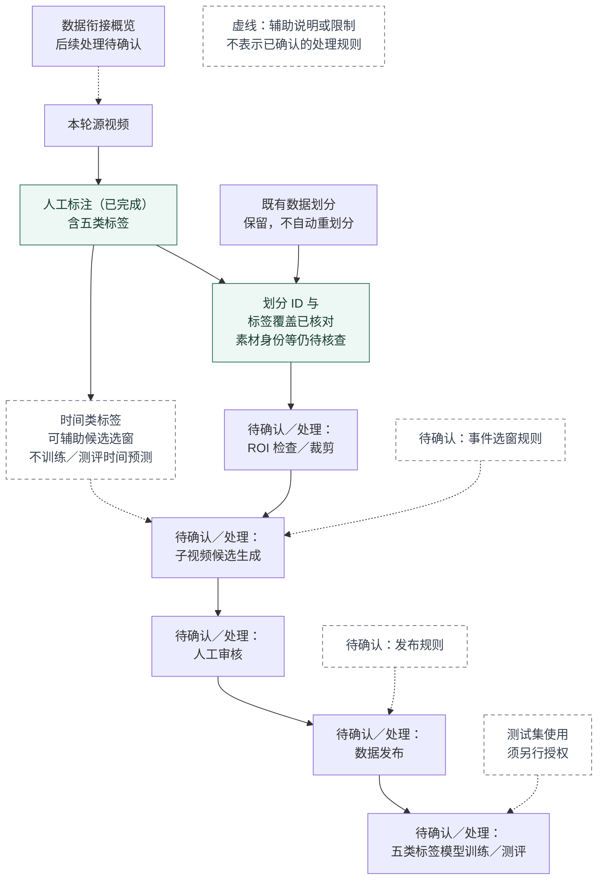

# 新标注到视频数据生成：衔接与待确认事项

**状态：衔接讨论稿，具体生成与迁移方案待确认；未授权运行。** 本文把[数据划分审查](data-split-migration-review.md)、[ROI 审查](roi-migration-review.md)和[现有子视频规则](subvideo-generation.md)连成一条链路，帮助逐项决定旧代码沿用、调整还是重新设计。静态代码核对不能证明新视频已经裁剪、生成或发布。

## 1. 先看已确认的边界

| 事项 | 已确认什么 | 仍需确认什么 |
| --- | --- | --- |
| 五类模型任务 | 当前面向模型判别的是断裂状态、断裂模式、断裂位置、异常情况和断裂现象，见[标签说明](label.md)。 | 片段标签、输出接口和评分工具怎样接入新语义。 |
| 断裂时间 | 断裂时间类标签可以用于子视频生成；已有帧号、时间点及时间范围保留。 | 如何接入本轮记录，以及具体选窗与默认标签规则。 |
| 时间预测 | 当前不构建时间预测任务对应的训练集；模型测评不考时间标签预测表现。 | 相关模型微调留待后续，不能由本次生成用途扩大授权。 |
| 数据划分 | 保留既有划分，同源片段保持相同划分。 | 素材身份、跨 ID 重复或近似及模拟来源仍待核查。 |
| 实施 | 本文用于讨论与确认衔接规则。 | 确认重大取舍后，仍需明确对应实施范围和授权。 |

时间边界按用户于 2026-11-07 的最新澄清理解，见 [facts.yaml](facts.yaml) DF-019。旧代码依赖事件时间已不构成使用范围冲突；允许使用时间也不代表所有旧生成规则已获确认。

## 2. 从源视频到可审核片段

以下是待衔接的阶段和成果，不是已经执行的数据处理流程。

| 阶段 | 输入与工作 | 需要形成的结果或记录 |
| --- | --- | --- |
| ① 源视频与既有划分 | 按视频 ID 对应本轮标注与原划分，记录素材身份。 | 视频、标注、划分对应；同源片段的划分一致。已有对应及覆盖见数据划分审查，内容近似和跨 ID 重复仍待查。 |
| ② ROI | 按视频检查观察区域，核对试样、夹具与断后变化；只对获准的视频生成裁剪产物。 | ROI 决策、复核及裁剪对应。原工具和规则是否适用见 ROI 审查，当前不宣称已执行。 |
| ③ 子视频与采样 | 选择窗口，可使用断裂时间信息；保留源视频、划分、片段边界和采样对应。 | 候选片段、初始标签建议及跳过或排除原因；具体窗口和标签规则待确认。 |
| ④ 人工审查与发布 | 分别记录初始建议、人工决定、修改、丢弃与重新生成原因。 | 确认产物、标签、划分及处理配置的身份后，才考虑发布。旧工具尚不能视为适配五类标签。 |
| ⑤ 评价衔接 | 与[评价设计](design-test.md)确认“无法判读”、字段未知值、异常和多选现象的数据用途及统计口径。 | 新五类评价的一致口径；不评价时间标签预测表现。测试集使用时机和频率另行决定。 |

**源级标签与片段标签分别描述不同观察范围。** 整段视频可以包含断裂前后过程，一个窗口可能只显示其中一部分；ROI 裁剪和帧采样也可能移除证据。因此五类源标签不能无条件复制到每个片段。时间信息可以辅助选窗和产生建议，但不会自动证明片段画面支持所有标签。

## 3. 五类标注与旧生成、审查链的差异

旧入口先按时间与源记录生成 v3 的 `clip_state`、`fracture_mechanism`、`root_break`、`location`、`special_case`，再由审查导出转换为旧 v4.1 建议；新五类人工标注和旧契约不是同一套接口。以下是差异与待定问题，不是转换规则。具体旧逻辑与来源见[子视频文档](subvideo-generation.md)，新值见[标签说明](label.md)。

| 本轮类别 | 旧生成及审查的对应情况 | 必须解决的衔接问题 |
| --- | --- | --- |
| 断裂状态 | 旧代码按事件时间和窗口推导，旧 v4.1 还有“临界未断裂”；当前四状态没有该类。 | 事件时间可参与选窗和候选状态推导；是否作为初始建议、如何按可见片段复核，以及未知状态和审查范围待定。 |
| 断裂模式 | 旧 `fracture_mechanism` 和 `root_break` 源自旧类型映射，未断裂等情况可能为 `null`。 | 新的脆、韧、半脆半韧、无法确定及固定“无”如何在片段中赋值；旧字段与新类别不能直接等同。 |
| 断裂位置 | 旧 `location` 只接收旧的标距内／外编码，齐根另由 `root_break` 表示。 | 新的夹持根部、标距外非根部、标距内、无法确定和固定“无”需与片段画面及位置校准衔接。 |
| 异常情况 | 旧 `special_case` 与窗口状态关联，未夹紧和视频异常源在候选规划中跳过。 | 三项异常逐项的是／否／无法判断／空白，以及异常样本是否生成和如何审查，不能由旧跳过规则直接决定。 |
| 断裂现象 | 旧候选字段没有本轮五种可多选现象的完整对应。 | 五项现象分别能否在该窗口判断、未知和未标注如何编码，以及人工审查与评分如何衔接，均待确认。 |

旧审查回收和发布的字段、队列、组合校验、自动准入及契约身份均需按确认后的五类语义另行设计与核对；不能让旧 `null`、未知值和新标签的固定“无”混为一谈。

## 4. 时间信息和窗口怎样衔接

旧入口按可靠事件时间产生事件前、包含事件和事件后窗口，并使用 0.5 秒保护间隔（guard）推导默认状态。该机制可以作为本轮审查对象；是否沿用及怎样适配，还需依据本轮标注和片段目标确认。

### 不同时间证据数据划分这一块，先不重新划分。我想的还是把数据划分的逻辑给理清楚，然后迁移过来脚本，再重新划分。不能自动当成同一种输入

| 本轮已有记录或情形 | 需要核对的衔接问题 |
| --- | --- |
| 可见分离第一帧及派生时间点 | DF-013 的权威锚点是第一帧已分离；怎样转换为旧代码要求的事件时间和可靠性标记，需明确。 |
| 首帧已经分离，后帧可记 0 | 0 表示视频起点已观察到分离，不代表物理断裂发生在起点；不能未经确认套用事件前后窗口规则。 |
| 只有时间范围或单侧边界 | 上下界描述可见证据范围；范围中点不作为时间点。怎样据此选窗、标记不确定性或跳过，待确认。 |
| 断裂但缺少可靠时间 | 旧代码跳过并记录原因；本轮是否沿用该处理尚未决定。 |
| 完整源视频未断裂 | 本轮时间字段按规则填“无”；旧代码有未断裂选窗分支，具体窗口和审查仍需确认。 |
| 未夹紧但实际发生断裂 | 按本轮规则，时间点填“无”，可记录前后帧或时间范围；旧代码会跳过未夹紧源，不能据此直接排除本轮样本。 |

帧号和时间换算还需核对源视频身份及实测帧率；变帧率视频按单一 fps 换算的时间是估算值。具体标注含义以[标签说明](label.md)及 DF-013 为准，本表没有新增转换规则。

### DF-015 的 2 秒要求仍须落实

| 判据 | 用途 | 当前证据 |
| --- | --- | --- |
| 旧代码最短候选 1 秒 | 决定单个候选是否足够长。 | 旧代码已有该常量。 |
| 事件时刻之后、guard 之外至少还有 2 秒素材 | 决定是否生成 post 候选，不足则不生成。 | 历史已确认要求 DF-015，尚未落地；接入对象与检查位置待明确。 |

两项检查不能等同，也不能因本次重写取消 DF-015。已有合成纯函数检查发现：事件与 guard 后只剩 1.5 秒时，旧代码仍生成 1.5 秒 post 候选；这是旧实现未落实该要求的证据，详见[子视频文档第 8 节](subvideo-generation.md#8-已有核查说明了什么)。合成检查没有证明真实视频覆盖、生成工作量或标签质量。

## 5. 等待用户确认的具体事项

| 决策范围 | 需明确的内容 | 关联材料 |
| --- | --- | --- |
| 生成目标与窗口 | 片段用于哪些学习和评价问题；旧目标时长、事件相对位置、guard、数量上限、采样及边界记录是否沿用。 | 子视频文档第 2—5 节。 |
| 时间接入与缺失处理 | 帧号和派生时间怎样进入生成器；范围、单侧边界、0 时刻、缺少可靠时间的处理；DF-015 的接入对象和检查位置。 | 本文第 4 节、DF-013、DF-015。 |
| 五类标签与人工复核 | 哪些源信息可作初始建议，哪些必须复核；未知、异常、未夹紧、裁剪失败及重做如何处理。 | 本文第 3 节、标签说明。 |
| ROI | 固定比例、可见性要求及既有人工决策是否适合当前任务。 | ROI 审查。 |
| 审查与发布 | 审查队列、人工决定、组合校验、自动准入、发布身份和记录接口。 | 子视频文档第 6 节。 |
| 评价与数据充足性 | 五类标签的数据使用与统计、各划分覆盖和样本是否足够，以及测试集使用口径。 | 评价设计、数据划分审查。 |

上述重大取舍确认后，再确定哪些旧代码和依赖可迁移、哪些需修改及如何验证。当前没有真实数据试运行证据，本讨论稿不授权生成视频、迁移实现、运行模型评测或使用 test。

**失效条件：** 用户确认的新链路方案取代本文，或标签、划分、ROI、时间使用边界及生成规则发生影响本文结论的变化时，本文须重新审查或作废。
