# 断裂位置典型样例（人工判读参考）

**定位：** 四类「断裂位置」标签的人工判读参考样例，读者为标注与评阅人员；规范来源 `docs/label-position-calibration.md`。
**范围声明：** 不构成标注者一致性证据、不用于训练、不作测评真值、不进入划分文件。
**判读口径：** 图片为压缩参考图，判读以原视频 / 原 ROI 帧为准。

## 1 样例来源与选样

源视频 110 个，其中固定 test 21 个不参与本次校准，剩开发侧 89 个；本图文从中选 9 例。

| video_id | 易混淆对（①/②/③） | 人工标签 | ROI 画幅（像素） | 一句选取理由 |
| --- | --- | --- | --- | --- |
| video_0017 | ① 夹持根部 vs 标距外非根部 | 夹持根部 | 162×216 | 断口紧贴夹口下沿、断口以上看不到未断段，是夹持根部的标准形态。 |
| video_0027 | ① 夹持根部 vs 标距外非根部 | 夹持根部 | 156×208 | 同属贴夹口断裂，断口处为较粗残样带一条细丝斜向左上方伸出。 |
| video_0029 | ① 夹持根部 vs 标距外非根部 | 标距外非根部 | 144×192 | 断口偏向下方夹持端，但断口与下夹块之间仍留一小段未断试样。 |
| video_0110 | ② 标距外非根部 vs 标距内 | 标距外非根部 | 192×256 | 断口偏向下方夹持端且未压在夹口面上，断口以下仍留短未断段。 |
| video_0004 | ② 标距外非根部 vs 标距内 | 标距内 | 144×192 | 断口落在两夹口之间可见段的内部，上下两侧都可见未断段。 |
| video_0030 | ② 标距外非根部 vs 标距内 | 标距内 | 138×184 | 同类位置判据，断口处可见一条横向亮缝与轻微错位。 |
| video_0009 | ③ 标距内 vs 无法判断 | 标距内 | 150×200 | 位置落在两夹持区之间，但条带仅数像素宽、断口线不可逐像素辨认。 |
| video_0045 | ③ 标距内 vs 无法判断 | 无法判断 | 492×656 | 上夹具不在画面内、另一端悬空，无法指认断裂处与夹具的关系。 |
| video_0083 | ③ 标距内 vs 无法判断 | 无法判断 | 192×256 | 帧号由时间范围换算，且条带被强反光遮挡，断口难以指认。 |

9 个 `video_id` 与 `data/splits/three-fold/test.json` 的 21 个 `video_ids` 交集为空；`data/annotation-table-full.csv` 共 110 行，排除 21 个 test 源后为开发侧 89 行，与 `manifest.json` 的 `expected_test=21`、`expected_labels=110` 一致。

入选 9 例的 `标注状态` 均为 `已标注·有断裂`。表内「ROI 画幅」列填的是 **ROI 画幅**尺寸（像素宽×高，如 `162×216`）；标注表 `data/annotation-table-full.csv` 的 `清晰度` 列记录的是**源分辨率**（如 1280×720），与本表「ROI 画幅」不是同一口径，交叉核对时勿混。

`断裂位置=无` 的源不涉及位置判据，未入选；`标注状态=无法判读` 的源既无 `断裂帧_前/后` 也无时间范围、无法取帧，亦未入选；难判角色由 `断裂位置=无法判断` 的 2 例承担。

## 2 易混淆对 ① 夹持根部 vs 标距外非根部

### video_0017（夹持根部）

| 断前最后一帧 | 首帧分离 | 断后 |
| --- | --- | --- |
|  | 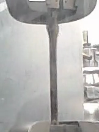 |  |

帧 6207 / 6208 / 6238（= 6208 + 30），0 基。

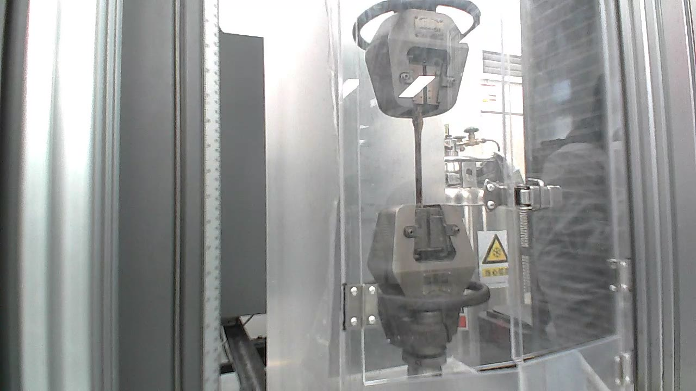

图：广角确认（帧 6238），仅用于确认夹具关系，不替代 ROI 图。

**判定理由：** 断口紧贴上夹具夹口下沿、位于画面顶部约 1/5 高度处，断口以上看不到未断试样段，断口以下是一整段连续试样直落到画面底部的下夹具。

### video_0027（夹持根部）

| 断前最后一帧 | 首帧分离 | 断后 |
| --- | --- | --- |
|  |  |  |

帧 5659 / 5660 / 5690（= 5660 + 30），0 基。

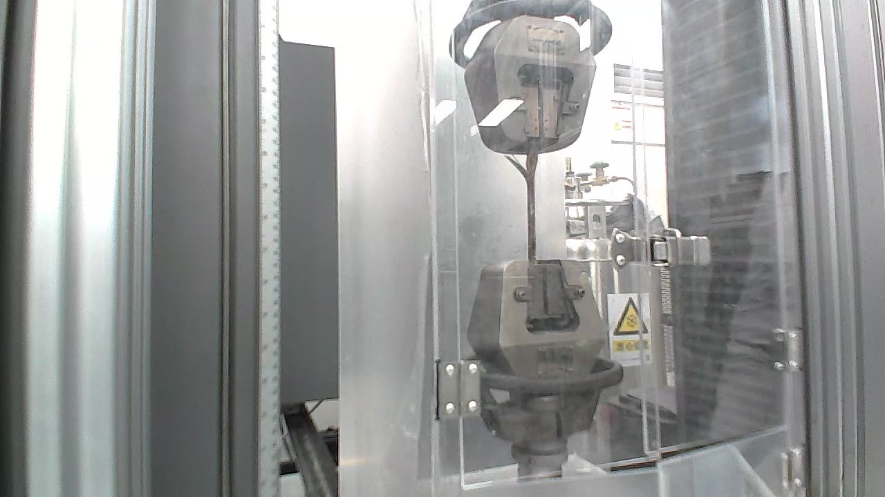

图：广角确认（帧 5690），仅用于确认夹具关系，不替代 ROI 图。

**判定理由：** 断口紧贴上夹具夹口下沿、位于画面顶部约 1/4 高度处，断口处是一段较粗的残样并有一条细丝斜向左上方伸出，断口以下整段试样延伸到画面底部的下夹具。

### video_0029（标距外非根部）

| 断前最后一帧 | 首帧分离 | 断后 |
| --- | --- | --- |
|  |  |  |

帧 5179 / 5180 / 5210（= 5180 + 30），0 基。

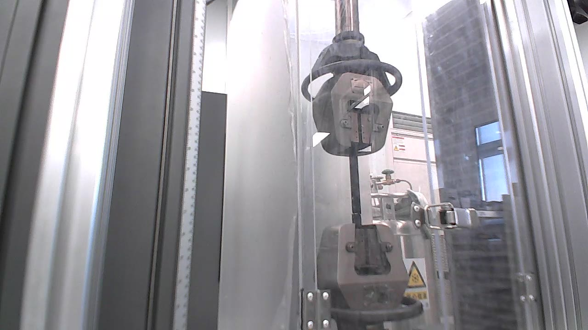

图：广角确认（帧 5210），仅用于确认夹具关系，不替代 ROI 图。

**判定理由：** 断口位于画面下部约 3/4 高度、明显偏向下方夹持端，断口以下到画面底部的下夹块之间仍可见一小段未断试样，断口以上是较长的未断试样段。

## 3 易混淆对 ② 标距外非根部 vs 标距内

### video_0110（标距外非根部）

| 断前最后一帧 | 首帧分离 | 断后 |
| --- | --- | --- |
| 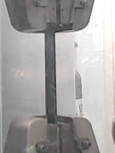 | 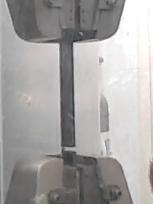 |  |

帧 4416 / 4417 / 4442（= 4417 + 25），0 基。

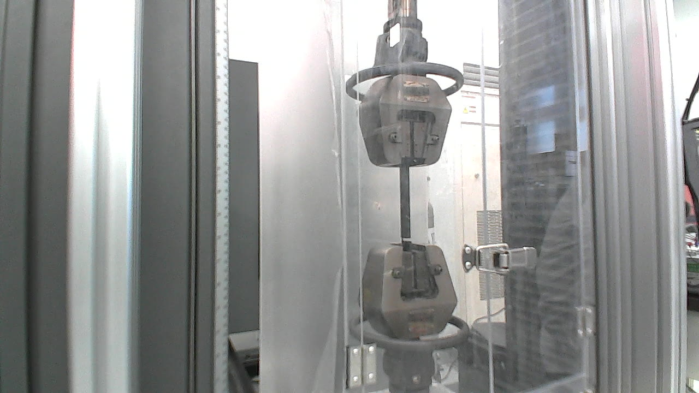

图：广角确认（帧 4442），仅用于确认夹具关系，不替代 ROI 图。

**判定理由：** 断口位于画面下部约 7 成高度、明显偏向下方夹持端，断口以上是较长的未断试样段，断口以下到画面底部的下夹板之间仍留有一小段未断试样、未直接压在夹口面上。

### video_0004（标距内）

| 断前最后一帧 | 首帧分离 | 断后 |
| --- | --- | --- |
|  |  |  |

帧 5510 / 5511 / 5541（= 5511 + 30），0 基。

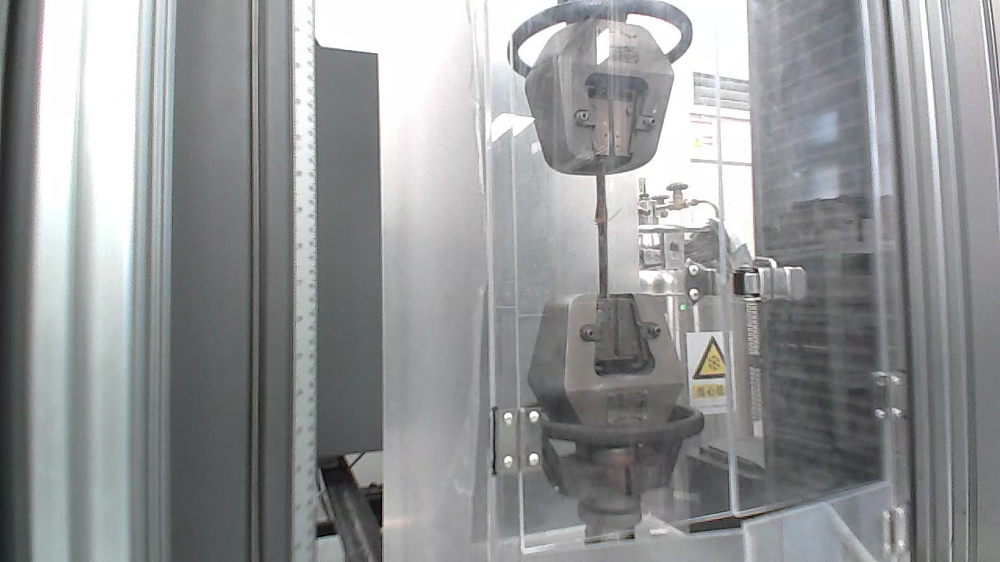

图：广角确认（帧 5541），仅用于确认夹具关系，不替代 ROI 图。

**判定理由：** 断口位于画面中部约 4 成高度、落在两夹口之间可见试样段的内部，断口以上试样仍连到上夹口、以下延伸到画面底部的下夹具，两侧都可见未断试样段。

### video_0030（标距内）

| 断前最后一帧 | 首帧分离 | 断后 |
| --- | --- | --- |
|  |  |  |

帧 6075 / 6076 / 6106（= 6076 + 30），0 基。

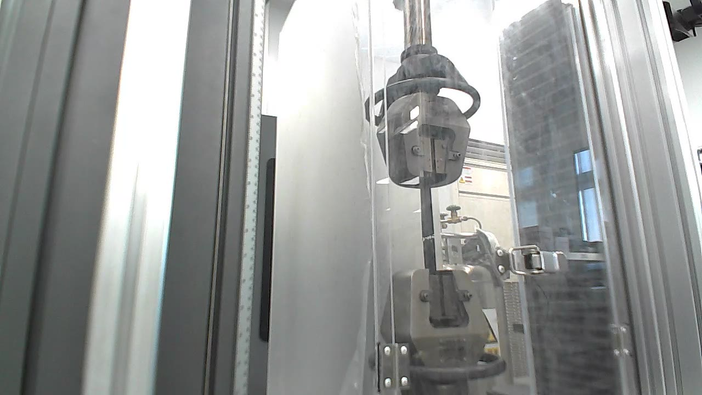

图：广角确认（帧 6106），仅用于确认夹具关系，不替代 ROI 图。

**判定理由：** 断口位于画面中下部约 6 成高度、落在两夹口之间可见试样段的内部并可见一条横向亮缝与轻微错位，断口上下都可见未断试样段。

## 4 易混淆对 ③ 标距内 vs 无法判断

### video_0009（标距内）

| 断前最后一帧 | 首帧分离 | 断后 |
| --- | --- | --- |
|  |  |  |

帧 5651 / 5652 / 5682（= 5652 + 30），0 基；首帧分离图上断口表现为条带中下部错位与局部加宽，未见贯通横缝。

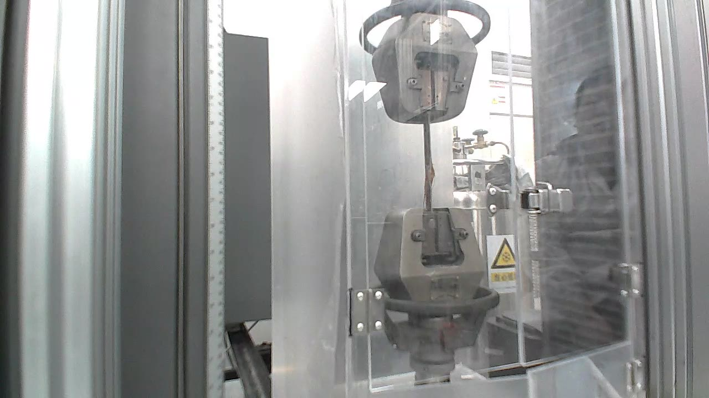

图：广角确认（帧 5682），仅用于确认夹具关系，不替代 ROI 图。

**判定理由：** 断裂处位于画面约 6 成高度、落在画面顶部上夹具夹口与画面底部下夹块之间可见试样段的内部，断口以上试样条带仍连到上夹口、断口以下条带继续延伸到下夹块，两侧都可见未断试样段。

### video_0045（无法判断）

| 断前最后一帧 | 首帧分离 | 断后 |
| --- | --- | --- |
| 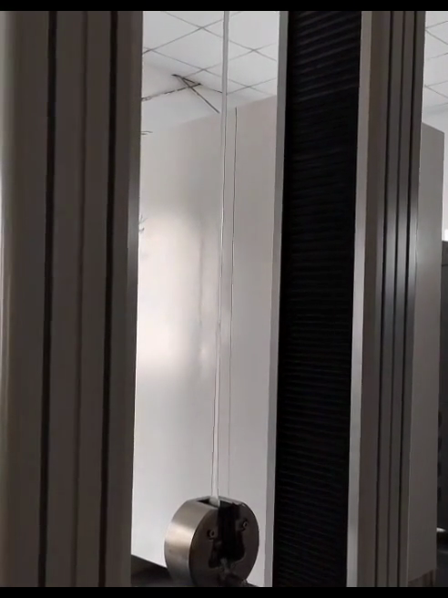 | 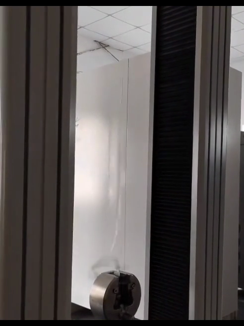 | 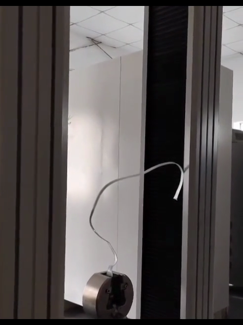 |

帧 5530 / 5531 / 5561（= 5531 + 30），0 基。

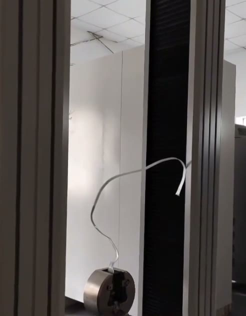

图：广角确认（帧 5561），仅用于确认夹具关系，不替代 ROI 图。

**判定理由：** 画面内只可见下方的圆盘夹具、试样向上伸出后另一端悬空，画面上部看不到上夹具或试样交界，无法指认断裂处与夹具的可见关系。

### video_0083（无法判断）

| 断前帧（由时间范围下界换算） | 断后首帧（由时间范围上界换算） | 断后 |
| --- | --- | --- |
|  |  |  |

该例无 `断裂帧_前/后`，帧号由时间范围换算：下界 161.9282596 s → 4858，上界 162.428243915024 s → 4873，断后 4903（= 4873 + 30），0 基。

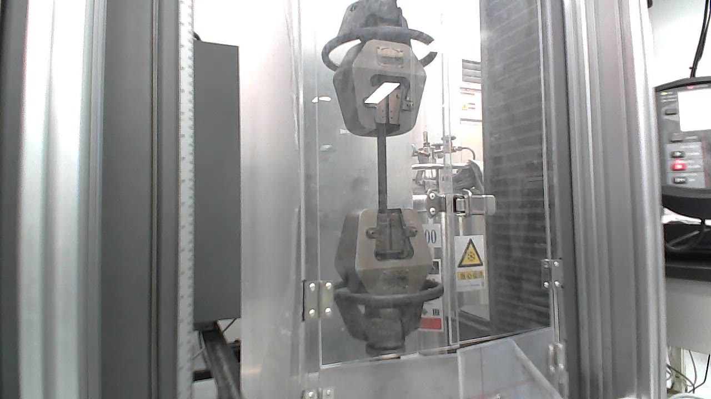

图：广角确认（帧 4903），仅用于确认夹具关系，不替代 ROI 图。

**判定理由：** 上夹具与下夹块分别在画面上下缘、中间试样条带的右侧被强反光遮挡且条带内未见可指认的横向断口，无法指认断裂处与夹口的可见关系。

## 5 判据速查

| 类别 | 看什么 |
| --- | --- |
| 夹持根部 | 断口紧贴上夹具夹口下沿、位于画面顶部约 1/5–1/4 高度，断口以上看不到未断试样段。 |
| 标距外非根部 | 断口偏向下方夹持端（画面下部约 3/4 或 7 成高度），与下夹块/下夹板之间仍可见一小段未断试样。 |
| 标距内 | 断口落在两夹口之间可见试样段的内部（画面中部约 4–6 成高度），断口上下两侧都可见未断试样段。 |
| 无法判断 | 画面内看不到上夹具／试样与夹具的交界（取景不全），**或**夹具可见但断口被遮挡／强反光遮蔽；两种情形均无法指认断裂处与夹口的可见关系。 |

## 6 已知限制

- ROI 裁剪尺寸远小于源视频（本组 9 例实测 138×184 至 492×656）。
- 试样条带在 ROI 内仅数像素宽，断口线本身难以逐像素指认；这是抽帧与裁剪层面的限制，不是判据本身的问题。
- `video_0009` 的 ROI 为 150×200、试样条带约 7–9 px 宽。
- `video_0009` 5682 帧可见 +4~5 px 横向错位与 9→15 px 局部加宽，但**无贯通性横缝，断口线不可逐像素辨认**。
- `video_0009` 广角图有反光与轻度模糊，断裂处在广角上更接近弯折形态；本组图只说明「标距内」的相对位置，不构成断口形态的精细证据。
- 源容器 `r_frame_rate` 可能为 `60/1` 而 `avg_frame_rate≈30`（`video_0017`、`video_0083`、`video_0009` 实测）。
- 因此**帧数只能以 `nb_frames` 为准，不能用 duration × fps 反推帧号**。
- `video_0045` 源为 **492×632**（非 1280×720），其 ROI 为 **492×656**、高于源高。
- `video_0045` 的 ROI 为源帧上下各补 12 行近黑边（上行 0–11、下行 645–655，12 + 632 + 12 = 656），不能由裁剪几何直接证明帧序号对应。
- `video_0045` 实测 `nb_frames=5601`、`avg_frame_rate=30`、`duration=186.7 s` 三者一致，据此沿用标注帧号。
- `video_0045` 同时是「上夹具不在画面内」的遮挡 / 取景难判例，此处如实记录，不做解释性推断。
- `video_0083` 帧号由时间范围换算，且条带右侧被强反光遮挡，在本组图分辨率下断口位置亦难指认。
- 判读一律以原视频 / 原 ROI 帧为准。

## 附件 A：帧号口径核对

对两个代表源全解码核对，用于确认「ROI 视频与源视频帧序号一一对应」：

| 文件 | 宽×高 | nb_frames(header) | nb_read_frames(全解码实测) | avg_frame_rate | r_frame_rate | duration(s) |
| --- | --- | --- | --- | --- | --- | --- |
| 源 video_0017.mp4 | 1280×720 | 6322 | 6322 | 31610000/1053609 ≈ 30.001642 | 60/1 | 210.721733 |
| ROI video_0017.mp4 | 162×216 | 6322 | 6322 | 30/1 | 30/1 | 210.733333 |
| 源 video_0083.mp4 | 1280×720 | 5009 | 5009 | 150270000/5008843 ≈ 30.000940 | 60/1 | 166.961400 |
| ROI video_0083.mp4 | 192×256 | 5009 | 5009 | 30/1 | 30/1 | 166.966667 |

9 例全量核对（消除抽样依赖）：

| video_id | 源 nb_frames | ROI nb_frames | 相等 | 源 avg_frame_rate | 标注表 视频帧率 | 源 duration(s) | ROI duration(s) | Δduration |
| --- | --- | --- | --- | --- | --- | --- | --- | --- |
| video_0004 | 5657 | 5657 | 是 | 30.000790 | 30.00079 | 188.561667 | 188.566667 | +5.0 ms |
| video_0017 | 6322 | 6322 | 是 | 30.001642 | 30.001642 | 210.721733 | 210.733333 | +11.6 ms |
| video_0027 | 5744 | 5744 | 是 | 29.996365 | 29.996365 | 191.489867 | 191.500000 | +10.1 ms |
| video_0029 | 5310 | 5310 | 是 | 30.001051 | 30.001051 | 176.993767 | 177.000000 | +6.2 ms |
| video_0030 | 6263 | 6263 | 是 | 29.999598 | 29.999598 | 208.769433 | 208.766667 | −2.8 ms |
| video_0009 | 5767 | 5767 | 是 | 30.001228 | 30.001228 | 192.225467 | 192.233333 | +7.9 ms |
| video_0045 | 5601 | 5601 | 是 | 30.000000 | 30 | 186.700000 | 186.700000 | 0 |
| video_0083 | 5009 | 5009 | 是 | 30.000940 | 30.00094 | 166.961400 | 166.966667 | +5.3 ms |
| video_0110 | 4535 | 4535 | 是 | 25.000000 | 25 | 181.400000 | 181.400000 | 0 |

`nb_frames` 的三方一致指**源 header、ROI header 与全解码实测计数**（6322 / 5009），两例完全相等，9 例全量核对亦逐一相等，故源与 ROI 同序、0 基标注帧号可直接沿用。另，源 `avg_frame_rate` 与标注表 `视频帧率` 在标注表保留 6 位小数的口径下逐例吻合。差异仅在 `duration`（≤11.6 ms）与派生 `avg_frame_rate`（<0.006 fps），属重编码时长取整 / 时间基差，不影响帧序号：帧数只以 `nb_frames` 为准，不得用 duration × fps 反推帧号。

`video_0083` 的 Δduration 在表内记为 +5.3 ms，精确值为 **+5.27 ms**（166.966667 − 166.961400）。

## 附件 B：帧号与越界检查

| video_id | 前帧号 | 后帧号 | 断后帧号（= 后 + round(实测 fps)） | N | 总帧数 | 越界检查 |
| --- | --- | --- | --- | --- | --- | --- |
| video_0017 | 6207 | 6208 | 6238 | 30 | 6322 | 6238 ≤ 6321 ✔ |
| video_0027 | 5659 | 5660 | 5690 | 30 | 5744 | 5690 ≤ 5743 ✔ |
| video_0029 | 5179 | 5180 | 5210 | 30 | 5310 | 5210 ≤ 5309 ✔ |
| video_0110 | 4416 | 4417 | 4442 | 25 | 4535 | 4442 ≤ 4534 ✔ |
| video_0004 | 5510 | 5511 | 5541 | 30 | 5657 | 5541 ≤ 5656 ✔ |
| video_0030 | 6075 | 6076 | 6106 | 30 | 6263 | 6106 ≤ 6262 ✔ |
| video_0009 | 5651 | 5652 | 5682 | 30 | 5767 | 5682 ≤ 5766 ✔ |
| video_0045 | 5530 | 5531 | 5561 | 30 | 5601 | 5561 ≤ 5600 ✔ |
| video_0083 | 4858 | 4873 | 4903 | 30 | 5009 | 4903 ≤ 5008 ✔ |

`video_0083` 无 `断裂帧_前/后`，走时间范围替换规则：下界 161.9282596 s × 30.00094 → round = 4858（作前帧号）；上界 162.428243915024 s × 30.00094 → round = 4873（作后帧号）；断后帧 4873 + 30 = 4903。帧号一律 0 基。

## 附件 C：分辨率及体积清单

| video_id | 源视频分辨率 | ROI 视频分辨率 | ROI 图（帧号→KB） | 广角图（帧号→KB） |
| --- | --- | --- | --- | --- |
| video_0017 | 1280×720 | 162×216 | 6207→38.8；6208→39.7；6238→39.5 | 6238→96.7 |
| video_0027 | 1280×720 | 156×208 | 5659→37.7；5660→38.7；5690→39.7 | 5690→98.5 |
| video_0029 | 1280×720 | 144×192 | 5179→31.7；5180→32.3；5210→32.4 | 5210→97.4 |
| video_0110 | 1280×720 | 192×256 | 4416→48.1；4417→47.2；4442→50.5 | 4442→108.5 |
| video_0004 | 1280×720 | 144×192 | 5510→31.0；5511→29.9；5541→31.3 | 5541→98.1 |
| video_0030 | 1280×720 | 138×184 | 6075→29.2；6076→29.9；6106→30.3 | 6106→92.4 |
| video_0009 | 1280×720 | 150×200 | 5651→34.0；5652→35.2；5682→35.5 | 5682→94.6 |
| video_0045 | **492×632** | **492×656** | 5530→190.5；5531→181.1；5561→166.9 | 5561→20.5 |
| video_0083 | 1280×720 | 192×256 | 4858→53.8；4873→52.6；4903→52.6 | 4903→97.3 |

合计 36 张、**2,318,389 B（2.21 MiB）**；单张最大 190.5 KB（`video_0045_5530_roi.png`）。ROI 图为无损 PNG，广角图为 JPEG（`-q:v 3`）。目录内为 27 张 `_roi.png` + 9 张 `_wide.jpg`，非 png/jpg 文件 0 个；本文图片引用 36 个（去重），缺失 0 个。9 张 `_wide.jpg` 的尺寸与其对应源视频分辨率一致（8 张 1280×720，`video_0045` 为 492×632）。
