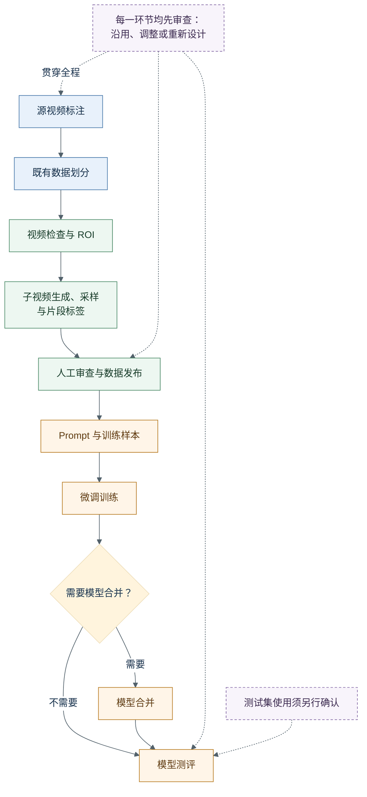

# TensileAgent-Finetune 迁移审查大纲

本大纲用于重新理清从源视频标注到模型测评的完整链路，并逐段判断原项目的代码应当沿用、调整还是重新设计。

**当前仍是初步框架，各阶段实现尚未因列入大纲而获得认可。**

现有代码保留在原工作区的主分支。推进到哪个环节，就读取该环节的实际入口及必要依赖，确认适用性后再迁入新工作区。

| 文档 | 承担的内容 |
| --- | --- |
| 本大纲 | 整体顺序、阶段之间的输入输出、审查范围与待决事项。 |
| [项目 TODO](TODO.md) | 具体任务、进展、下一步和完成标准。明确某阶段的实施范围后，再登记细分任务；本次重排不改写 TODO。 |

## 1. 先看整体流程

下表列出每段审查最终需要讲清的结果。它们是**后续应形成的成果**，不是现有产物已通过验收的声明。

| 审查范围 | 包含阶段 | 应当讲清什么 |
| --- | --- | --- |
| 标注与数据划分 | A 源视频与标注 → B 既有划分 | 每份视频对应哪条标注、属于哪个划分，哪些数据允许用于后续工作。 |
| 视频数据处理 | C 视频检查与 ROI → D 子视频与采样 → E 审查发布 | 从源视频到可用片段的处理方式、标签依据和发布身份。 |
| 训练与测评 | F Prompt 与样本 → G 微调 → H 合并（如需）→ I 测评 | 模型实际看见什么、怎样训练、产物来自哪里，以及效果如何判断。 |

建议先核对 A 的视频与标注对应关系，再核对 B 的已有划分。它们提供后续处理、样本生成和评价共同依赖的源视频身份。

## 2. 已确认什么，哪些仍需决定

| 事项 | 已确认的起点 | 后续边界 |
| --- | --- | --- |
| 工作区 | 精简显示指定的源视频、新一轮标注、核心文档、LlamaFactory 及根目录文件。 | 其他已跟踪文件仍在 Git 中，审查后再决定是否真正删除。 |
| 人工标签 | 依据[标签说明](label.md)，当前面向模型判别的是断裂状态、断裂模式、断裂位置、异常情况和断裂现象五类。 | 新五类标签与冻结 v4.1 旧契约分开；新契约、输出编码及数据接入尚未实施（[facts.yaml](facts.yaml)，DF-018）。 |
| 断裂时间 | 断裂时间类标注可用于子视频生成；当前不为时间预测任务构建训练集，也不评价模型预测时间类标签的表现。已有帧号、时间点及时间范围记录保留。 | 旧候选生成依赖事件时间；具体输入转换、缺失与不可靠时间的处理，以及候选标签的视觉复核尚待确认（DF-019）。 |
| 数据划分 | 既有划分暂作基线；用户已确认固定测试成员，核实来源后重排开发三折，见[划分规则](data-split-design.md)。 | 不因整理工作区自动重划；测试集有历史使用记录，不称为从未使用过的独立测试集，本大纲不授权用 test 进行模型测评。 |
| 已有专题材料 | [整体模型测评设计](design-test.md)是待确认的设计稿；[现有子视频生成与默认标签](subvideo-generation.md)是静态代码梳理。 | 两份材料都不能直接作为新链路的已确认规则。 |

**窗口规则、输出接口、模型、训练配置和评价阈值等重大取舍，仍需逐项确认。** 方案确认与实施授权分别核定；本大纲确定审查覆盖范围和衔接顺序，不据此启动数据处理或真实模型运行。

## 3. 标注与数据划分：先确认输入基准

### A. 源视频与标注基准

| 输入 | 审查后应形成的输出 |
| --- | --- |
| 本轮源视频副本、新一轮标注表、已确认的标签说明。 | 可追溯的视频与标注输入清单、字段说明、已知问题及处理边界。 |

| 核查对象 | 重点问题 |
| --- | --- |
| 视频与标注对应 | 视频身份、标注行和文件路径是否一致？副本与来源能否追溯？ |
| 标签读写 | 五类字段、允许值和固定组合是否保留？“无”“无法确定／无法判断”和“未标注”是否被区分？ |
| 标注工具 | 实际读取哪份视频和表格，是否仍指向旧位置？导入、保存和导出是否覆盖标注或丢失字段？ |
| 源视频与片段语义 | 两类标签各自描述什么？整段视频标签不能无条件复制到每个片段。 |

**审查后决定：** 哪些标注读写和校验代码可迁入、是否需要适配路径、哪些问题需用户复核；不预设整批重新标注。

### B. 既有划分与数据使用边界

| 输入 | 审查后应形成的输出 |
| --- | --- |
| A 的输入清单、原项目已有划分及其生成依据。 | 与源视频身份绑定的划分记录、标签覆盖说明、重复或来源疑问清单，以及后续允许使用的输入范围。 |

| 核查对象 | 重点问题 |
| --- | --- |
| 划分对应 | 新标注的视频如何对应训练、验证和测试划分？是否存在缺失、重复或无法解释的对应？ |
| 数据泄漏 | 同源片段是否保持同一划分？不同划分间是否存在重复或近似素材？ |
| 标签覆盖 | 各划分的新标签覆盖和未知项如何记录？不能由源视频总量直接判断训练或评价样本充分。 |
| 模拟视频（若引入） | 来源、参考素材与真实视频的关系是否清楚？是否包含验证或测试素材的信息？ |

**审查后决定：** 沿用既有划分所需的适配，发现冲突先报告。测试使用时机、候选准入和使用频率另行确认，本阶段不默认开放测试集。

## 4. 视频数据处理：把输入变成可追溯的数据

### C. 视频检查与 ROI 处理

ROI 指画面中需要保留的试样及相关观察区域。

| 输入 | 审查后应形成的输出 |
| --- | --- |
| B 确认的数据范围、源视频和标注。 | ROI 记录、裁剪视频、源视频与裁剪产物的对应、处理异常记录；具体文件形式待确认。 |

| 核查对象 | 重点问题 |
| --- | --- |
| 视频可用性 | 视频能否读取？帧率、时长、方向和关键画面是否影响后续处理？ |
| ROI 处理链 | 标注、复核、冻结和裁剪分别由什么入口完成？坐标如何与源视频绑定？ |
| 裁剪结果 | 是否保留判断所需的试样、夹具和断后变化？失败、跳过与重新处理如何记录？ |

**审查后决定：** ROI 交互与处理规则是否适合本轮，哪些实现及必要依赖可以保留。

### D. 子视频生成、采样与片段标签

| 输入 | 审查后应形成的输出 |
| --- | --- |
| C 的视频与 ROI 产物、源视频划分、当前标签基准。 | 候选片段、采样或输入映射、源视频与片段的关联、候选标签及排除原因。 |

| 核查对象 | 重点问题 |
| --- | --- |
| 窗口目的 | 子视频用于解决什么学习和评价问题？如何选窗，能否覆盖所需过程？ |
| 事件时间依赖 | 如何把已记录的时间点、帧号或时间范围接入选窗？缺失、不可靠或仅有范围时如何处理？允许使用时间标注不等于旧选窗与自动标签规则已经确认。 |
| 模型可见证据 | 片段起止位置、帧采样和模型实际输入如何对应？裁剪或采样会否移除关键证据？ |
| 片段标签 | 哪些源信息可提供初值，哪些须重新观察？无法判读、异常视频和不满足生成条件的样本怎样处置？ |
| 历史要求 | 怎样衔接历史窗口和最小观察要求，包括 DF-015 的待落地要求？不自行取消，也不未经核对直接套用。 |

**审查后决定：** 窗口、采样及标签衔接方案，再据此确定旧生成代码沿用、修改或重写的范围。

### E. 人工审查与数据发布

| 输入 | 审查后应形成的输出 |
| --- | --- |
| D 的候选片段、候选标签、源视频关联和处理记录。 | 审查决定、修订与排除记录，以及经确认后发布的数据清单和对应媒体。 |

| 核查对象 | 重点问题 |
| --- | --- |
| 审查回收 | 审查对象如何完整导出、查看、修改和回收？决定如何绑定到原候选？ |
| 人工与自动检查 | 哪些结果须人工确认，哪些可自动检查？丢弃和重新生成怎样追踪？ |
| 发布身份 | 如何固定视频、标签、划分和输入处理的身份，使训练与评价读取同一份明确数据？ |
| 新旧契约 | 五类标签怎样进入数据契约？旧 v4.1 字段、状态和编码不能混作新标签语义。 |

**审查后决定：** 审查工具、发布格式及版本记录接口，再判断相关实现是否迁入。数据完整性校验与模型任务效果评价分开验收（DF-006）。

## 5. 训练与测评：把样本、模型和结果对应起来

### F. Prompt 与训练样本组织

| 输入 | 审查后应形成的输出 |
| --- | --- |
| E 的数据发布、已确认标签语义、待确认的模型输出和评价设计。 | 经确认的 Prompt 与输出约定、训练样本格式、转换记录和配置身份。 |

| 核查对象 | 重点问题 |
| --- | --- |
| 模型任务 | 模型接收什么视频或采样帧？Prompt 怎样表达任务、标签边界、不确定性和固定组合？ |
| 输出接口 | 字段、类型及多选编码如何与标签和评分工具一致？不默认沿用旧四字段输出。 |
| 模板与输入 | 训练、验证和推理是否一致？不同模型需要哪些明确适配？ |
| 样本转换 | 转换、过滤和重采样是否改变分布？是否保留源视频和划分身份？ |

**审查后决定：** Prompt、输出接口和转换规则；涉及新契约时明确其身份与旧契约边界。

### G. 实际微调训练

| 输入 | 审查后应形成的输出 |
| --- | --- |
| F 的样本和 Prompt、明确的基础模型与预处理器、训练配置和运行环境。 | 可追溯的训练记录、配置、checkpoint／adapter 和验证记录。 |

| 核查对象 | 重点问题 |
| --- | --- |
| 实际加载 | LlamaFactory 版本、项目适配和训练入口如何配合？加载的模型、数据及模板是否与记录一致？ |
| 训练策略 | 微调方法、资源配置、保存与恢复策略、验证及 checkpoint 选择如何确定？ |
| 产物链路 | 日志、adapter、checkpoint 和 metadata 能否互相对应？失败或中断后如何辨认可用产物？ |

**审查后决定：** 训练方案及实施范围。实际训练在训练机进行；loss 下降只证明训练目标收敛，任务效果由 I 的真实评价判断。

### H. 模型合并与可加载检查（如需）

| 输入 | 审查后应形成的输出 |
| --- | --- |
| G 选定的 checkpoint／adapter、对应基础模型及配置。 | 经确认需要的合并模型、来源记录和可加载性检查结果。 |

| 核查对象 | 重点问题 |
| --- | --- |
| 合并必要性与来源 | 是否需要合并？入口如何确认基础模型、adapter、checkpoint step 和输出位置？ |
| 配套文件 | tokenizer、processor、模板及必要配置是否正确保存？ |
| 合并检查 | 如何核对合并前后的实际加载身份和基本推理行为？失败或不一致如何留证？ |

**审查后决定：** 合并方式与验收范围。文件完整、加载成功或简单推理成功，均不能替代完整任务评价。

### I. 模型测评与结果验收

| 输入 | 审查后应形成的输出 |
| --- | --- |
| 身份明确的基础模型或微调／合并模型、获准使用的数据、冻结 Prompt、输入处理及评分规则。 | 原始预测、失败与未处理记录、逐类评价与性能报告、比较范围及限制；涉及模型晋级时，再形成相应验收记录。 |

| 核查对象 | 重点问题 |
| --- | --- |
| 评分口径 | 先逐项确认五类评分、分母、未知项、多选项、缺字段、失败和冲突处理，再审查评分实现。 |
| 形式与语义 | 分别报告输出形式合法性和语义正确性；旧 v4.1 指标与阈值不自动迁入（DF-003、DF-004）。 |
| 对照比较 | 微调前后、多模型和不同训练数据方案如何比较？模拟视频与真实视频结果怎样分开报告？ |
| 运行与身份 | 训练机上的加载、单次及批量处理、超时和失败怎样记录？实际运行模型能否对应结果文件？ |
| 测试与证据 | 开发比较与正式测试的准入、执行及留档如何区分？缺少模型、样本、指标或身份链路时，明确报告证据不足。 |

**审查后决定：** 正式指标、阈值、候选名单、测试安排与晋级衔接。真实模型测评在训练机执行；具体运行和测试集使用仍须对应授权。

## 6. 每次审查迁移都留下什么

每次推进一个环节，按下表留下简明结论，便于后续接续与核查。

| 记录项 | 需要留下的内容 |
| --- | --- |
| 来源与现状 | 原工作区所读的分支和提交、实际入口、必要依赖、输入与产物。文档与代码冲突时先报告。 |
| 适用性结论 | 哪些可沿用、哪些需调整、哪些待重新设计，以及依据和影响范围。未决重大选择交用户确认。 |
| 迁移范围 | 本次需要显示或修改的代码、测试及配置，覆盖必要调用链，避免只复制单个入口。 |
| 验证证据 | 实际检查、结果与覆盖范围；区分静态阅读、轻量测试、真实数据处理和真实模型运行。测试可收集不能代替真实运行通过。 |
| 任务衔接 | 明确实施范围后，将细分工作登记到 TODO；本大纲保留整体顺序及阶段输入输出，不重复维护细分任务状态。 |

**失效条件：** 本轮迁移审查全部结束，或用户确认新的整体流程取代本大纲时，本文作废；届时将仍有效的已确认事实并入 `docs/facts.yaml`，或直接删除本文。
