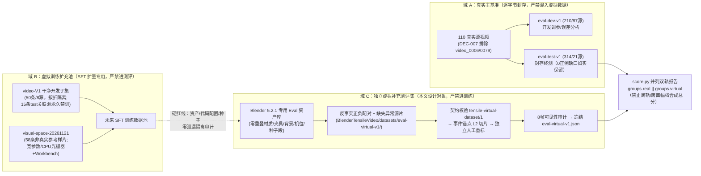
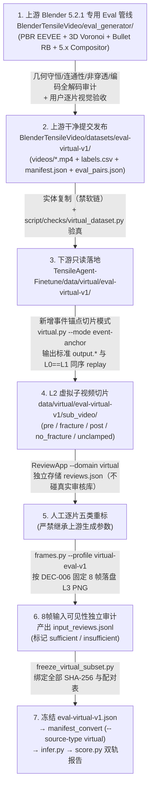

# 独立虚拟补充测评集（含爆炸性断裂与缺失异常）深度调研与设计方案

- **文档性质**：基于 `idea-to-design` 方法论产出的跨双仓方案设计稿（只读调研与零副作用探针实测，已于 2026-11-26 经独立复核归档入库）。
- **日期**：2026-11-26
- **交付与分工状态（2026-11-26 用户确认）**：
  - **正式虚拟补充测评视频制作**：统一交回 **Codex（配合 Blender MCP）** 承接执行，本文作为规范设计与反泄漏基线输入。
  - **Antigravity Phase 0 视觉对照参考留档**：Antigravity 已基于本方案完成 6 条 EEVEE PBR 反事实对比试片（`explosive` / `unclamped` / `crack` 各 1 对），归档于 `BlenderTensileVideo/review/phase0-eval-comparison-20261126/` 作视觉对照参考（对应参考生成代码位于 `BlenderTensileVideo` 独立分支 `work/eval-virtual-phase0` @ `c0fad80`）。
- **覆盖仓库**：
  - 上游生成仓：`BlenderTensileVideo`（当前工作区 `main @ 8a37a1a`，另有未提交清理与新增 `review/visual-space-20261121/`）
  - 下游评测仓：`TensileAgent-Finetune`（主线分支 `feat/tensileagent-finetune`）
- **核心前提**：
  1. **严守三域物理与资产隔离**：真实主基准（`eval-dev-v1` / `eval-test-v1`）、虚拟训练扩充池（如 `visual-space-20261121` 58 条）与**独立虚拟补充测评集**（本文焦点，`eval-virtual-v1`）三轨绝不混用。
  2. **爆炸性断裂已恢复制作**：按用户 2026-11-26 明确指令，不暂停 `异常情况.爆炸性断裂`，将其与 `未夹紧`、`开裂` 及稀疏异常/位置/现象纳入同一套物理可信、可复现的虚拟测评生成与验收框架。
  3. **真实冻结集逐字节不动**：`eval-dev-v1`（210 条 / 87 源）与 `eval-test-v1`（314 条 / 21 源）保持逐字节不可变；虚拟测评运行在独立并行轨道，正式启用前须落盘新决策（`DEC-009`，修订 `DEC-003` 第 6 条边界）。

---

## §1 场景锚定与三域隔离总图

### 1.1 目标使用画面与成功标准

| 维度 | 锚定口径 |
|---|---|
| **触发者与时机** | 在首轮基座模型摸底或 LoRA/QLoRA 微调完成后，由研究员在真实主基准 `eval-test-v1` 之外，额外触发一次独立的虚拟诊断评测批次（`--candidate-ids data/eval-subsets/eval-virtual-v1.json`）。 |
| **要回答的核心问题** | 1) 模型在真实测试集为 **0 正例**的 3 类关键现象（`未夹紧`、`爆炸性断裂`、`开裂`）上是否具备真实视觉检出能力，而不是靠先验全猜「否」？ 2) 在真实测试集 **≤ 3 来源**的 5 类稀疏标签（`夹持根部`、`标距外非根部`、`界面分离`、`断后脱夹`、`脆性断裂`）及 `视频异常`（关键 vs 非关键遮挡/模糊）上，模型是否真正依赖目标视觉证据而非背景/材质捷径？ |
| **成功交付物** | 1) 一份经人工按 `docs/label.md` 逐片确认五类标签 **且** 经 8 帧输入可见性独立审计的冻结虚拟子集 `eval-virtual-v1.json`； 2) `script/five_label_eval/score.py` 输出的并列报告中 `groups.real` 与 `groups.virtual` 严格分栏展示（含 `full_clip` vs `actual_input` 及反事实正负配对一致率），绝不与真实分数加权合成总分。 |

### 1.2 三域隔离架构总图（真实主基准 vs 虚拟训练池 vs 虚拟补充测评集）

> **为什么旧 `video-V1`（65 条）和 `visual-space-20261121`（58 条）都不能直接拿来当虚拟补充测评集？**
> 1. `video-V1`（65 条）中 15 条直接/间接关联真实 `test` 源（`video_0025` 1 条、`video_0032` 11 条、`video_0006` 3 条，见 `DEC-007`），其余 50 条参考 8 个真实开发源；且 65 条全部为「完全断裂、无夹持异常、无拍摄异常、无开裂、无爆炸性断裂」，无法补齐 0 正例缺口。
> 2. `visual-space-20261121`（58 条）明确定位为**虚拟训练扩充池**，一旦其模板、夹具、着色器、相机或随机化风格进入 SFT 训练，同源/同资产的样片绝对丧失无泄漏测评资格。

---

## §2 内部现状全量盘点（本机实测与代码级取证）

### 2.1 真实冻结集 `eval-test-v1` / `eval-dev-v1` 精确标签缺口（本轮亲手统计）

直接读取 `TensileAgent-Finetune/data/eval-subsets/{eval-test-v1,eval-dev-v1}.json` 关联 `data/subvideo-review/reviews.json` 确认记录与 `data/sub_video/manifest.json` 实测统计如下：

| 缺口分级 | 标签项 | `eval-test-v1` (314片 / 21源) 实测分布 | `eval-dev-v1` (210片 / 87源) 实测分布 | 虚拟补充测评定位 |
|---|---|---|---|---|
| **P0 · 0 正例黑洞** | `异常情况.未夹紧` | **是 0** / 否 307 (21源) / 无法判断 7 (1源) | 是 3 (1源) / 否 206 (86源) / 无法判断 1 (1源) | **必补核心**：正例（滑移/脱出）+ 易混反例（纯伸长、断后脱夹）+ 遮挡无法判断 |
| **P0 · 0 正例黑洞** | `异常情况.爆炸性断裂` | **是 0** / 否 307 (21源) / 无法判断 7 (1源) | **是 0** / 否 209 (87源) / 无法判断 1 (1源) | **必补核心（已解冻）**：正例（多向崩散/碎裂）+ 易混反例（普通瞬断、局部毛束散开） |
| **P0 · 0 正例黑洞** | `断裂现象.开裂` | **是 0** / 否 307 (21源) / 无法判断 7 (1源) | 是 7 (3源) / 否 200 (84源) / 无法判断 3 (2源) | **必补核心**：正例（双侧/单侧可见裂口且仍连通或渐进贯通）+ 易混反例（划痕/接缝纹理） |
| **P1 · 超稀疏 (≤3源)** | `断裂位置.夹持根部` | **15片 (2源)** | 12片 (6源) | **重点补强**：同材质/同夹具下与标距内对照 |
| **P1 · 超稀疏 (≤3源)** | `断裂位置.标距外非根部` | **20片 (2源)** | 20片 (12源) | **重点补强**：夹持端附近但明确非齐根对照 |
| **P1 · 超稀疏 (≤3源)** | `断裂现象.界面分离` | **是 21片 (2源)** / 否 285 (20源) / 无法判断 8 (2源) | 是 10片 (6源) / 否 199 (83源) / 无法判断 1 (1源) | **重点补强**：层合复材层间明显剥离 vs 表面条纹/无分层断裂反例 |
| **P1 · 超稀疏 (≤3源)** | `断裂现象.断后脱夹` | **是 15片 (3源)** / 否 289 (21源) / 无法判断 10 (2源) | 是 1片 (1源) / 否 208 (87源) / 无法判断 1 (1源) | **重点补强**：与 `未夹紧` 严格解耦的正反配对（断后滑脱但断前有效夹持） |
| **P1 · 超稀疏 (≤3源)** | `断裂模式.脆性断裂` | **25片 (3源)**（韧性 123/11源、半脆半韧 23/4源、无法判断 143/19源） | 36片 (24源) | **重点补强**：跨材料（陶瓷/玻璃/脆性复材/脆性金属）小变形脆断 + 短窗「无法判断」边界 |
| **P2 · 控制与反捷径** | `异常情况.视频异常` | 是 25 (8源) / 否 289 (21源) | 是 19 (13源) / 否 189 (79源) / 无法判断 2 (1源) | **成对诊断**：关键区域遮挡/严重失焦/出画（标「是」）vs 同面积非关键遮挡/轻微噪点（标「否」） |
| **P2 · 状态完整覆盖** | `断裂状态` | 未断裂 183 (19源) / 发生断裂 100 (15源) / 已断裂 17 (9源) / 无法判断 14 (6源) | 未断裂 110 (53源) / 发生断裂 69 (52源) / 已断裂 17 (14源) / 无法判断 14 (10源) | 通过事件锚点切片自然产出 `pre`（未断裂）、`fracture`（发生断裂）、`post`（已断裂）及遮挡 `无法判断` |

> **关键发现**：`eval-dev-v1` 中 `异常情况.爆炸性断裂` 同样是 **0 正例**（仅 1 条无法判断），`断后脱夹` 仅 **1 片 / 1 源**、`未夹紧` 仅 **3 片 / 1 源**！这意味着现有真实数据在开发侧和终测侧都缺乏统计可信的检出诊断能力。

### 2.2 下游代码链路 4 处显式拦截点（代码级行号核对）

在 `TensileAgent-Finetune` 中，`score.py`（`script/five_label_eval/score.py:476-490`）已经原生按 `for source_type in ("real", "virtual"):` 双轨聚合、分别输出 `full_clip` 与 `actual_input` 指标；`build_manifest.py` 与 `infer.py` 也无硬编码禁止 `source_type="virtual"`。但从导入到评测之间存在 **4 处硬拦截点**，当前状态下虚拟数据无法跑通端到端链路：

| 序号 | 拦截模块与精确位置 | 当前硬编码行为 | 对独立虚拟测评集的阻断后果 |
|---|---|---|---|
| **1** | **切片层** `script/subvideo_generation/virtual.py:20-24`, `:56-94`, `:149`, `:274-275`, `:374-375` | ① 只扫描顶层 `*.mp4` 并按固定 `WINDOW_SECONDS=20` / `STEP_SECONDS=15` 盲切 `role="window"`，**不读 `labels.csv` 锚点**； ② 硬编码 `"for_training": False, "published": False`； ③ 候选条目只写平铺字段 `output_sha256`、`output_frames`（`:274-275`），**缺失标准嵌套对象** `output.{sha256, media, frame_preserving_replay, frame_mapping}`。 | ① 对 10–20s 虚拟源片只切出 1 条整片 `window`，无法产出 `pre`/`fracture`/`post` 状态对照切片； ② 产出 manifest 不兼容下游 `ReviewApp`、`manifest_convert.py` 与 `frames.py`。 |
| **2** | **人工重标层** `script/subvideo_review/server.py:131-134`, `:194-196`, `:203`, `:333-344`, `:384` | ① `records_path` 位于 `data/` 下时强制要求在 `data/subvideo-review/` 内（`:131-134`），拒绝 `data/virtual/<ver>/subvideo-review/`； ② `split_for(source_id)`（`:333-344`）强制校验 `source_id` 必须存在于 `data/splits/three-fold/{test,fold_*}.json`，否则初始化即抛 `403 ReviewError("来源开发或 test 归属不明")`； ③ `source_preview_available` 写死 `source_path == f"data/videos/{source_id}.mp4"`（`:384`）。 | 任何非 110 真实源的虚拟切片都**无法启动审核工作台**，无法落盘带 SHA-256 身份锁定的独立 `reviews.json`。 |
| **3** | **清单转换层** `script/five_label_eval/manifest_convert.py:20`, `:23`, `:41-52`, `:94-101` | ① 硬编码常量 `SOURCE_TYPE = "real"`（`:20`）与正则 `SOURCE_ID = re.compile(r"video_\d+")`（`:23`）； ② `source_type_rationale()`（`:45-50`）遇到任何非 `video_\d+` 的 `source_video_id` 直接抛 `InputError` 拒绝转换。 | 虚拟切片 manifest 在进入评测清单前被直接拒收。 |
| **4** | **抽帧谱系与冻结层** `script/five_label_eval/frames.py:50`, `:183-198`, `:693-719`, `:922-936`; `config/eval_paths.json`; `freeze_subsets.py:170-196`; `exclusions.py:28-50` | ① `frames.py:702,714-717` 强制按 `profiles["source_videos"]`/`roi_videos`/`sub_video_videos` 查真实目录，`config/eval_paths.json` 无虚拟 profile； ② 若虚拟源无独立 ROI 步或缺少 `frame_preserving_replay`，`derive_lineage()` 会 100% 落为 `unverified` 并触发 `>5%` 覆盖率告警； ③ `freeze_subsets.py` 与 `exclusions.py` 的 `V1_PINNED_INPUTS`/`V1_PINNED_MEMBERS` 写死绑定 `eval-dev-v1`/`eval-test-v1`，无虚拟子集独立冻结与防泄漏校验入口。 | 无法将虚拟切片抽成合法的 `five-label-input-record/3` 8 帧 PNG 与冻结的 `eval-virtual-v1.json`。 |

### 2.3 上游 `BlenderTensileVideo` 现状、旧 `composite_fragmentation.py` 失败教训与已有雏形

1. **旧 `composite_fragmentation.py` (`full_span` 0.2) 被用户否决的 4 条结构性根因**（代码核对 `BlenderTensileVideo/generator/composite_fragmentation.py:26-38, 99-178` 与 `BlenderTensileVideo/docs/virtual-eval-supplement-design.md:89-100, 222-224`）：
   - **单 Mesh 逐帧整块重建，没有「独立碎片实体」**：`build_full(f)`（`:99-141`）把全部 42 个纵向条带塞进一个 `bpy.data.meshes.new('whole span conserved material')`，所谓区分只是按 `x` 坐标轮换 `material_index`（`:139`），没有任何自由飞散碎片（`free_detached_fragments: 0`，`:24`）。
   - **极端长细比导致视觉退化为「毛束/扫帚」**：总宽 `0.60` 切成 14 列（`:28-35`），在 `960×540`、`ortho_scale=16.4` 下单束宽仅约 **2.5 像素**，而自由段长 5.0 单位（长细比约 **117:1**），呈现整齐展开的细丝束。
   - **主动强制有序不交叉，消灭了爆炸的无序崩散特征**：代码特意施加 `tilt_safety_scale_applied = 0.65` 与 `minimum_ordered_neighbour_margin_before_envelope`（`:37-38`），确保相邻束保持有序排列且不交叠，视觉上像梳开的刷毛，正好踩中 `docs/label.md:75` 的显式排除条款——**「单次快速断开、两端回弹或少量束状散开，不单独构成本项」**。
   - **缺少真实的断后动力学与碰撞落位**：只有余弦包络 + 阻尼正弦摆动（`event_strength(f)`，`:58-62`），无重力下落、翻滚或与设备基座碰撞。

2. **上游已有三类补充脚本雏形（2026-11-14/15 编写，但存在致命隔离与真实性局限）**：
   - `generator/explosive_fracture.py`（`composite-explosive-candidate/0.1.0`）：采用 2D 各向异性 Voronoi 网格划分（6×7=42 胞元，中央 4 胞元合并为大残段）+ 预设手写运动学轨迹（无物理刚体动力学，见 `:158` `'not rigid-body dynamics'`）。**三大局限**：① 硬绑定开发真实源 `video_0026`（`:142, 168`）；② 单一场景、单一固定种子 `SEED=1625`、固定 20s/600 帧（事件帧 `EVENT=451`，见 `:34`）、`BLENDER_WORKBENCH` 平涂着色，极易成为模型背诵的视觉指纹；③ 碎片轨迹靠硬编码 `y_lane` 分层避碰（`:91-96`），2D 凸包防穿模并非真实三维刚体碰撞弹跳。
   - `generator/ceramic_crack.py`（`ceramic-partial-crack/0.2.0`）：从 `ceramic_initial.py` 派生，支持双侧裂纹向中心推进并保留中央材料桥（`bridge_half_width_u`），带完整的连通分量、材料通路、投影可见性检查。**局限**：派生自 `video_0050`（`ceramic_dogbone_brittle_baseline_v1`，`:41`），仅覆盖白色陶瓷狗骨一种形态，缺少易混反例（划痕/接缝对照）与多材质泛化。
   - `generator/unclamped_initial.py`（`unclamped-flexible-strip/0.1.0`）：已解耦上夹具与试样运动，支持 `--control-no-slip` 同几何无滑移对照（`:26`），是一次非常好的反事实设计尝试。**局限**：仅覆盖 `video_0002` 参考的单一深色柔性高分子条带，无「断后脱夹 vs 未夹紧」对照，无金属/复材楔形夹具滑移。
   - **重要现状核对**：`git status` 显示 `BlenderTensileVideo` 主工作区当前为**脏工作树**（删除了 `review/supplement-20261114/` 等旧审核目录，并存在未提交的 58 条 `review/visual-space-20261121/`，其中 24+22 条由自定义 C 语言 CPU 三角形光栅器 `replay/raster.c` 生成，12 条由 Blender Workbench 渲染）。而下游契约 `script/checks/virtual_dataset.py` 强制要求 `upstream.working_tree_dirty == false`。

### 2.4 本机零副作用只读探针实测结果（Zero-Side-Effect Spike）

本轮对本机环境执行了 4 项只读探针（不写任何文件、不改任何配置），亲眼核对结果如下：

| 探针目标 | 实测命令与结果 | 对方案设计的直接修正价值 |
|---|---|---|
| **探针 1：Blender CLI 与引擎能力** | `which blender` 为空；实际可执行路径为 `/Applications/Blender.app/Contents/MacOS/Blender` → **Blender 5.2.1 LTS**（build `2026-08-25`，内置 Python `3.13.13` + NumPy `2.3.4`）。三引擎 `BLENDER_WORKBENCH`、`BLENDER_EEVEE`、`CYCLES` 全部 `OK`；`bpy.ops.rigidbody.world_add`、`NODES`（Geometry Nodes）、Compositor 均可用；本机已有 `/opt/homebrew/bin/ffmpeg` 与 `ffprobe`。 | 脚本中绝不能硬编码 `blender` PATH 命令，须支持环境变量/路径探测；三引擎均可用，可为虚拟测评集启用 **EEVEE / Cycles PBR 渲染**以与训练池的 `raster.c`/平涂 Workbench 形成强域隔离。 |
| **探针 2：Cell Fracture 插件检查** | `addon_utils.modules()` 过滤 `fract`/`cell` 结果为 **`[]`（空）**，`object_fracture_cell` **未预装/未启用**。 | **重大避坑**：绝不能在自动化管线中依赖未预装的 `bpy.ops.object.cell_fracture`！必须改用 **纯 NumPy/Python 3D Voronoi 半平面切割（`bmesh.ops.bisect_plane`）**，零外部插件依赖、100% 确定性且可精确守恒体积。 |
| **探针 3：Blender 5.2.1 无头 Rigid Body 运动学→动力学切换** | ① 直接跳帧 `frame_set(1,5,6,10,15,20)` 时，刚体碎片 `z` 全为 `1.0`（物理完全未步进！）； ② 逐帧步进 `for f in range(1, 21): s.frame_set(f)` 后，碎片在第 1–5 帧保持 `kinematic=True`（`z=1.0`），第 6 帧切 `kinematic=False` 后真实下落：`f6: 0.9911 → f10: 0.7856 → f15: 0.149 → f20: -0.9062`。 | **关键避坑**：无头模式下启用刚体动力学时，必须显式逐帧步进或烘焙点缓存（`ptcache.bake_all`）后再跳帧渲染/检查，绝不能直接 `frame_set(event_frame)` 抽帧检验，否则所有碎片将静止悬空。 |
| **探针 4：Blender 5.2.1 Compositor API 与下游契约检查** | ① Blender 5.2.1 中 `scene.node_tree` 已废弃，设置 `s.use_nodes = True` 后 `s.compositing_node_group` 默认仍为 `None`；必须显式创建 `bpy.data.node_groups.new('...', 'CompositorNodeTree')` 并赋给 `s.compositing_node_group`，此时 `CompositorNodeRLayers`、`CompositorNodeBlur` 与 `CompositorNodeDefocus` 均可用。 ② 运行 `.venv/bin/python script/checks/virtual_dataset.py --all` 退出码 `0`，确认 `data/virtual/video-V1`（65 条、28.7 MB）校验通过。 | **关键避坑**：所有针对 `视频异常`（失焦/运动模糊/光学畸变）的 Blender 5.x 合成脚本必须使用 5.x 新 API `scene.compositing_node_group`，避免沿用 Blender 4.x 旧教程的 `scene.node_tree` 报错。 |

---

## §3 外部调研与社区/科学标杆对比

本节所有材料力学依据、Blender 技术路线与 VLM 反事实测评范式均基于本轮真实检索与双仓已登记一手文献，不编造任何论文、标准或工具。

### 3.1 高速拉伸试验中的科学视觉判据（含爆炸性断裂）

1. **ASTM D3039 复合材料拉伸破坏代码（`X` / `XGM` / `XGV`）**：
   - 在聚合物基复合材料标准试验方法 **ASTM D3039** 中，三字符破坏代码的首位 **`X`（Explosive）** 明确定义了爆炸性破坏：`XGM`（Explosive, Gauge, Middle）与 `XGV`（Explosive, Gauge, Various）均属于**标距内有效拉伸破坏**，典型出现在高弹性储能的 $0^\circ$ 单向 CFRP/GFRP 层合板中；极限强度瞬间整个自由标距段高能崩解，伴随多裂纹分叉、多方向碎片/条状残片高速弹出与纤维束爆裂（参考 ZwickRoell [ASTM D3039 复材拉伸说明](https://www.zwickroell.com/industries/composites/astm-d3039-tensile-test-on-composites/)）。
2. **高速相机下的多材料脆性碎裂与分叉机制**：
   - **CFRP / 环氧复材**：[Zhang 等高速拉伸研究（234 s⁻¹，Figure 19）](https://curate.curtin.edu.au/articles/journal_contribution/Static_and_dynamic_material_properties_of_CFRP_epoxy_laminates/31607107) 记录了两条斜向主裂纹贯穿、试样碎成多段主体残段及大量大小不一飞散碎片的视觉过程；与静态局部纵向分束（[Shimadzu V18](https://www.shimadzu.com/an/apl/9847/index.html)）形成清晰的**「爆炸性正例 vs 局部毛束反例」**视觉边界。
   - **玻璃与单体先进陶瓷（ASTM C1273）**：高速摄影（20,000–1,000,000+ fps）显示高储能脆性非晶/陶瓷材料在跨越临界应力后发生裂纹达到终端速度后的**分叉（bifurcation/branching）**与弹性应变能瞬间释放导致的多碎片崩散；高温玻璃拉伸试验（[Namiki 等，2023，Nature Communications Earth & Environment](https://www.nature.com/articles/s43247-023-00816-3)）展示了同材料在不同条件下「产生多碎片崩散 vs 无碎片断开」的清晰视觉边界。
   - **重要排除约束（沿用并巩固上游物理红线）**：绝不使用**钢化玻璃残余预应力自爆**作为常规拉伸爆炸模板（能量来源与单轴外加载荷错配），也绝不用闪光、烟雾、火星或机架附件弹跳伪造爆炸。
3. **夹持滑移（未夹紧）vs 自身伸长 vs 断后脱夹**：
   - 依据 [Instron 夹持滑移技术说明](https://www.instron.com/en/resources/videos/2026/april/preventing-specimen-slippage-quick-tips-for-testing/)，判断滑移的核心视觉证据是**试样靠近夹口处的表面标记/端肩相对夹具唇缘发生不可逆的相对位移或拉出**，且试样标距段本身未产生等价轴向拉伸（甚至发生弹性回缩/弯曲）；而 `断后脱夹` 必须发生在**已可见试样断裂的同时或之后**（`docs/label.md:89`），两者在物理时序与视觉证据上完全可正交构造。

### 3.2 社区 VLM 合成诊断基准范式对比（防捷径与防泄漏）

| 社区标杆范式 | 代表文献（真实 arXiv ID） | 核心设计骨架 | 本项目最值得借鉴的 2–3 个成熟设计 | 社区踩过的坑与本方案规避方式 |
|---|---|---|---|---|
| **合成可控变量基准** | **CLEVR** (Johnson et al., 2017, [arXiv:1612.06890](https://arxiv.org/abs/1612.06890)) | 全程序化 3D 场景生成（Blender 渲染），严格解耦几何/材质/位置/关系，消除真实世界统计偏置 | 1) 参数化因子解耦，避免某标签绑定单一颜色或机位； 2) 完整记录场景真值图谱供误差归因 | 坑：纯 3D 合成容易产生「渲染风格捷径」。 规避：绝不与真实基准合并计分，且虚拟测评集与虚拟训练池实行**资产域完全互斥**。 |
| **最小反事实正负配对** | **Winoground** (Thrush et al., 2022, [arXiv:2204.03162](https://arxiv.org/abs/2204.03162)) & **Vinoground** (Zhang et al., 2024, 时序视频反事实) | 同一场景/相同实体集合仅改变单一目标关系或时序，要求模型在正反两题上**配对全对（Group Score / Counterfactual Consistency）** | 1) 为每类缺失异常构造「同场景固定外观、仅翻转目标机制」的反事实配对（如滑移 vs 伸长、爆炸碎裂 vs 普通瞬断、真裂纹 vs 表面划痕）； 2) 同时报告单片指标与**配对全对率（Pairwise Consistency）** | 坑：微调后模型靠猜多数类（全答「否」）拿到高准确率却零检出。 规避：反事实配对中正负 1:1 平衡，全答「否」配对一致率直接为 **0%**。 |
| **视觉盲点与编码器瓶颈诊断** | **MMVP** (Tong et al., 2024, [arXiv:2401.06209](https://arxiv.org/abs/2401.06209)) | 专门构造在视觉编码器（CLIP）下表征高度相近、但细粒度视觉状态截然不同的成对图像（方向、开合、局部破损等） | 1) 针对小尺度特征（微裂纹、夹口微小滑移、高速瞬态碎片）设置**8 帧输入可见性独立审计**（`actual_input` 真值）； 2) 对低画幅档（`w_le_200`）与高画幅档（`w_gt_400`）分别评估分辨率退化边界 | 坑：把「8 帧抽帧根本没拍到碎片/裂纹」错算成模型推理失败，或反过来为了提分静默删掉难例。 规避：复用 `score.py` 的 `full_clip` vs `actual_input` 双口径，两套账并行公开，绝不静默删样。 |

### 3.3 6 类核心缺失/稀疏异常的物理视觉判据与 Blender 5.2.1 工程路线对比表

| 目标标签 | `docs/label.md` 视觉证据边界 | 必须成对构造的易混反例 | 推荐 Blender 5.2.1 工程路线（经只读探针核实） | 备选路线及淘汰理由 |
|---|---|---|---|---|
| **1. `异常情况.爆炸性断裂`** *(0 正例)* | 明显碎裂、多方向碎片飞散或大范围崩散；单次快断/回弹/少量毛束不算 | ① 同几何/同材质的**普通高速脆断**（仅断成 2 截）； ② **局部纵向毛束散开**（类似旧 `local` 形态，标「否」） | **路线 R1（推荐）：纯 Python 3D 各向异性 Voronoi 切割（`bmesh.ops.bisect_plane`）+ Bullet Rigid Body（`kinematic: True → False` 触发 + 径向/轴向弹性释能初速度脉冲 + 机架/底板 Passive 碰撞）+ EEVEE/Cycles 真实运动模糊（Shutter 0.35–0.5）**。 - 夹具端胞元保持 `kinematic=True` 作为参差残端； - 标距内 15–35 个不等体积凸多面体（含 1–2 个合并大残段 + 多尺寸小碎片）在断裂帧瞬间释放，受重力与碰撞自然散落至台面。 | 淘汰：① `cell_fracture` 插件（本机未预装，且非程序化可控）；② 旧 `composite_fragmentation.py`（单 mesh 无碎片，呈毛束）；③ 旧 `explosive_fracture.py` 纯手写 `y_lane` 运动学（无真实碰撞弹跳、轨迹死板）。 |
| **2. `异常情况.未夹紧`** *(0 正例)* | 试样相对夹具滑移或脱出，能排除自身伸长与断后回弹 | ① **同几何有效夹持伸长**（`--control-no-slip` 对照）； ② **断后脱夹**（已可见断裂后才滑出，标 `未夹紧=否, 断后脱夹=是`） | **路线 R2：夹具与试样运动学解耦 + 试样表面高对比标距/夹口参考刻度 + 楔形/平口夹爪内壁净距碰撞审计**。 - 覆盖两类形态：A) 渐进滑移（夹口参考线逐渐拉出夹唇，标距线间距基本不变）；B) 完全脱出回弯（整根未断试样从一端夹口滑出并松弛回弯）。 | 淘汰：完整摩擦接触有限元求解（Blender 原生无材料弹塑性摩擦接触求解器，且超出视觉诊断所需）。 |
| **3. `断裂现象.开裂`** *(0 正例)* | 出现或扩展可辨认的裂缝；不要求整体断开（`未断裂` + `开裂=是` 是高价值组合） | ① **表面划痕/接缝纹理/反光条**（外观近似但无几何张开与裂口深度阴影，标 `开裂=否`）； ② 渐进开裂最终转为全断（`发生断裂` + `开裂=是`） | **路线 R3：基于程序化顶点合并/局部张开场（参考 `ceramic_crack.py` 拓扑守恒思想，但采用全新独立试样与 PBR 裂面着色）+ Geometry Nodes 局部法向/粗糙度裂口增强**。 - 支持单侧边裂、双侧向中推进（保留可见材料桥）及斜向表面裂纹；严格校验求值网格边图仍为单连通分量。 | 淘汰：纯 2D 贴图画黑线（换视角/光照易穿帮，无法通过 3D 裂口深度与几何开口度量审计）。 |
| **4. `断裂现象.界面分离`** *(test 仅 2 源)* | 复合材料试样各层之间明显分开 | ① 同层合板外观但**无分层横贯脆断**； ② 表面彩色铺层印刷条纹（无层间物理间隙） | **路线 R4：多层独立叠合子网格（4–8 层显式厚度铺层）+ 界面粘结释放曲线（分层先于或同步于主断裂，伴随外层局部屈曲/外翻张开）**。逐帧实测相邻铺层法向间隙与非穿透约束。 | 淘汰：单层网格表面画条纹（无真实层间张开与阴影）。 |
| **5. `断裂现象.断后脱夹` + 稀疏位置（`夹持根部` / `标距外非根部`）** *(test 各 2–3 源)* | 断后脱夹：可见断裂的同时或之后从夹具脱出； 位置：以可见上下夹具参照区分齐根 / 偏端非根 / 标距内 | ① 断后保持牢固夹持（`断后脱夹=否`）； ② 同材质同夹具的三位置对照（标距内 vs 标距外非根部 vs 夹持根部） | **路线 R5：断裂后在断裂瞬间或断后 2–8 帧触发一侧残段的 `Rigid Body` 脱夹滑落/弹射动画**（断前 100% 锁定夹持、标距明显受载变形以排除 `未夹紧`）；位置通过精确材料坐标控制断裂面相对夹唇距离（齐根 `0–0.05L` / 偏端 `0.10–0.22L` / 标距中段 `0.35–0.65L`）。 | 淘汰：靠旋转镜头或遮挡夹具制造假位置差异（会导致 `断裂位置=无法判断` 而非有效正例）。 |
| **6. `异常情况.视频异常`（关键 vs 非关键对照）** | 严重模糊、遮挡、缺帧、出画**确实影响可靠判断**；轻微画质变化不影响判断时不标 | **同原片三联对照**：① 干净原片（否）；② **非关键区域遮挡/轻微失焦**（同等遮挡面积但位于背景/非破坏区，标「否」）；③ **关键区域遮挡/重度失焦/关键段出画**（覆盖断口或夹口，标「是」且受影响标签转「无法判断」） | **路线 R6：Blender 5.2.1 `scene.compositing_node_group` 合成管线（`CompositorNodeBlur` / `CompositorNodeDefocus`）+ 3D 前景物理遮挡物（防护网柱/引伸计臂/手部轮廓挡板）+ 相机偏移出画**。严格经人工重看确认实际输入是否真变为不可判。 | 淘汰：在 MP4 上直接贴纯色黑块矩形（过于人工，易让模型学到「见黑框就答视频异常」的捷径）。 |

---

## §4 能力拼图与端到端架构

### 4.1 标准能力拼图（必选底线 vs 本机已有 vs 可选进阶）

| 层级 | 组件 | 当前状态（本机实探核实） | 说明 |
|---|---|---|---|
| **本机已有（直接复用）** | `Blender 5.2.1 LTS` + Python 3.13 + NumPy 2.3.4 + `ffmpeg`/`ffprobe` | ✅ 就绪 | EEVEE / Cycles / Workbench、Bullet Rigid Body、Geometry Nodes、5.x Compositor 全部实测可用 |
| **本机已有（直接复用）** | 跨仓传输契约 `tensile-virtual-dataset/1` + `script/checks/virtual_dataset.py` | ✅ 就绪 | 已验证 28 列 CSV + SHA-256 + 干净工作树强校验 |
| **本机已有（直接复用）** | `script/five_label_eval/score.py`（`five-label-score/3`） | ✅ 就绪 | 已原生区分 `groups["real"]` 与 `groups["virtual"]` 并列报告 `full_clip` & `actual_input` |
| **本机已有（直接复用）** | `script/five_label_eval/frames.py` 8 帧公式（`evenly_spaced_inclusive` + `fail_closed` + `resize: null`） | ✅ 就绪 | 严格承接 DEC-006 口径 |
| **必选底线（待新增/适配）** | **上游独立 Eval 资产池与 6 类异常程序化生成器**（`BlenderTensileVideo/eval_generator/`） | ❌ 缺失 | 必须与 `visual-space-20261121` 训练池物理分目录、资产零共享 |
| **必选底线（待新增/适配）** | **下游 4 处拦截点最小化虚拟通道改造**（事件锚点切片、虚拟独立工作台、清单转换支持 `virtual`、抽帧支持虚拟 profile / L0==L1 同序） | ❌ 缺失 | 改造严格隔离在虚拟路径，**零触碰**真实主链路与 `eval-dev-v1`/`eval-test-v1` |
| **必选底线（待新增/适配）** | **8 帧输入可见性审计（`actual_input` 审核）与虚拟子集独立冻结**（`eval-virtual-v1.json` + 反事实配对元数据） | ❌ 缺失 | 防止瞬态爆炸碎片漏帧造成伪失败，并支持配对一致率（Pairwise Consistency）统计 |
| **必选底线（治理前置）** | **正式决策 `DEC-009`（修订 `DEC-003` #6）** | ❌ 待用户拍板 | 明确虚拟补充测评集作为独立并行诊断轨的合法地位，重申不混入真实主榜 |
| **可选进阶（v0.2+ 再做）** | 正反序诊断（`A→B` vs `B→A`）、文本无图盲测、多帧数（16 帧）消融、全量 110+ 虚拟场景扩展 | ⏸ 延后 | 不阻塞 v0.1 最小闭环跑通 |

### 4.2 端到端数据与控制流

> **关于 L0→L1→L2→L3 四层谱系在虚拟数据上的清洁映射**：
> 真实视频有 `L0 源片 → L1 ROI 裁剪片 → L2 子视频 → L3 8帧PNG` 四层。虚拟源片若直接按实验完整画面切片（不另做独立 ROI 视频，或若做裁剪则走同一 ROI 管道）：
> - **无独立 ROI 裁剪时**：在虚拟切片 manifest 中将 `L1` 声明为与 `L0` 同一实体路径与同一 `sha256`（`mapping = SOURCE_MAPPING`、`l0_decoded == l1_decoded` 天然 100% 恒等），`frames.py` 的三级校验（`manifest_anchors` / `source_replay_mapping`）可**零妥协通过 100% 帧号覆盖率**，不触发 `unverified` 告警。
> - **含低画幅退化对照时**（见 §5.2）：将官方 ROI 裁剪后的低画幅 `L1` 视频与对应 `roi_sha256` 同样登记在 `data/virtual/eval-virtual-v1/roi/` 下，天然兼容现有四层谱系。

---

## §5 关键隐蔽权衡与防泄漏硬机制

### 5.1 防泄漏硬机制：虚拟测评集与 `visual-space-20261121` 训练池的零重叠隔离

本轮实查了 `BlenderTensileVideo/review/visual-space-20261121/scene-index.csv`（58 条）与 `replay/cases.json`（12 条初始配置），已摸清虚拟训练扩充池的完整视觉资产指纹。为防止微调后的模型靠记住 Blender 资产特征「背题」，虚拟补充测评集必须在 **6 个正交维度**上与训练池实现机器可校验的**硬互斥（Disjoint Asset Partition）**：

| 隔离维度 | 虚拟训练扩充池已有指纹（`visual-space-20261121` 实测盘点） | 独立虚拟补充测评集 `eval-virtual-v1` 强制互斥配置 | 自动化防泄漏守卫 |
|---|---|---|---|
| **1. 渲染引擎与光照管线** | 自定义 CPU 光栅器 `raster.c`（46 条） + `BLENDER_WORKBENCH` Studio `paint.sl`（12 条）；正交投影（`ORTHO`）为主 | **统一使用 `BLENDER_EEVEE`（配合真实 PBR 材质、三点/HDRI 实验室灯光与透视相机 `PERSP` 50–85mm）**；与训练池的平坦光栅/正交渲染风格完全拉开域差 | 元数据记录 `render_engine` & `camera_type`，CI 检查禁止出现 `raster.c` 或 `paint.sl` |
| **2. 夹具与机架几何族** | `collet`（开槽筒夹）、`wedge`（旧双楔）、`plate`（旧螺栓压板）、`air`（旧气动平口）、灌封端套、分瓣承肩座；背景板 `slate`/`cream`/`green` 纯色 | **全新建模 Eval 专用实验机架与夹具族**：液压锯齿楔形夹头（带防滑滚花纹理与侧视锁紧手轮）、双柱门式伺服试验机台（含立柱、横梁、下防护托盘、背景实验室墙壁/光学防震台微纹理） | 独立目录 `eval_generator/assets/`，禁止 `import` `review/visual-space-20261121/replay/` 或 `generator/` 中任何旧几何函数 |
| **3. 试样材质色板与纹理** | 已占用的 sRGB 色值与表面代号（`#CC7751` 铜、`#BDD2DB` 铝、`#DBC071` 黄铜、`#EC795F` 硅胶、`#49AFD7` TPU 等 58 条色表） | 启用独立程序化 PBR 噪声/微划痕/各向异性金属拉丝/真实碳纤斜纹/哑光陶瓷材质库，色值与光泽度在 Lab 色空间与训练池保持最小距离，且**正负反事实配对强制共用完全相同的材质与背景** | 脚本启动时读取 `visual-space-20261121/scene-index.csv` 校验资产 ID/色板零复用 |
| **4. 真实参考源隔离** | `video-V1` 参考 11 个真实源；旧 `supplement-20261114` 参考 `video_0002` / `video_0026` / `video_0050` | **零真实源参考（`reference_source_id: null`）**，完全基于材料力学标准（ASTM D3039/E8/C1273）与高速文献现象学独立构建，彻底切断与 110 个真实源（尤其 `dev`/`test`）的传递关联 | 契约清单强制声明 `real_source_ids: []` 与 `training_pool_disjoint: true` |
| **5. 随机种子与 ID 命名空间** | `video-V1`（`metal_*`, `polymer_*` 等）、`visual-space`（`m_*`, `p_*`, `c_*`, `k_*`, `v2_*`, `i3_*`） | 独占前缀 **`veval_v1_<category>_<pair_id>_<variant>`** 与独立哈希种子空间（`seed >= 900_000_000`），写入 `data/splits/virtual-eval-registry.json`，同时在未来 SFT 训练数据构建器中将其列入**永久禁训黑名单**（类比 `DEC-007` `dev-exclusions.json`） | `exclusions.py` 扩展校验：训练构建器遇到 `veval_*` 直接 `fail_closed` 报错 |
| **6. 反事实答案去关联（Anti-Shortcut）** | 训练池为扩量允许不同类别用不同颜色/时长 | 同场景正负配对（如「爆炸性断裂 vs 普通瞬断」「未夹紧滑移 vs 有效夹持伸长」「开裂 vs 表面划痕」）**严格锁定完全一致的试样颜色、夹具、机位、光照、视频总时长、事件发生时刻区间**，只翻转目标物理机制 | 配对校验脚本核查同组 `pair_id` 的首帧 PSNR/SSIM 一致性与事件帧差在容差内 |

### 5.2 隐蔽权衡 1：8 帧均匀抽帧（DEC-006）能否捕捉瞬态「爆炸性断裂」？

这是整个设计中**最容易翻车的物理×采样数学陷阱**。我们来做精确算术核验：
- 按 `DEC-006`（`script/five_label_eval/frames.py:56-59, 681`），任意总帧数为 $N \ge 8$ 的 L2 子视频，固定抽取 8 帧：
  $$\text{idx}[i] = \text{round}\left(i \cdot \frac{N - 1}{7}\right), \quad i = 0, 1, \dots, 7$$
- 相邻两个模型输入帧的时间步长为 $\Delta t = \frac{T_{\text{clip}}}{7}$：
  - 若盲沿用 `virtual.py` 现有的 **20 秒切片窗口**（$N = 600$ 帧 @ 30 fps），相邻两帧间隔高达 **$\Delta t \approx 2.86$ 秒（86 帧）**！
  - 在真实或物理合理的 30 fps 拉伸视频中，爆炸碎片从起裂、多向飞散到落出台面/出画通常只持续 **0.3–1.0 秒（9–30 帧）**。
  - **直接后果**：在 20 秒窗下，8 帧均匀采样有 **65%–90% 概率完全跳过碎片空中飞散阶段**——第 $k$ 帧还是完整试样，第 $k+1$ 帧碎片早已飞出画面或落定消失，模型只看到「上一帧完整 → 下一帧两截残端」，此时连人类看这 8 帧也只能标「无法判断」而非「爆炸性断裂」！
- **工程解法（两层协同，严守 DEC-006 不改抽帧公式）**：
  1. **下游事件锚点切片缩短 `fracture` 窗口时长**：对虚拟补充测评集的 `fracture` 角色切片，采用紧致事件窗 **$T_{\text{clip}} \in [3.0\text{ s}, 5.0\text{ s}]$**（90–150 帧 @ 30 fps，远大于 `fail_closed` 的 8 帧下限），此时 8 帧步长压缩至 **$\Delta t \approx 0.43\text{–}0.71$ 秒（13–21 帧）**，且允许事件锚点落在切片 $[35\%, 65\%]$ 区间内波动（避免固定时刻捷径）。
  2. **上游物理可见持续时间设计（零伪造，符合物理规律）**：
     - 在机架下方配置**可见的试验机工作台/接料防护托盘**（真实万能试验机下横梁与防护罩结构），碎片在空中飞散持续 **0.4–0.8 s**（自然覆盖至少 1 帧空中多向飞散瞬间），随后**散落停留在可见台面与下夹具周围**，叠加夹具内参差不齐的炸裂残端，在后续 2–3 帧依然保留清晰的「大范围崩散残骸」静态证据（严格遵守 `BlenderTensileVideo/docs/virtual-eval-supplement-design.md:237`「绝不用无支撑悬停凑观察时间」）。
  3. **强制 8 帧可见性审计**：每条冻结前由人工（辅以抽帧拼图 `frames.py --export-lineage-png`）复核这 8 张 L3 PNG，明确记录 `input_reviews.jsonl` 中每项标签的 `sufficient` / `insufficient` 结论；**若某条爆炸性正例在 8 帧中确实漏掉了碎裂证据，不得篡改抽帧公式，而是调整切片窗口起点（并在未冻结阶段返工）或如实登记为输入不足样本**。

### 5.3 隐蔽权衡 2：画幅分布（`w_gt_400` vs 低画幅退化对照）

依据 `docs/eval/eval-subset.md:5-42`，真实测试集 `eval-test-v1` 横跨三档画幅（`w_le_200` 90/7源、`w_200_400` 140/8源、`w_gt_400` 84/6源），且**严禁跨画幅档合并计分**，某档 `< 3` 来源只报个案不报比例。
- 如果虚拟补充测评集全部是 1280×720（`w_gt_400`），所有指标都只落在最高画幅档，无法回答「在真实场景常见的中低画幅 ROI 下，模型还能否看清微裂纹、夹口滑移或飞散碎片？」。
- **权衡与建议方案**：
  - **主渲染统一高原生分辨率**（如 `1280×720` 或 `1080×1080`，完整实验场景）；
  - **画幅覆盖通过「标准 ROI 裁剪 + 下采样退化变体」控制**：
    - 主评估档落在 `w_gt_400`（保证细微现象如 `开裂`、精细碎片有充分原生像素证据，先测「模型看清了会不会判」）；
    - 对核心异常场景额外派生一组经真实 ROI 裁剪/模拟远机位下采样得到的 **`w_200_400`（如宽 280–360 px）对照子集**（至少覆盖 ≥ 3 个独立虚拟场景），单独记档报告，用于诊断**分辨率退化导致的漏检与 `无法判断` 校准能力**；
    - 严禁对高画幅原片做无意义 `upscale`，也不硬凑 `w_le_200` 下的不可辨微裂纹（若在 `w_le_200` 下人眼已看不清裂纹，人工重标会诚实标为 `无法判断`，刚好可作为 `无法判断` 校准测试）。

### 5.4 隐蔽权衡 3：上下游标签体系语义冲突（「先伸长后瞬断」与 `无` 取值）

内部排查确认两处已有文档语义差异，必须在设计期锁死防止数据污染：
1. **「半脆半韧断裂」判据冲突**：`BlenderTensileVideo/docs/DESIGN.md:77` 允许把「均匀伸长 + 快速脆断」记为半脆半韧，而下游权威规则 `TensileAgent-Finetune/docs/label.md:42` 明确规定**「先伸长后瞬断本身不足以单独支持半脆半韧，必须分别指出脆性与韧性证据及对应部位或阶段」**。
   - **裁定**：虚拟补充测评集的最终真值**100% 以 `TensileAgent-Finetune/docs/label.md` 为唯一权威**，上游 `labels.csv` 仅作为源级锚点与生成检索线索，严禁直接当测评真值导入。
2. **「无」值跨层隔离**：上游 `labels.csv` 遵循源表 28 列规范（未断裂/未夹紧时模式与位置可为 `无`），而下游片段层审核与评分器已按 `DEC-004` 彻底移除 `无`（统一按可见证据填实际值或 `无法判断`，见 `docs/label.md:21, 45`）。
   - **裁定**：进入独立人工审核工作台时，初值严格按 `server.py:452-456` 将旧 `无` 映射为待审提示，且禁止自动预填通过，须人工逐片审定。

---

## §6 3 个典型翻车预演剧本与兜底方案（事前验尸）

### 剧本 1：视觉风格捷径泄漏（模型靠「画风」猜标签，而非看物理现象）
- **翻车画面**：所有「爆炸性断裂」正例都用了暗灰色 CFRP + 深色背景，所有「未夹紧」都用了红色柔性高分子，所有「开裂」都是米白色陶瓷狗骨。模型（尤其是 SFT 后）只需识别材质颜色就能 100% 猜中异常，换一种材质立刻崩盘；或者因 Eval 复用训练池 `visual-space-20261121` 的夹具/着色器，导致微调后虚拟测评虚高、真实泛化为零。
- **硬兜底措施**：
  1. **强制反事实 1:1 成对生成**：每个场景家族必须同时产出一组外观、背景、机位、光照、时长完全一致的 `positive` 与 `hard_negative`（例如：同款碳纤板配爆炸碎裂 vs 普通单断 vs 局部毛束；同款高分子带配滑移脱出 vs 有效伸长 vs 断后脱夹）。
  2. **跨材料交叉覆盖**：每类 P0 缺失异常至少横跨 **2 种不同材料外观族**（如爆炸性覆盖「0° 单向 CFRP 扁条」+「高储能脆性陶瓷/硅酸盐玻璃棒」；开裂覆盖「脆性陶瓷」+「金属/高分子带缺口板」；未夹紧覆盖「柔性高分子带」+「金属薄板滑移」）。
  3. **熔断红线**：在冻结前跑一遍**零样本/单帧遮挡探针或仅首帧分类检查**；若仅凭首帧（断裂/滑移尚未发生）即可区分正负类，直接熔断返工该场景，禁止进入 `eval-virtual-v1`。

### 剧本 2：8 帧采样盲区与物理穿帮（Bullet 刚体失稳或碎片逃逸出帧）
- **翻车画面**：在无头渲染时忘记逐帧步进 Bullet 刚体缓存（本轮探针 3 实测复现的真实坑），导致碎片悬空静止；或高初速碎片在 2 帧内全部飞出取景框，叠加 20 秒长窗 8 帧均匀抽帧后，模型拿到的 8 张 PNG 里既没有飞散瞬间也没有残留碎片，人工与模型全判「无法判断」，整批爆炸性样本白做。
- **硬兜底措施**：
  1. **渲染前自动化几何与动力学门禁**：强制先 `ptcache.bake_all(bake=True)`（或全序列 `frame_set(1..N)` 步进），随后在求值网格上自动校验：① 断前单连通且零夹口滑移；② 断后上下夹具通路彻底断开；③ 至少 `>= 60%` 碎片总体积在事件后 `[+2帧, +15帧]` 内仍位于相机视野内且速度非零（防悬空/防瞬间飞出画面）；④ 碎片总体积与断前自由段体积守恒误差 `< 1%`（防靠删料造假间隙）。任一不达标，退出码非零直接阻断编码。
  2. **切片窗口自动覆盖检查**：切片后立即用 `frames.py` 的确定性 8 帧索引公式计算落地帧号，检查至少有 **≥ 1 帧落入断前连通期、≥ 1 帧落入碎片飞散/开裂扩展期、≥ 1 帧落入断后残骸/稳定期**；不满足则在试制阶段调整事件锚点窗长，绝不改抽帧公式。

### 剧本 3：虚拟数据意外污染真实冻结集或下游审核/训练管线
- **翻车画面**：改造 `virtual.py`、`server.py`、`manifest_convert.py` 或 `frames.py` 时不慎放宽了 `source_type` 或 `exclusions.py` 守卫，导致虚拟样本混进 `data/subvideo-review/reviews.json`、`eval-dev-v1`/`eval-test-v1` 或未来 SFT 训练集，破坏 `V1_PINNED_INPUTS` 哈希或造成真实评测/训练泄漏。
- **硬兜底措施**：
  1. **物理目录 + 独立文件隔离**：虚拟测评集全部产物严格限定在 `data/virtual/eval-virtual-v1/{videos,sub_video,subvideo-review,eval_inputs}/` 下；冻结清单单独命名为 `data/eval-subsets/eval-virtual-v1.json`（显式声明 `"source_type": "virtual"`, `"forbidden_uses": ["training", "prompt_tuning", "mixing_with_real_main_benchmark"]`）。
  2. **Fail-Closed 机械回归守卫**：① `script/five_label_eval/freeze_subsets.py --verify` 必须逐字节通过（确保 `eval-dev-v1` / `eval-test-v1` 零变动）；② `manifest_convert.py` 默认仍只接受 `real`，处理虚拟清单必须显式传 `--source-type virtual` 且二次核验清单内 `source_type == "virtual"`（防止无意混入）；③ 新增单测强制验证 `exclusions.py` 拒绝 `veval_*` 进入任何训练清单构建器，且禁止把 `real` 与 `virtual` 混入同一份 `eval-subset` 文件。

---

## §7 MVP v0.1 最小闭环切分、Non-Goals 与跨双仓落地改动清单

### 7.1 MVP v0.1 最小闭环（先跑通验证价值，防过度膨胀）

遵循上游「先出首例、用户亲眼看画面与标签后再扩量」铁律，v0.1 拆分为 **Phase 0（视觉试片验收，6 条）→ Phase 1（v0.1 冻结诊断闭环，24 条源片 → ~48–60 条切片）**：

- **Phase 0（视觉与物理可行性首检，6 条源片，3 对反事实）**：
  1. `explosive` 1 对（2 条）：0° 单向 CFRP 扁条（3D Voronoi + Bullet RB 爆炸碎裂正例 vs 同外观普通单断反例）；
  2. `unclamped` 1 对（2 条）：带参考刻度高分子条带（上夹口渐进滑移脱出正例 vs 同外观有效夹持伸长反例）；
  3. `crack` 1 对（2 条）：陶瓷扁条（双侧裂口向中扩展+保留中央材料桥正例 vs 同外观表面划痕反例）。
  - **门禁**：用户亲眼验收 6 条 EEVEE 渲染成片 + 8 帧抽帧拼图，确认「物理可信、无塑料感、8 帧肉眼可判」后，才启动 Phase 1 全量渲染。

- **Phase 1（MVP v0.1 冻结集 `eval-virtual-v1` 推荐规模：24 条独立虚拟源片，全部非真实参考、全新 Eval 资产域）**：
  | 专题模块 | 源片数 | 反事实配对结构（覆盖材料与正负边界） | 补齐目标 |
  |---|---:|---|---|
  | **M1 · 爆炸性断裂** | 6 条 | 2 种材料（CFRP 扁条 + 脆性陶瓷/玻璃圆棒）× 3 态（爆炸碎裂正例 / 普通快速脆断反例 / 局部毛束或单裂反例） | `爆炸性断裂`（0→正负平衡）+ `脆性断裂` |
  | **M2 · 未夹紧 vs 断后脱夹** | 6 条 | 2 种材料（高分子带 + 金属薄板）× 3 态（未夹紧滑移脱出 / 有效夹持纯伸长反例 / 正常夹持断裂后**断后脱夹**） | `未夹紧`（0→正负平衡）+ `断后脱夹`（≤3源补强） |
  | **M3 · 开裂与界面分离** | 6 条 | ① 陶瓷/缺口金属：持续连通开裂正例 vs 表面划痕反例（4 条）； ② 多层层合复材：明显层间界面分离正例 vs 无分层整断反例（2 条） | `开裂`（0→正负平衡）+ `界面分离`（≤3源补强） |
  | **M4 · 稀疏位置 + 视频异常对照** | 6 条 | ① 同夹具位置三对照：标距内 / 标距外非根部 / 夹持根部（3 条）； ② 视频异常三联对照（基于同场景）：干净原片 / 非关键区遮挡（否） / 关键区遮挡或 5.x Compositor 重度失焦（是）（3 条） | `夹持根部` / `标距外非根部` / `视频异常` / `无法判断` 校准 |
  - **合计**：24 条源片 → 经事件锚点切片产出约 **48–60 条 L2 切片**（自然覆盖 `未断裂` / `发生断裂` / `已断裂` / `无法判断`），全量 100% 人工五类重标 + 8 帧可见性审计（约 1–1.5 小时人工审阅成本，轻量可控）。
  - **画幅退化对照（v0.1 轻量附加）**：从 M1–M3 选取 4 个代表性源片派生 `w_200_400` 裁剪/退化副本（8–12 条切片），单独归入 `w_200_400` 档统计，确保不触发跨档混算。

### 7.2 明确 Non-Goals（v0.1 不做，留待 v0.2+ 扩展）

1. **不做**任何真实冻结集 `eval-dev-v1` / `eval-test-v1` / `data/splits/three-fold/*.json` / `docs/label.md` 的修改。
2. **不做**钢化玻璃残余预应力自爆、火光/烟雾/粉尘云特效，或重启被否决的 `composite_fragmentation.py --variant full_span`。
3. **不做**有限元（FEM）/真实本构标定（我们只需要宏观视觉物理可信的刚体动力学与几何守恒，不声称测量真实断裂韧性）。
4. **不做**正反序（`B→A`）重排诊断与多帧数（16/32 帧）消融（按 `DEC-003` #5 与 `DEC-006` 保持 v0.1 与主评测 8 帧五类契约完全对齐，留待 v0.2 诊断套题）。
5. **不做**百条级海量渲染（避免未验证模型行为前陷入渲染与人工重标泥潭）。

### 7.3 跨双仓落地改动清单与当前交接状态

> **交付分工更新（2026-11-26）**：
> 1. **上游正式虚拟视频生产交回 Codex（配合 Blender MCP）**：下表 A 所列上游正式 `eval-virtual-v1` 视频生成与渲染工作交由 Codex（Blender MCP）承接，本文设计与 6 轴防泄漏边界作为其验收参考；
> 2. **Antigravity Phase 0 视觉对照参考已归档**：Antigravity 已先行产出一组 6 条 EEVEE PBR 反事实对照试片（`explosive` / `unclamped` / `crack` 各 1 对，附 8 帧 DEC-006 拼图与自动审计报告 `audit_report.json`），存放在 `BlenderTensileVideo/review/phase0-eval-comparison-20261126/` 供 Codex 视觉对照参考，对应生成脚本留存于 `BlenderTensileVideo` 分支 `work/eval-virtual-phase0` @ `c0fad80`；
> 3. **下游通道改造待上游定稿后分 PR 实施**：下表 B 的下游 4 处拦截点改造及 `DEC-009` 落盘待正式虚拟测评视频验收推进时同步落地。
>
> **全局配置 / 权限 / 外部服务影响声明**：以下所有改动均限定在两个项目的 Git 仓库工作树内（独立 `work/*` 分支 + PR 审查流程），**不修改**任何全局 Agent 规则、全局环境配置、外部付费 API 或训练机已下载模型权重。

#### A. 上游仓 `BlenderTensileVideo`（新建独立 `work/eval-virtual-v1` 分支）
| 路径 | 操作 | 职责 |
|---|---|---|
| `eval_generator/assets/eval_rig.py` | **新增** | 全新 Eval 专用机架/液压锯齿夹具/接料防护台/EEVEE PBR 材质库（与 `visual-space-20261121` 资产零共享） |
| `eval_generator/voronoi_rb_explosive.py` | **新增** | 纯 NumPy + `bmesh.ops.bisect_plane` 3D Voronoi 切割 + Bullet Rigid Body `kinematic→dynamic` 逐帧烘焙 + 体积守恒/视野覆盖自动门禁 |
| `eval_generator/unclamped_and_degrip.py` | **新增** | 夹具/试样解耦滑移正例、无滑移伸长反例、以及断后脱夹独立场景生成器 |
| `eval_generator/crack_and_delam.py` | **新增** | 双侧/单侧连通开裂、表面划痕反例、多层显式界面分离生成器 |
| `eval_generator/location_and_video_anomaly.py` | **新增** | 三位置对照 + Blender 5.2.1 `scene.compositing_node_group` 失焦/模糊与 3D 关键/非关键遮挡生成器 |
| `eval_generator/audit_and_export.py` | **新增** | 资产互斥防泄漏检查（比对 `visual-space-20261121/scene-index.csv`）+ 导出标准 `datasets/eval-virtual-v1/{videos,labels.csv,manifest.json,eval_pairs.json}` |
| `docs/eval-virtual-v1-spec.md` | **新增** | 冻结记录 24 条场景配置、反事实配对表、验收结果与失效条件 |

#### B. 下游仓 `TensileAgent-Finetune`（新建独立 `work/virtual-eval-pipeline` 分支）
| 路径 | 操作 | 职责 |
|---|---|---|
| `docs/decisions/0009-virtual-eval-parallel-track.md` | **新增** | 正式登记 `DEC-009`（若 `0008` 未占位则顺延编号）：修订 `DEC-003` #6，确立独立虚拟补充测评并行轨规则与零混合红线 |
| `data/virtual/eval-virtual-v1/{videos,labels.csv,manifest.json}` | **新增** | 实体复制上游交付包（`videos/` 不入 Git），通过 `script/checks/virtual_dataset.py` 验真 |
| `script/subvideo_generation/virtual.py` | **修改** | 新增 `--mode event-anchor`（读取 `labels.csv` 锚点按紧致事件窗切出 `pre`/`fracture`/`post`/`no_fracture`/`unclamped`），输出兼容下游的标准 `output.{sha256,media,frame_preserving_replay,frame_mapping}` 与 `source_type="virtual"`；保留默认 `window` 模式向后兼容 |
| `script/subvideo_review/server.py` | **修改** | 新增 `--domain virtual` 模式：允许 `records_path` 位于 `data/virtual/<ver>/subvideo-review/`，放宽虚拟源不在 110 真实 `three-fold` 内的限制（改为读取虚拟数据集 `manifest.json` 身份哈希并绑定 `review_subject_sha256`），支持虚拟源视频预览；真实模式行为零变化 |
| `script/five_label_eval/manifest_convert.py` | **修改** | 新增显式 `--source-type {real,virtual}`（默认仍为 `real` 保持 fail-closed），当 `--source-type virtual` 时按 `veval_` 命名空间与 manifest 声明核验 `source_type="virtual"` |
| `script/five_label_eval/frames.py` & `config/eval_paths.json` | **修改** | 新增 `virtual-eval-v1` 路径 profile（或 `--media-root` 显式覆盖），支持无独立 ROI 裁剪时 `L1 == L0` 帧数恒等同序验证，确保 `lineage_summary` 覆盖率 100% |
| `script/five_label_eval/freeze_virtual_subset.py` & `exclusions.py` | **新增/修改** | 新增虚拟子集独立冻结与 `--verify` 工具，产出 `data/eval-subsets/eval-virtual-v1.json`（含 `eval_pairs` 反事实配对索引）；在 `exclusions.py` 中新增 `virtual-eval` 禁训黑名单守卫，防止 `veval_*` 进入任何训练集构建 |
| `script/five_label_eval/score.py` | **轻量扩展** | 在已有 `groups["virtual"]` 下追加可选的 `counterfactual_pairs`（正负配对全对率）补充统计，不改动 `groups["real"]` 与既有指标口径 |
| `script/five_label_eval/tests/` & `script/subvideo_review/tests/` & `script/subvideo_generation/tests/` | **新增测试** | 全覆盖单测 + 守卫测试（验证真实冻结集 `freeze_subsets.py --verify` 逐字节不变、虚拟数据无法混入真实通道、虚拟测评 ID 无法混入训练构建） |

---

## §8 给用户的聚焦决策选择题（等待拍板后启动实施）

请在以下 **3 个决定架构走向的分歧点**上给出选择（每题首项为推荐默认值）：

### 问题 1：渲染视觉域策略（如何与 `visual-space-20261121` 训练池做域隔离）
- **A. `(Recommended)` 启用 Blender 5.2.1 `BLENDER_EEVEE` + 全新 PBR 实验室机架/透视相机**
  - *优点*：与训练池的 `raster.c`/平涂 `Workbench` 正交渲染形成天然视觉域隔断，极大降低微调模型靠「渲染风格捷径」作弊的风险，且 EEVEE 原生支持物理运动模糊与 5.x Compositor 光学失焦，单条 150–300 帧在本机 Mac 渲染耗时可控（分钟级）。
  - *代价*：需要新建一套约 300 行的独立 PBR 机架与材质模块（不复用旧模板）。
- **B. 继续使用 `BLENDER_WORKBENCH`，仅靠更换几何、颜色和背景做隔离**
  - *优点*：单帧渲染最快，与旧脚本写法一致。
  - *代价*：与训练池同属无光照平涂画风，无法排除「同渲染引擎分布泄漏」质疑，且真实感运动模糊与裂纹阴影表现较弱。
- **C. 使用 `CYCLES` 路径追踪渲染**
  - *优点*：照片级光照与折射（玻璃/金属反光）最逼真。
  - *代价*：单条视频渲染耗时显著增加（10× 以上），迭代试片周期慢。

### 问题 2：MVP v0.1 规模与画幅退化对照策略
- **A. `(Recommended)` 两步走：先出 6 条 Phase 0 视觉试片（3 对反事实：爆炸/未夹紧/开裂）由你亲眼看片拍板，通过后再扩至 24 条源片（~50–60 切片）+ 4 源 `w_200_400` 退化对照**
  - *优点*：风险最低，避免一口气渲染 24 条后发现爆炸或滑移视觉不满意导致大返工；同时覆盖全部 P0/P1 缺口与高/中画幅对照。
- **B. 直接一步到位生成 24 条源片（仅高画幅 `w_gt_400`，暂不做 `w_200_400` 退化对照）**
  - *优点*：链路更简单，省去退化副本的人工重标。
  - *代价*：若首版视觉不满意返工成本高，且缺少中低画幅退化边界诊断。
- **C. 仅聚焦 3 个 0 正例黑洞（爆炸性断裂 + 未夹紧 + 开裂），v0.1 缩小为 12 条源片**
  - *优点*：交付最快、人工重标量最小（~24–30 切片）。
  - *代价*：`界面分离`、`断后脱夹`、`夹持根部`、`标距外非根部` 与 `视频异常` 关键/非关键遮挡对照需延后至 v0.2。

### 问题 3：爆炸性断裂的 8 帧捕捉窗口策略
- **A. `(Recommended)` 保持 DEC-006 全局 8 帧均匀抽帧公式绝对不变，通过下游事件锚点将 `fracture` 切片窗长收紧至 3.0–5.0 秒（步长 0.43–0.71 秒）+ 上游设计可见接料台留存崩散残骸 + 人工 8 帧可见性审计**
  - *优点*：与真实评测 100% 同口径（不破坏 DEC-006 与模型训练/推理一致性），且既能抓到空中飞散瞬间又能保留台面崩散残骸证据，零伪造悬停。
- **B. 沿用 `virtual.py` 现有 20 秒整片窗，不改切片长度，改由上游放慢爆炸慢动作（拉长至 3–4 秒飞散）适配 20 秒 8 帧抽帧**
  - *优点*：不用改切片窗长。
  - *代价*：慢动作爆炸会严重偏离真实 30 fps 拉伸视频的动力学节奏（视觉上像失重漂浮），容易教坏或误导对时序敏感的模型。

---

## §9 本轮核对证据清单与失效条件

### 9.1 本轮直接核对的内部证据
- `TensileAgent-Finetune`：`docs/label.md`、`docs/research/evaluation-data-requirements.md`、`docs/virtual-dataset-handoff-contract.md`、`docs/research/virtual-video-provenance.md`、`docs/eval/eval-subset.md`、`docs/decisions/0003-five-label-eval-scope.md`、`docs/decisions/0006-eval-frame-sampling-and-model-lineup.md`、`docs/decisions/0007-dev-test-dedup-exclusion.md`、`script/subvideo_generation/{virtual.py,rules.py}`、`script/subvideo_review/server.py`、`script/checks/virtual_dataset.py`、`script/five_label_eval/{manifest_convert.py,build_manifest.py,frames.py,exclusions.py,freeze_subsets.py,infer.py,score.py,paths.py}`、`config/eval_paths.json`、`data/eval-subsets/{eval-dev-v1,eval-test-v1}.json`、`data/subvideo-review/reviews.json`。
- `BlenderTensileVideo`：`README.md`、`docs/DESIGN.md`、`docs/virtual-eval-supplement-design.md`、`docs/video-generation-parameters.md`、`generator/{README.md,composite_fragmentation.py,explosive_fracture.py,unclamped_initial.py,ceramic_crack.py}`、`review/visual-space-20261121/{README.md,scene-index.csv,replay/cases.json,audit/expansion-24-review.md,audit/inclined-22-review.md,audit/new-scene-review.md}`。
- 本机实测只读探针：Blender 5.2.1 LTS 路径/引擎/插件、无头 Rigid Body 逐帧步进 `kinematic: True→False`、5.x `scene.compositing_node_group`、`virtual_dataset.py --all` 退出码 `0`。

### 9.2 失效条件
当以下任一条件发生变化时，本方案须重新核对并修订：
1. 五类标签口径（`docs/label.md`）或 `DEC-006` 8 帧抽帧公式/模型输入契约变更；
2. 真实冻结集 `eval-dev-v1` / `eval-test-v1` 成员变更或 `DEC-007` 排除清单扩大；
3. 虚拟训练扩充池（`visual-space-20261121` 或后续训练批次）新增了 `BLENDER_EEVEE` PBR 或相同机架/材质资产，破坏 §5.1 的资产互斥前提；
4. 本机升级 Blender 主版本导致 Rigid Body 或 `compositing_node_group` API 行为变化；
5. 下游传输契约 `tensile-virtual-dataset/1` schema 升级。
